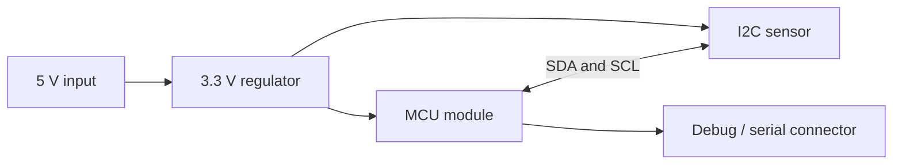

# Schematic Capture and PCB Design

<div class="course-identity pcb-design" markdown="1">
<div class="course-identity__icon">PCB</div>
<div markdown="1">
<p class="course-identity__eyebrow">Module 1 · Schematic & PCB Design</p>
<p class="course-identity__title">Read, review, and design the board-level interfaces that make AI hardware usable.</p>
<p class="course-identity__meta">Artifact: schematic review or interface map · Measure: constraints, risks, bring-up checks</p>
</div>
</div>


**Phase 2, section 1.** Design a small 3.3 V sensor interface that a firmware engineer can power, probe, and diagnose. You can finish the review exercise without ordering a PCB. A development board remains a valid starting point for the [firmware course](../2.%20Embedded%20Software/Guide.md).

Allow two or three sessions: draw the interface, review electrical constraints, then prepare a bring-up plan. You need Ohm's law, the difference between voltage and current, and a datasheet pin table. The result is a schematic, a pin map, calculated constraints, and a list of observations that distinguish common faults.

## 1. Start with the signals and power, not the footprint

Our teaching example contains a 3.3 V MCU module, a 3.3 V I2C sensor, a connector, and a regulator supplied from 5 V. The numerical values below are **exercise assumptions**, not a design for a named sensor. Replace each assumption with a selected part's operating limits before making hardware.



Write a pin table before routing:

| Signal | Electrical behavior | Reset / idle expectation | Firmware observation |
|---|---|---|---|
| 3V3 | Supply within both devices' operating range | Rises without repeated brownout | Supply test point |
| GND | Shared reference and return path | Continuous connection | Continuity check before power |
| SDA | Bidirectional open-drain | Pulled to 3.3 V when idle | Address, ACK, returned data |
| SCL | Controller clock; target may stretch | Pulled to 3.3 V when idle | Frequency and rise time |
| SENSOR_INT | Device-specific output type | Defined by datasheet | Edge or level acknowledged correctly |
| MCU_RESET | Polarity and thresholds are part-specific | Inactive after startup | Reset cause and boot log |

The connector's pin 1, symbol pin number, footprint pad number, and cable view must agree. A mirrored bottom-view connector drawing can produce a board that passes automated checks and is still wired backward.

**Level compatibility:** A 5 V supply connector does not make MCU inputs 5 V tolerant. Check absolute maximum ratings, operating thresholds, power-off behavior, and the actual pull-up rail. For I2C, select a level-shifting circuit intended for bidirectional open-drain signals. A resistor divider used on one UART receive line is not a general replacement for an I2C translator or a fast push-pull SPI buffer.

## 2. Work out an I2C pull-up window

An open-drain output can pull a line low; a resistor charges the line capacitance back high. A resistor that is too large gives a slow rising edge. One that is too small demands excessive sink current.

For a first-order RC estimate:

```text
R_min = (V_pullup - V_low_max) / I_sink
R_max = t_rise_max / (0.8473 × C_bus)
```

The rise interval is measured from 30% to 70% of the pull-up voltage. Use the bus mode's limits and the weakest connected device. The [NXP I2C specification, section 7.1](https://community.nxp.com/pwmxy87654/attachments/pwmxy87654/nxp-designs/931/1/UM10204.pdf) and [TI pull-up calculation note](https://www.ti.com/lit/an/slva689/slva689.pdf) explain this model.

Assume `V_pullup = 3.3 V`, a device guaranteed to hold `V_low ≤ 0.4 V` at `3 mA`, estimated total `C_bus = 100 pF`, and a `300 ns` Fast-mode rise-time limit:

```text
R_min = (3.3 - 0.4) / 0.003 = 967 ohms
R_max = 300e-9 / (0.8473 × 100e-12) = 3541 ohms
```

A nominal 2.2 kΩ resistor lies inside this window. The estimated rise time is `186 ns`; current at a 0.4 V low level is `1.32 mA` per asserted line. This is a first calculation, not final verification. Include resistor tolerance, supply tolerance, connector/cable/probe capacitance, and the actual device limits.

Now change the assumptions:

- At 200 pF, the same 2.2 kΩ resistor gives about **373 ns**, which exceeds 300 ns. Lower the resistance if sink-current limits permit, reduce capacitance, change topology, or lower the bus mode after checking its timing requirements.
- Four modules each adding a 2.2 kΩ pull-up yield **550 Ω** in parallel. At 0.4 V that demands about **5.27 mA**, above the exercise's 3 mA guarantee.
- A breakout's pull-up tied to 5 V can violate the MCU's ratings even if its sensor supply is 3.3 V.

On a board, measure both SDA and SCL rise time with the intended cable and devices. A decoded logic-analyzer trace can hide a marginal analog waveform; use an oscilloscope to examine the edges.

### Extend the calculation to bounded tolerances

Run the [CPU circuit lab](CPU-Circuit-Lab.md) to compare a nominal pass with a worst-case failure, generate a numerical waveform, and test parallel pull-ups and probe loading. It includes seven executed standard-library tests. Keep its simplified model separate from board measurements.

**Address convention:** a target documented at 7-bit address `0x48` produces address bytes `0x90` for write and `0x91` for read on the wire. Many controller APIs expect the unshifted 7-bit value. Check the API before copying a logic analyzer's address byte. An ACK proves a bus participant responded; it does not by itself prove identity or measurement validity.

**Power sequencing:** an unpowered device may clamp a line and receive current through its I/O protection path. A bidirectional level translator does not automatically provide power-off isolation. Check every device and translator's power-off, enable and leakage behavior; do not infer it from “3.3 V compatible”.

## 3. Calculate power in states

Assume the MCU module draws 80 mA while processing and 250 mA during a radio burst; the sensor needs 10 mA and indicators need 5 mA. The combined burst is `265 mA`. A 25% planning margin gives `331 mA`, but that margin is only a stated design choice. Verify the regulator's guaranteed current, thermal limits, transient response, and input conditions.

For a linear regulator from 5 V to 3.3 V, the exercise's burst dissipation is:

```text
P ≈ (5.0 - 3.3) × 0.265 = 0.451 W
```

Check package and board thermal behavior; a current rating alone does not guarantee acceptable temperature. A switching regulator trades conversion loss against layout, ripple, and electromagnetic constraints. Use its selected datasheet's reference circuit and layout.

For a capacitor-only transient estimate, supplying an extra 100 mA for 100 microseconds while allowing 0.1 V droop requires `C = IΔt/ΔV = 100 µF`. This simplified estimate ignores regulator response, capacitor ESR/ESL, tolerance, and ceramic DC-bias derating. It teaches why “put 100 nF everywhere” is not a complete power design.

Do not treat a datasheet's junction-to-ambient thermal resistance as an intrinsic, board-independent number. Its test board, airflow and mounting conditions matter. A package-top characterization parameter such as `ψJT` is not interchangeable with a thermal resistance. For a first screening estimate under an explicitly assumed `80 °C/W` effective board condition and `40 °C` ambient, `Tj ≈ 40 + 0.451 × 80 = 76 °C`; this is an estimate to verify, not a measured junction temperature. [TI thermal-metrics guidance](https://www.ti.com/lit/an/spra953d/spra953d.pdf).

Keep local decoupling close to its supply/return pins, following component guidance. Put bulk storage where the current step enters the load region. Identify the current loop rather than choosing capacitor count by habit.

## 4. Capture and review the schematic

Choose one supported EDA release and archive the project and libraries together. [KiCad 10.0's official beginner tutorial](https://docs.kicad.org/10.0/en/getting_started_in_kicad/getting_started_in_kicad.html) provides schematic and board steps (documentation reviewed on 18 October 2026; KiCad execution is not claimed here); record the installed version rather than relying on a screenshot from another release.

Draw power, reset/boot, sensor, and debug blocks separately. Label net functions and voltage domains. Assign manufacturer part numbers and footprints; open each unfamiliar datasheet drawing and check pad numbering, pitch, body dimensions, exposed pad, and required keep-outs. A 3D model is useful for fit but does not prove the electrical mapping.

Run electrical rules checking (ERC). Investigate undriven power nets, conflicting outputs, unconnected pins, and accidental labels. A power flag tells the tool that a source exists; it does not create a regulator or justify connecting two supplies. Mark intentionally unused pins and explain any waived finding.

For this exercise, manually review these three faults even if ERC passes:

1. The sensor interrupt needs a pull-up but is left floating.
2. A reset/boot strap pin is reused by a peripheral that drives it during startup.
3. The sensor symbol's pin numbers refer to a different package variant.

## 5. Place, route, and generate a reviewable package

Choose layer stack and manufacturing rules before routing. Place connectors for access, then critical power components, then the MCU and sensor. Route short return loops for decoupling and regulator switching currents. Maintain a continuous reference plane under signals; a trace crossing a plane gap can force its return current around a large loop.

Use impedance and length constraints where the interface requires them. Matching every low-speed trace by eye is not a substitute for reading a USB, DDR, or Ethernet design guide. Keep radio antenna keep-outs and enclosure effects in the module's layout rules. A motor current path and a sensitive analog/reference path deserve explicit review in a robot.

Run board design-rule checking (DRC), then inspect the exported fabrication outputs independently. Deliver the agreed layer files, drill files, fabrication notes, BOM with exact parts/alternates, assembly drawing, and placement data when needed. Check top/bottom orientation, units, and origin conventions with the fabricator's requirements. A clean DRC report checks configured geometry; it does not establish signal integrity, correct pin mapping, or manufacturing yield.

## 6. Bring up one uncertainty at a time

Before powering, inspect polarity, bridges, component orientation, and supply-to-ground resistance. With a current-limited low-voltage supply set appropriately for this board, power the rails before attaching loads that are not yet understood. Use the selected components' operating limits to choose acceptable readings.

| Observation | Interpretation to test next |
|---|---|
| Supply immediately current-limits | Short, reversed part, excessive load, or startup setting; inspect before changing firmware |
| 3.3 V collapses during radio transmission | Supply transient/connection/thermal issue; capture the rail and load event |
| Stable rail but no boot log | Reset/boot straps, programming path, clock, and correct serial/USB interface |
| Both I2C lines idle high but address NACKs | Address convention, target power/reset, wiring, or device state |
| SDA stays low | Short or target holding bus; investigate before bounded bus recovery |
| Identity register works but samples are implausible | Configuration, byte order, signedness, scale, or calibration |

Keep the raw measurement beside your interpretation. “The chip is broken” is a hypothesis; “3V3 drops to 2.1 V during the transmit burst” is a reproducible observation.

## Practice and answer checks

1. **At 100 pF, would 4.7 kΩ meet the 300 ns exercise limit?** No: `0.8473 × 4700 × 100e-12 ≈ 398 ns`.
2. **Does a 500 mA regulator rating settle the power design?** No. Check input range, dropout or conversion efficiency, temperature, transient response, and the actual PCB implementation.
3. **Does an I2C address ACK prove the sensor measures correctly?** No. Read identification/configuration, check status and freshness, then compare a known physical input.
4. **Can a tested development module remove all RF work?** No. It may simplify integration, but antenna placement, enclosure, power, coexistence, and product-level requirements still matter.

Your finished artifact is the pin map, calculations with assumptions, reviewed schematic/layout files, and a bring-up log template. None of the worked values above is claimed as a fabricated or measured board. Carry the pin names and expected observations into [Embedded Software](../2.%20Embedded%20Software/Guide.md).
