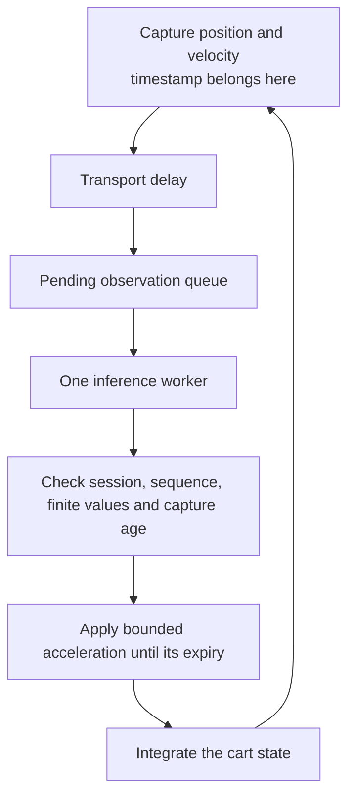
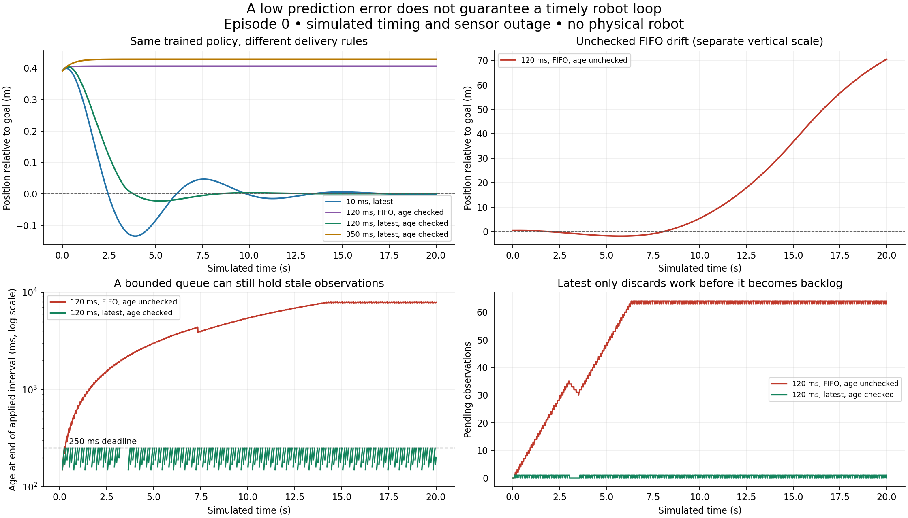

# Lab 02: put the trained policy into a timed robot loop

**Time:** 75–120 minutes. **Needs:** Python 3.12; no third-party package, robot, GPU, account or model download. Optional plotting uses Matplotlib. First complete the [CPU policy lab](Lab-01-CPU-Policy.md) and the [first cart experiment](../../Start-Here.md).

**You will learn:** a model can predict expert actions accurately while the system applies those actions to the wrong moment. You will keep the learned weights fixed, change only the timing and queue rules, and explain the resulting behavior.

## 1. Follow one observation to an action

The cart's goal is position zero. A sensor captures position and velocity; a small trained policy predicts acceleration. The acceleration is limited to ±1 m/s². A numerical model updates velocity and position every 10 ms.



In one scenario, capture occurs at **0 ms**, transport takes **20 ms**, and inference takes **120 ms**. The result becomes available at **140 ms**. Its observation is already 140 ms old, even if sending the result takes no extra time.

The freshness deadline is **250 ms after capture**, not 250 ms after inference finishes. With a 10 ms integration step, the command can cover `[240,250)` but cannot cover `[250,260)`. The test suite checks this boundary explicitly.

All these durations are **imposed simulation parameters**. They are not measured model or network latency. The actual Python program runs the arithmetic on the CPU.

## 2. Predict before running

The sensor produces an observation every 50 ms: **20 observations/s**. An inference worker taking 120 ms handles about **8.33 observations/s**.

If all observations are queued in order, work arrives faster than it leaves. A finite queue caps memory consumption, but does not make its oldest item fresh. When this fixture's FIFO reaches 64 entries, it drops new arrivals and retains older work.

For a continuously sampled state, a different choice is to keep only the newest pending observation while the current inference finishes. That discards some data. It can be appropriate for a current-state controller; it would be inappropriate for a stream of distinct commands or events that all must be processed.

Write predictions for these five settings:

| Setting | Inference | Pending work | Check age before applying? |
|---|---:|---|---|
| Fast reference | 10 ms | Latest only | Yes |
| Slow FIFO | 120 ms | FIFO, capacity 64, drop new when full | No |
| Slow FIFO with deadline | 120 ms | Same FIFO | Yes |
| Slow latest with deadline | 120 ms | Latest only | Yes |
| Over budget | 350 ms | Latest only | Yes |

All settings also experience a sensor outage from 3.0 to 3.5 seconds. During an expired or unavailable command, an assumed independent current velocity encoder supports local damping: `acceleration = clip(-2 * velocity, -1, 1)`. This is an explicit capability of the teaching model, not a universal safe-stop method for real robots.

## 3. Run the connected experiment

From the course repository root:

```bash
python3 'Phase 3 - Artificial Intelligence/0. AI and Robot Learning Foundations/labs/timed_policy_lab.py' --output /tmp/timed-policy-report.json
python3 -m unittest discover -s 'Phase 3 - Artificial Intelligence/0. AI and Robot Learning Foundations/labs' -p 'test_*.py' -v
```

The script reuses the previous lab's actual training, episode splits, training-only normalization, gradient check and validation-based model selection. It does not hand-set the learned weights. The five timing scenarios then use identical learned parameters and paired initial conditions from a separate fixed rollout seed.

The 2026-10-18 run produced held-out action RMSE **0.021930 m/s²** and these results:

| Setting | Episodes meeting final tolerance | Mean absolute final position |
|---|---:|---:|
| Fast reference | 12/12 | 0.0013 m |
| Slow FIFO, age unchecked | 0/12 | 66.4270 m |
| Slow FIFO, age checked | 2/12 | 0.5666 m |
| Slow latest, age checked | 12/12 | 0.0006 m |
| Over budget | 2/12 | 0.6038 m |

The terminal condition is `|position| < 0.1 m` and `|velocity| < 0.1 m/s` after 20 simulated seconds. It does not measure collision avoidance, path constraints or physical safety. These twelve synthetic episodes also cannot establish broad policy reliability.

**A useful trap:** the over-budget setting accepts **zero policy commands**, yet two episodes meet the terminal condition through their initial state and fallback damping. Do not credit the model with those two outcomes. Inspect `accepted_commands`, the trajectory and the baseline behavior alongside the success count.

Acceptance and use are separate too. A result arriving exactly at its capture
deadline can pass the message check but cannot cover another 10 ms control
interval. The independent boundary test accepts three results and applies none.
The report therefore includes `distinct_commands_applied` and
`applied_policy_intervals`. Neither a nonzero acceptance count nor a terminal
success count alone proves that the model influenced the motion.

The [retained summary](labs/timed-policy-summary.json) contains every episode's metrics, fixed seeds and source identities. The [validation record](labs/timed-policy-validation.json) distinguishes tested behavior from untested physical claims.

## 4. Explain the trajectories



The unchecked FIFO case uses a separate vertical scale. Its large drift comes from repeatedly applying actions computed for much older states. Limiting acceleration bounds the requested acceleration; it does not bound how far the cart can travel over time.

Checking age suppresses those old actions, but FIFO still spends its compute budget on expired work. In episode 0 it accepts only two commands and spends most of the run in fallback. Latest-only delivery keeps completed observations between roughly 140 and 190 ms old in the normal part of the run, leaving some of the 250 ms budget for holding the action.

Even latest-only control sometimes falls back between results. A command remains tied to its original capture timestamp. Its expiry cannot be renewed by repeating a packet or receiving another invalid result.

The latest-only terminal position happens to be smaller than the fast reference in this fixture. That is not evidence that adding latency improves control in general. Compare full trajectories and more scenarios before drawing such a conclusion.

To regenerate the figure from your report in an environment with Matplotlib:

```bash
python3 'Phase 3 - Artificial Intelligence/0. AI and Robot Learning Foundations/labs/plot_timed_policy.py' /tmp/timed-policy-report.json --output /tmp/timed-policy.png
```

This also writes an SVG alongside the PNG. The main experiment and tests do not require plotting packages.

## 5. Inspect the actual contracts

Read [timed_policy_lab.py](labs/timed_policy_lab.py) in this order:

1. `Observation`: session, sequence, capture time and physical units.
2. `Timing`: integral simulation timestamps and explicit queue policy.
3. `CommandGate.accept`: reject old sessions/sequences, invalid times, nonfinite values and stale results.
4. `action_for_interval`: check the whole held interval against the capture deadline.
5. `simulate`: capture, deliver, finish inference, start pending work, apply and integrate.

At an equal timestamp, the new observation arrives **before** the worker selects
its next pending job. For example, with captures every 100 ms and 200 ms
inference, the observation captured at 200 ms replaces the pending 100 ms
observation before the worker finishes the first job and selects the next.
This is the explicit scheduling rule of the fixture; another rule can produce a
different queue trace. A regression checks it with independently calculated
position and velocity.

The [18 timing tests](labs/test_timed_policy.py) include a hand-calculated two-step trajectory, the 0→20→140 ms timeline, simultaneous events, acceptance without application, deadline boundaries, duplicate rejection, wrong sessions, nonfinite values, queue capacity, outages and actual trained-policy integration. Combined with the first lab, **28 tests passed** in the recorded run.

For the hand calculation, start at position 0 and velocity 1 m/s with no observation available. The bounded damping requests −1 m/s². At a 0.1 s step, velocity becomes 0.9 m/s and position 0.09 m. The next step gives velocity 0.8 m/s and position 0.17 m. This checks the semi-implicit integration order independently of the implementation.

## 6. Change one assumption

Choose one extension and record a prediction before editing:

- **Drop expired work before inference.** Compare FIFO with and without this check. Keep the check after inference too, because a fresh input can become stale during computation.
- **Add variable compute time.** Use a separate seeded schedule shared across queue policies. Report age percentiles and maximum age, not only mean inference time.
- **Add sensor noise.** Keep training and selected weights fixed. Add a separate seeded noise sequence and compare complete trajectories, not just the final state.
- **Remove the independent velocity encoder.** State what fallback can actually observe, then redesign it. Do not quietly use the simulator's hidden true state.

**Finish:** submit the report, one annotated capture-to-action timeline, a paired scenario comparison, one failing test you intentionally created and then repaired, and an explanation of the over-budget setting's two apparent successes.

Continue to the [ROS queue and QoS lab](../../Phase%205%20-%20Advanced%20Topics%20and%20Specialization/Track%20D%20-%20Robotics/Advanced%20Robot%20Operating%20System/Integration-Lab.md) to test real middleware behavior, then the [capture-time tracking lab](../../Phase%205%20-%20Advanced%20Topics%20and%20Specialization/Track%20D%20-%20Robotics/Advanced%20Perception%20and%20AI%20for%20Robotics/Tracking-Lab.md) to connect timestamps with geometry. Those experiments add evidence at different boundaries; none turns this cart into a validated physical robot.
