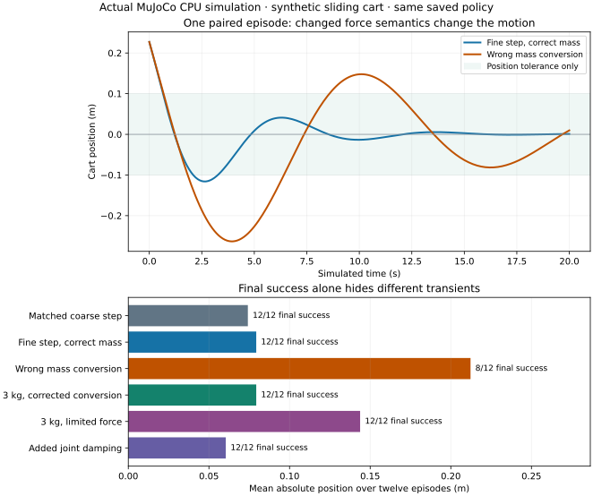

# Run your learned policy in a CPU physics engine

[Training lab](Lab-01-CPU-Policy.md) · [Timing lab](Lab-02-Timed-Robot-Loop.md) · [Foundation guide](Guide.md)

**Time:** 60–90 minutes after the training lab, plus package installation. **Hardware:** CPU; no display, GPU or robot. **Result:** the same saved policy runs through actual MuJoCo dynamics, with a checked force interface, reset behavior and physics clock.

The first lab integrates two equations written in Python. This lab places the cart in a real simulation engine, while keeping the model simple enough to check by hand. It is a one-dimensional sliding body, with no contact surfaces, images or language. A real engine does not make this small model a validated representation of a physical robot. MuJoCo's [Python interface](https://mujoco.readthedocs.io/en/stable/python.html) calls its native simulation library; this exercise uses that CPU path.

## 1. Decide what the policy's number means

The saved policy predicts **acceleration in m/s²** from goal error in metres and velocity in m/s. The simulated motor applies **force in newtons** through a unit transmission ratio. The adapter must convert between them:

\[
F_{\mathrm{requested}}=\hat m\,a_{\mathrm{requested}},
\qquad
m\dot v=F-bv.
\]

Here `m` is the simulated mass, `m̂` is the adapter's assumed mass, and `b` is joint damping in N·s/m. The simple adapter compensates mass only; it does not cancel damping. The [actuation reference](https://mujoco.readthedocs.io/en/stable/XMLreference.html#actuator-motor) defines the motor and transmission parameters used by the model.

**Predict:** a policy requests `0.5 m/s²` for a `3 kg` cart. With no damping it needs `1.5 N`. An adapter that assumes `1 kg` requests only `0.5 N`, producing about `0.1667 m/s²`. With the correct mass but a `0.5 N` actuator limit, the requested acceleration is still unattainable. Fixing a unit conversion does not increase actuator capacity.

The program bounds policy acceleration to ±1 m/s², converts it to force, then applies the force bound. It records acceleration clipping and force clipping separately. The simulator also enforces the motor's declared bound; one regression deliberately bypasses Python clipping to check that boundary.

## 2. Reuse the saved policy in an isolated environment

From the **repository root**, run:

```bash
AI_PHYSICS_LABS='Phase 3 - Artificial Intelligence/0. AI and Robot Learning Foundations/labs'
# Regenerate the small policy report if you have not retained the training lab's output.
python3 "$AI_PHYSICS_LABS/policy_lab.py" --output /tmp/ai-policy-report.json
python3 -m unittest discover -s "$AI_PHYSICS_LABS" -p 'test_mujoco_contract.py' -v

python3.12 -m venv /tmp/course-mujoco-venv
/tmp/course-mujoco-venv/bin/python -m pip install --require-hashes --only-binary=:all: \
  -r "$AI_PHYSICS_LABS/requirements-mujoco.lock"
/tmp/course-mujoco-venv/bin/python -m unittest discover \
  -s "$AI_PHYSICS_LABS/optional" -p 'test_mujoco_bridge.py' -v
/tmp/course-mujoco-venv/bin/python "$AI_PHYSICS_LABS/mujoco_bridge.py" \
  --policy /tmp/ai-policy-report.json --output /tmp/ai-physics-report.json
```

The [ten-package lock](labs/requirements-mujoco.lock) was installed with hash enforcement on CPython 3.12, Linux x86-64. It includes MuJoCo **3.16.0** and NumPy **2.5.4**. The platform-specific wheels total roughly 51 MB; installed size is larger. A different Python/platform may need a separately verified lock. No viewer or rendering context is opened, even though the distribution includes graphics-related dependencies.

The extreme-state regression deliberately prints MuJoCo instability warnings. That test passes only when the bridge rejects those episodes; a warning during an ordinary benchmark run is a failure.

The report stores the training-artifact hash; the retained run also links its [exact training report](labs/mujoco-policy-report.json). Its loader validates weight and normalization shapes, positive scales, finite values and current training-script identity. It reuses the training-only normalization saved by the first lab; the loader does not independently refit the scaler or authenticate the artifact's author. Keep the saved policy and preprocessing together. If the training script changes, regenerate the artifact and review the change rather than removing the identity check.

## 3. Prove the simplest case before changing physics

The matched model uses a `1 kg` mass, zero damping, zero gravity and a `0.1 s` physics step. A policy call occurs once per physics step. MuJoCo's Euler integrator updates velocity and then position in this zero-damping case:

```text
v_next = v + (F/m) × dt
x_next = x + v_next × dt
```

These are the original training lab's rollout equations. The recorded run compares **all position and velocity samples across 12 paired episodes**, not just final success. The maximum absolute difference was **0.0** in this environment. That establishes agreement for the declared simple model, precision and integrator; it does not validate contact dynamics or every simulator feature.

Joint damping is treated implicitly by this Euler path. For zero external force, its one-step velocity is `v_next = v / (1 + b × dt / m)`. A separate actual-engine test checks that expression. Do not silently substitute the explicit-damping formula. See the [numerical integration documentation](https://mujoco.readthedocs.io/en/stable/computation/index.html#numerical-integration).

## 4. Separate the policy period from the physics step

In the refined case, the policy still acts every `0.1 s`, but physics advances ten times at `0.01 s` between decisions. The same force is held during those ten steps. Over a 20-second episode this is **200 policy calls and 2,000 physics steps**. A faster physics clock does not imply faster inference or more observations delivered to the policy.

For a constant acceleration of `1 m/s²` from rest, one `0.1 s` semi-implicit step gives `x=0.01 m`. Ten `0.01 s` steps give `x=0.0055 m`. The continuous-time solution is `0.005 m`. Both discrete runs reach velocity `0.1 m/s`; their positions differ because of integration error. The supplied test checks these numbers against the engine.

Changing the physics step therefore changes the numerical experiment even when the controller period is unchanged. Keep both periods in the manifest. This lab has immediate, exact state observations and no inference queue; use the separate [timing lab](Lab-02-Timed-Robot-Loop.md) to study delayed observations.

## 5. Interpret the observed cases

All cases use the same learned parameters and twelve initial states from seed 101. The first case uses a `0.1 s` physics step; every later case uses `0.01 s`. All keep the `0.1 s` policy period and 20-second duration. A final state succeeds when both absolute position and absolute velocity are below `0.1` in their respective units. Mean absolute position averages the 200 samples at the ends of policy intervals, excluding the initial state, then averages the twelve episode values. It is a sampled transient metric, not continuous-time integration or a quality estimate for a population of real robots.

| Case | Final successes | Mean absolute position | Force-limited decisions |
|---|---:|---:|---:|
| Matching `1 kg`, `0.1 s` physics | 12/12 | 0.07415 m | 0 |
| `1 kg`, `0.01 s` physics | 12/12 | 0.07934 m | 0 |
| `3 kg`, adapter still assumes `1 kg` | 8/12 | 0.21223 m | 0 |
| `3 kg`, adapter correctly uses `3 kg` | 12/12 | 0.07934 m | 0 |
| Correct `3 kg` adapter, force capped at `0.5 N` | 12/12 | 0.14377 m | 454 |
| `1 kg` with `1 N·s/m` damping, no damping compensation | 12/12 | 0.06044 m | 0 |

These are results of the retained [actual run](labs/mujoco-results.json). A lower transient error in the damping case does not make damping universally beneficial. The limited-force case reaches the final tolerance despite a worse transient and 454 clipped decisions out of 2,400. A binary final-success metric hides that difference.



[Open the plot at full size](labs/mujoco-results.svg).

The first plot compares correct and incorrect mass conversion in one episode; the bar chart summarizes all twelve. The [validation record](labs/mujoco-validation.json) identifies executed commands, source hashes, packages and checks. The plotting environment is separate from the physics environment.

## 6. Reset and failure are part of the task

Every episode resets simulator time, controls, external applied forces and dynamic state, then sets its initial position/velocity and recomputes derived quantities. Reusing an allocated model and data object is useful, but leftover forces must not leak into the next episode. A reused engine must be an unmodified result of `make_model`: its saved XML is checked against the requested physical configuration. Construct a new engine to change mass, damping, force limits or physics timestep; the adapter mass and episode duration can change independently. Read the [reset and stepping guidance](https://mujoco.readthedocs.io/en/stable/programming/simulation.html) alongside the supplied `reset` function.

MuJoCo can warn and reset an unstable state automatically. A cart returning to zero after such a reset is **not a successful policy episode**. The lab rejects simulator warnings, nonfinite policy actions, incompatible reused models, and a simulated clock that disagrees with the requested step count. Tests include an extreme-state failure that previously could have looked successful.

The report's settling time is sampled at policy boundaries: the first sample after the last observed tolerance violation. It is zero if every sample, including the initial state, is inside tolerance, and `null` if the final sample is outside. Equality with either tolerance counts as outside. This metric can miss an excursion between samples and does not establish permanent stability beyond the finite episode. Simulator wall time is a local execution observation, not a hard real-time deadline or robot-response measurement.

## 7. Finish with a controlled variation

1. Predict the first step for `m=2 kg`, `F=0.5 N`, `dt=0.05 s`, starting at rest. **Answer:** acceleration `0.25 m/s²`, velocity `0.0125 m/s`, position `0.000625 m` with this integrator.
2. Change the adapter mass without changing the simulated mass or force limit. Which equation predicts the direction of the error?
3. Change only the physics timestep while preserving the policy period. Compare complete trajectories before comparing success counts.
4. Add damping and explain why multiplying the action by mass no longer produces exactly the requested acceleration.
5. Trigger the extreme-state failure and show that the episode is rejected, then restore the baseline.

For a small variation without changing the supplied benchmark, run this from the repository root:

```bash
/tmp/course-mujoco-venv/bin/python - <<'PY'
import sys
sys.path.insert(0, "Phase 3 - Artificial Intelligence/0. AI and Robot Learning Foundations/labs")
from mujoco_bridge import Dynamics, load_policy, simulate

policy = load_policy("/tmp/ai-policy-report.json")
config = Dynamics(mass_kg=3, assumed_mass_kg=1, physics_dt_s=0.01)
episode = simulate(policy, config, (1.0, 0.0))
print("Final position (m):", episode["final_position_m"])
print("Mean absolute position (m):", episode["mean_abs_position_m"])
print("Force-limited decisions:", episode["force_clips"])
PY
```

**Check your explanations:** without clipping or damping, `a_actual = (m̂/m) × a_requested`, so an underestimated mass weakens the response. Finer physics steps improve the constant-force integration example but do not change the observation or policy rate. With damping, `a_actual = (m̂ × a_requested − b × v)/m`, before accounting for the discrete integrator: velocity matters as well as the policy output. To check extreme-state rejection, run the supplied `test_simulator_auto_reset_is_failure_not_success` regression; do not count a simulator reset as a return to the goal.

Submit the policy identity, model configuration, baseline parity check, one predicted variation and its actual results. Explain one limitation that would matter before adding an arm, contact, a camera or a physical actuator. Continue with [robot dynamics and task execution](../../Phase%205%20-%20Advanced%20Topics%20and%20Specialization/Track%20D%20-%20Robotics/Robot%20Dynamics%20and%20Task%20Execution/README.md) and the [Isaac engineering labs](../../Phase%205%20-%20Advanced%20Topics%20and%20Specialization/Track%20D%20-%20Robotics/Isaac%20Sim%20and%20Isaac%20Lab/Lab-Guide.md) when the task needs those additional capabilities.
