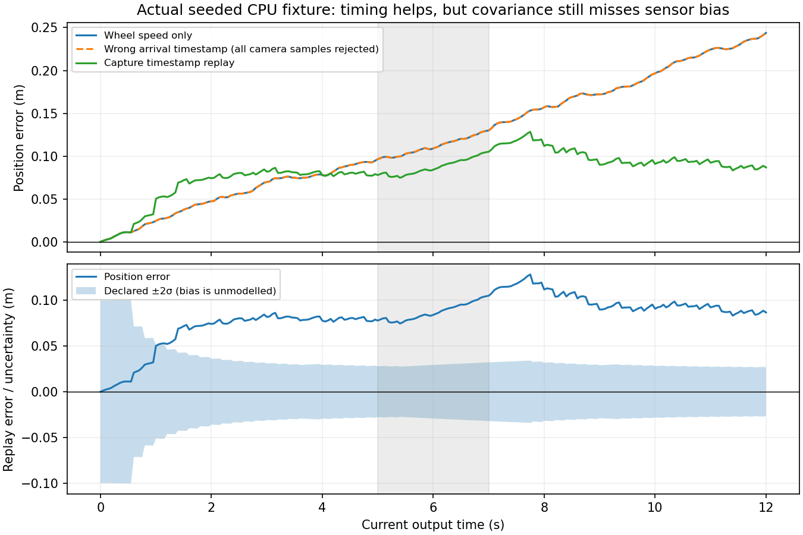

# Camera geometry and delayed sensor fusion on CPU

A camera measures pixels. A robot needs a position **at a known time**. In this lab you recover position with real OpenCV, combine it with wheel speed using NumPy, and discover when a small residual or a small covariance is misleading.

**You need:** Python, arrays, a basic pinhole-camera model, and [Kalman prediction/update](../kalman-filter/13-complete-algorithm.md). Plan one session for the baseline and one for the failure exercises. No camera, GPU, ROS installation, model downloads, or paid services are needed.

**You produce:** a JSON evidence report, state/measurement CSV files, a synthetic corner image, and a short explanation of three failures. The generated data and code are original teaching fixtures under this repository's [MIT license](../../../../LICENSE). They contain no external images or personal data.

## 1. Predict the experiment before running it

The synthetic robot travels along the camera's forward axis for 12 seconds. A stationary planar board is centred at world position `(0,0,8)` metres. We generate 30 known board corner correspondences, add pixel noise, and call `cv2.solvePnP`; we do **not** run corner detection on real photographs or estimate camera calibration from images.

| Quantity | Default |
|---|---|
| Camera axes | x right, y down, z forward |
| World axes | Parallel to the initial camera; robot motion along +z |
| Intrinsics | fx=fy=600 px, cx=320 px, cy=240 px; image 640×480 |
| Board coordinates | 6×5 points spanning 0.8×0.6 metres |
| Lens distortion | Known five-parameter radial/tangential model in the code |
| Robot truth | p(t)=0.45t+0.08 sin(t), v(t)=0.45+0.08 cos(t) |
| Wheel observation | 20 Hz, 0.025 m/s noise standard deviation, +0.02 m/s unmodelled bias |
| Camera observation | 5 Hz, 0.35 px corner noise; fixed assumed position σ=0.05 m |
| Transport delay | Camera arrives 0.6 seconds after capture |
| Dropout | Camera captures from 5 through 7 seconds are unavailable |
| Outliers | Two +1.5 m faults injected **after** pose recovery at capture times 3.2 and 8.6 s |
| Random seed | 11, NumPy default generator |

The faults represent a wrong association or corrupted pose output, not random pixel noise. They are deliberately separate from camera reprojection error. Position-noise variance is a simple declared assumption, not an uncertainty estimate returned by PnP.

**Prediction:** at 0.5 m/s, what apparent position error would a 0.6 s timestamp mistake create? Approximately 0.3 m. Would a low pixel residual detect a wrong printed board size? Keep your answer for section 5.

## 2. Install and run in isolation

From the repository root on **Linux x86_64 with Python 3.12**, run:

```bash
python3.12 -m venv /tmp/course-perception-cpu-venv
/tmp/course-perception-cpu-venv/bin/python -m pip install --require-hashes -r "Phase 3 - Artificial Intelligence/Track A - Hardware and Edge AI/4. Sensor Fusion/Camera-Time-Fusion-Lab/labs/requirements-linux-cpu-py312.txt"
/tmp/course-perception-cpu-venv/bin/python "Phase 3 - Artificial Intelligence/Track A - Hardware and Edge AI/4. Sensor Fusion/Camera-Time-Fusion-Lab/labs/camera_fusion.py" --output /tmp/camera-time-fusion
```

The lock includes the exact NumPy 2.3.5 and OpenCV headless 4.13.0.92 wheels, all runtime dependencies, and SHA256 hashes. The install was repeated with hash verification. Other platforms need corresponding wheels and a separately recorded lock; these wheel URLs are not portable to ARM/macOS/Windows. The preinstalled system packages are not modified.

Files appear under `/tmp/camera-time-fusion`:

- `report.json`: versions, parameters, frame/time contract, error and covariance summaries, code hashes.
- `states.csv`: each method's original current-time output, error, uncertainty, and current replay's rejection count.
- `camera.csv`: capture/arrival times, recovered position, reprojection error, dropout/fault labels used **for evaluation only**.
- `synthetic-corners.png`: plotted pixel correspondences; this is not a photograph.

A run took a few seconds in the authoring environment. This is neither a per-frame latency benchmark nor a real-time claim. The truth function supplies only data generation and scoring; the filters receive observations and a declared initial prior, not future truth.

## 3. Understand the two transforms and the filter

Pinhole projection before distortion is `u=fx*Xc/Zc+cx`, `v=fy*Yc/Zc+cy`. OpenCV pose recovery returns **object-to-camera** rotation/translation: `Xcamera=R*Xboard+t`. Camera position in board coordinates is `−Rᵀt`, not `t`. The board-to-world translation then gives the robot position. With identity rotation and a board 6 m ahead, camera position relative to the board is −6 m; adding the board's world coordinate 8 m gives robot position 2 m.

The filter state is `[position_m, velocity_m_s]`. Prediction uses `F=[[1,dt],[0,1]]`. Its continuous white acceleration model is:

```text
Q = q [[dt³/3, dt²/2], [dt²/2, dt]], q = 0.06 m²/s³
```

This is different from the step-constant random acceleration formula containing `dt⁴/4`. [Lesson 12](../kalman-filter/12-process-measurement-noise.md) derives the difference. Wheel observations use `H=[0,1]`; camera position uses `H=[1,0]`. Updates use the Joseph covariance form. Camera normalized innovation squared above 9 is rejected; this scalar threshold is a teaching choice.

Three methods receive the same observations:

1. **Wheel only:** estimate current position by integrating speed through the filter.
2. **Arrival time:** incorrectly assign every camera value to its arrival time. This intentionally broken baseline can gate out valid camera observations.
3. **Capture time replay:** use only events already received, reconstruct from the fixed prior in capture-time order, then predict to the current output time. Gate decisions are recomputed after delayed arrivals.

The third method is causal: a sample arriving tomorrow cannot improve today's saved output. It replays the full history, so work grows with log length. It is not an efficient fixed-lag smoother or a production estimator. A bounded implementation needs checkpoints and a policy for samples older than its retained history.

## 4. Compare actual measured results

Executed on 2026-10-18 with Python 3.12.3, NumPy 2.3.5, OpenCV 4.13.0, seed 11. Exact evidence is [measured-run-2026-10-18.json](labs/measured-run-2026-10-18.json). Numerical tolerances may vary across platforms.

| Default method | Position RMSE | Final error | Camera samples rejected at final reconstruction |
|---|---:|---:|---:|
| Wheel only | 0.1366 m | 0.2439 m | No camera input |
| Wrong arrival time | 0.1366 m | 0.2439 m | 47 of 47 arrived |
| Capture-time replay | 0.0861 m | 0.0868 m | 2 of 47 arrived |

There are 241 output times, 61 camera captures, 11 dropped captures, and 47 camera samples that have arrived by the final output. Late arrivals beyond 12 s do not enter these estimates. Clean available camera poses have 0.0314 m RMSE at their capture times; comparing that number directly with current-time fused error would compare different tasks and sample sets.



Replay improves this default error, but its declared uncertainty is overconfident: only about 8.7% of its position errors fall inside ±2σ. The constant wheel bias is absent from the state/noise model. The grey interval marks missing camera captures; some earlier captures still arrive after dropout begins. Lower RMSE does not establish calibrated covariance or readiness for robot control.

## 5. Run failures and explain them

Append these options to the same script command, choosing a different output directory for each run:

| Change | Actual replay RMSE | What to inspect |
|---|---:|---|
| `--delay 0` | 0.0764 m | Arrival and capture methods agree numerically |
| `--no-gate` | 0.1445 m | Both injected faults affect estimates; replay is now worse than wheel only |
| `--wheel-bias 0.06` | 0.3140 m | 23 camera samples rejected; bias drives wrong confident predictions |
| `--board-scale 1.1` | 0.1366 m | All camera samples rejected; clean pose error becomes 0.5327 m |

For the wrong board scale, mean reprojection RMSE stays about **0.4693 px**, the same as the baseline. In a noiseless case with robot position 2 m, using a board 10% too large gives position 1.4 m and essentially zero reprojection error: recovered distance scales from 6 to 6.6 m. Pixel fit alone cannot establish metric truth.

**Independent practice:** predict and run `--pixel-noise 1.0 --seed 12`, leaving the filter's assumed camera variance unchanged. Record accuracy, gate rejections, and uncertainty coverage. Explain why raising pixel noise need not have the same metre impact at every board distance. Then run `--wheel-bias 0 --no-outliers` as a diagnostic control. These additional exercise outcomes are intentionally not claimed as measured here.

## 6. Check the math and reproduce the result

```bash
python3 -m unittest discover -s "Phase 3 - Artificial Intelligence/Track A - Hardware and Edge AI/4. Sensor Fusion/Camera-Time-Fusion-Lab/labs" -p 'test_*.py' -v
/tmp/course-perception-cpu-venv/bin/python -m unittest discover -s "Phase 3 - Artificial Intelligence/Track A - Hardware and Edge AI/4. Sensor Fusion/Camera-Time-Fusion-Lab/labs/optional" -p 'test_*.py' -v
```

The first command runs three standard-library contract tests. The second runs nineteen actual NumPy/OpenCV tests: known metric pose, wrong-scale counterexample, invalid input, continuous-noise composition, no future leakage, covariance validity, zero-delay equivalence, delayed-fusion comparison, analytic EKF/UKF/angle/nullspace/RTS examples, and eight original-series checks covering full covariance, the train hand calculation, 500-step 2D parity, shapes, invalid inputs, caller-array ownership, and a negative-gain/contraction counterexample. Advanced kernels connect to [Kalman lessons 14–20](../kalman-filter/00-index.md); they are not full 3D ESKF/MSCKF implementations.

**Completion gate:** reproduce baseline and zero delay, explain the inverse transform with the 2 m example, diagnose one incorrect timestamp and one model/calibration failure, and submit a report with versions/parameters plus original and revised hypotheses. Apply the [course rubric](../../../../Learning-Guide.md#completion-rubric): at least 8/10, with full correctness and reproducibility. No credit for asserting that more sensors always improve the result.

## Sources and boundaries

Primary references checked 2026-10-18: [OpenCV PnP conventions](https://docs.opencv.org/4.x/d5/d1f/calib3d_solvePnP.html), [OpenCV camera calibration/projection](https://docs.opencv.org/4.13.0/d9/d0c/group__calib3d.html), and [ROS REP 103 source for optical-frame conventions](https://github.com/ros-infrastructure/rep/blob/master/rep-0103.rst). Projection and pose recovery were executed with the pinned CPU package; real camera calibration, feature detection, ROS transport, hardware timing, and physical uncertainty calibration were not executed.

**Continue:** [Kalibr](../Kalibr/Guide.md) for real calibration inputs, [tracking](../multi-object-tracking/Guide.md) for association, and [BEVFusion](../BEVFusion/Guide.md) for learned multi-sensor features.
