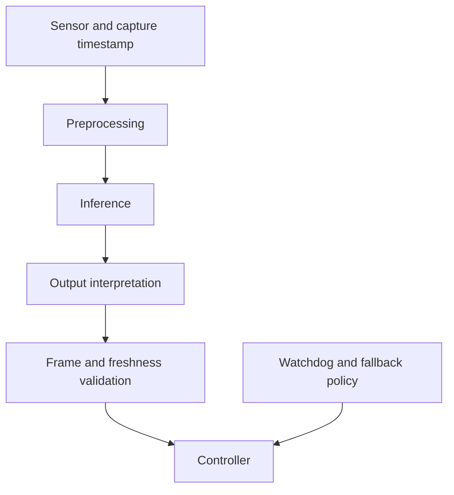

# NVIDIA Jetson: build and explain an edge AI pipeline

<div class="course-identity jetson-platform" markdown="1">
<div class="course-identity__icon">JET</div>
<div markdown="1">
<p class="course-identity__eyebrow">Track B1 · NVIDIA Jetson Platform</p>
<p class="course-identity__title">Identify the board, choose a working stack, validate inference, and measure the robot loop.</p>
<p class="course-identity__meta">Artifact: platform record, numerical reference, and end-to-end trace</p>
</div>
</div>

**Primary learning hardware:** Jetson Orin Nano 8GB developer kit. Other modules and custom carriers need their own hardware and software records. **Before:** Linux files/processes, Python, array shapes, and the [AI foundations](../../Phase%203%20-%20Artificial%20Intelligence/0.%20AI%20and%20Robot%20Learning%20Foundations/Guide.md).

**Source review: 18 October 2026.** Start with the [current compatibility guide](../Compatibility.md). JetPack **7.2.1** and the **6.2.3** maintenance line are distinct choices. Older 36.x examples throughout the deep dives remain version-specific reference material; they are not installation instructions for every current device.

Work through four milestones. The later specialist sections are references to use when your project needs them.

| Milestone | Learning task | Evidence | Suggested effort |
|---|---|---|---|
| A. Identify | Explain module, carrier, BSP and boot medium | Environment record | 45–60 min |
| B. Validate | Compare one model against a numerical reference | Inputs, outputs, tolerance and mismatch report | 1–2 h after setup |
| C. Integrate | Carry stamped observations through ROS | Frame/age checks and failure trace | 1–2 h |
| D. Measure | Test the complete pipeline under sustained load | Latency, queue, memory, thermal and power report | 1–2 h |

**Access route:** without hardware, complete the linked CPU compiler and ROS labs and a written deployment plan. Mark board flashing, CUDA/TensorRT, camera capture and power measurements **not run**. The commands below that inspect a Jetson are target exercises, not a claim that a Jetson was attached during this review.

<a id="1-orin-nano-8gb--hardware--boot-chain-internals"></a>
## 1. Orin Nano 8GB — hardware and boot chain

The **module** contains the SoC, memory and supporting components. The **carrier** provides connectors, power delivery and peripheral routing. A header pin's Linux name, electrical voltage and permitted function depend on both.

Orin Nano 8GB combines six Arm Cortex-A78AE CPU cores, an Ampere GPU with 1,024 CUDA cores, and shared LPDDR5 memory. It has **no DLA**. Its developer-kit storage options differ from production module/carrier configurations. Verify specifications in [NVIDIA's Orin family information](https://www.nvidia.com/en-us/autonomous-machines/embedded-systems/jetson-orin/).

A useful simplified boot sequence is:

```text
SoC BootROM -> early NVIDIA boot firmware -> UEFI -> Linux -> services -> application
```

Each stage establishes something the next needs: early hardware and memory setup, executable loading, kernel initialization, then userspace. QSPI firmware and a root filesystem on microSD or NVMe are separate artifacts. Replacing a root filesystem does not necessarily update firmware.

Secure boot configuration determines how authenticity is enforced. Do not infer customer key provisioning or complete security from the fact that a board boots. Use the release-specific [Orin boot-flow reference](https://docs.nvidia.com/jetson/archives/r36.4.4/DeveloperGuide/AR/BootArchitecture/JetsonOrinSeriesBootFlow.html) when diagnosing a 36.4.4 system.

### Read evidence instead of memorizing one boot log

On the target, record:

```bash
cat /etc/nv_tegra_release
uname -r
tr '\0' '\n' < /proc/device-tree/model
findmnt /
lsblk -o NAME,SIZE,FSTYPE,MOUNTPOINTS
journalctl -b -k --no-pager
```

Access to some logs may require the device administrator. Save the first failing stage and its exact error. A boot time or partition count from another board is not a requirement for yours.

**Worked diagnosis:** UEFI appears, but Linux cannot mount its root device. That evidence moves the investigation toward root-device selection, storage availability, filesystem and kernel configuration. It does not suggest that the CPU failed to execute BootROM.

**A/B distinction:** bootloader redundancy and root-filesystem redundancy are different features. `APP_b` exists only in a layout configured for redundant root filesystems. In the documented 36.4.4 rootfs A/B setup, bootloader and rootfs slots are linked. `nvbootctrl` selects slots; it does not set NVMe ahead of microSD in UEFI's device boot order. Read the [rootfs redundancy reference](https://docs.nvidia.com/jetson/archives/r36.4.4/DeveloperGuide/SD/RootFileSystem.html) before interpreting slot state.

Continue into [kernel and boot internals](Orin-Nano-Kernel-Internals/Guide.md) or [rootfs and redundancy](Orin-Nano-Rootfs-and-AB-Redundancy/Guide.md) after you have an actual platform record.

## 2. Jetson hardware overview

Shared physical memory is useful, but it does not mean every application path is zero-copy. A camera capture buffer, an OpenCV array and a CUDA tensor may still involve different allocations, layouts, mappings and copies.

For each boundary, ask:

1. Who allocated and owns this buffer?
2. What are its shape, strides, dtype and memory location?
3. Which processor can access it, and through which API?
4. What synchronization establishes that writing is finished?
5. When may the producer reuse it?

**Worked storage budget:** one 1920×1080 RGB8 frame has `1920×1080×3 = 6,220,800` payload bytes. Thirty frames/s produce **186.624 MB/s** of payload, using decimal MB. A full copy reads and writes the payload, so two copies imply **746.496 MB/s** of copy traffic before inference. Padding, color conversion, caches and other users alter actual memory traffic.

Eight GB of installed memory is shared with Linux, services, buffers and the GPU. A 7 GB model does not automatically fit. Peak live memory can include weights, activations, workspace, caches and temporarily overlapping artifacts during startup or update.

The advertised TOPS of a power profile are precision- and sparsity-dependent peaks. They are not your model's frames/s. Record the module, BSP, flash configuration, power profile and cooling when interpreting performance.

Study [memory architecture](Orin-Nano-Memory-Architecture/Guide.md), [tensor cores](Orin-Nano-Tensor/Guide.md), and the [DLA comparison](Orin-Nano-DLA-Deep-Dive/Guide.md). The last is a comparison with supported NX/AGX hardware, not an engine available on Nano.

## 3. Installing JetPack — choose the supported route

JetPack combines the Jetson Linux BSP with NVIDIA user-space tools and libraries. Select the exact release and hardware in the [compatibility guide](../Compatibility.md), then use that release's official installation procedure.

The current 7.2.1 release uses a unified ISO route; older Orin Nano tutorials use an SD image. A custom carrier also needs its vendor's matching BSP configuration. Do not substitute a developer-kit DTB or flash target merely because the processor family matches.

Before flashing, identify the target storage, preserve any existing data you need, and establish a recovery route. The goal of this course step is a known installation, not a generic command copied across all modules.

After installation, fill in the environment record and run a vendor sample appropriate to the installed stack. Keep these outcomes separate:

- the board boots;
- the expected device is visible;
- a CUDA operation runs;
- the intended model produces correct outputs;
- the complete robot application meets its measured timing target.

A successful earlier outcome does not establish a later one.

**Checkpoint:** what changes when you move from a reference carrier to a custom carrier? Name at least pinmux, peripheral routing, power configuration and the corresponding BSP/device-tree artifacts.

## 4. Upgrading JetPack on Orin Nano 8GB

Write an upgrade record containing the old and new versions, supported transition, backup/recovery method and acceptance tests. Use release-specific OTA or reflash instructions. A generic Ubuntu distribution upgrade is not a substitute for a supported Jetson BSP transition.

Keep model input fixtures, numerical outputs and a complete pipeline trace from the old stack. Re-run them on the new stack. Rebuild artifacts whose platform or library compatibility requires it, including TensorRT engines when applicable.

**Failure to inject in a test environment:** the new inference process starts but expects NHWC input while the sensor adapter supplies NCHW. Process health alone should not mark that release successful; the known-answer inference check must reject it.

See [OTA engineering](Orin-Nano-OTA-Deep-Dive/Guide.md) and [BSP customization](../3.%20L4T%20Customization/Guide.md).

## 5. Benefits and costs of a newer software stack

New releases can bring hardware support, fixes and newer libraries. They can also change APIs, package availability, camera integration and reproducibility. Choose a release because it supports your required combination and has an appropriate maintenance path.

For a new learning environment, start from a current supported combination. For an existing robot, compare the complete dependency graph and rerun acceptance tests. “Newest” and “validated for this application” are separate claims.

ROS compatibility is especially visible: standard Humble/Ubuntu 22.04 and Jazzy/Ubuntu 24.04 environments differ, and Isaac ROS release lines have their own requirements. The [compatibility table](../Compatibility.md) records the checked combinations and an unresolved upstream JetPack/Isaac ROS documentation mismatch.

## 6. Porting AI models to Jetson

Model deployment preserves a function and its surrounding data contract. Before export, write:

| Contract field | Example to make explicit |
|---|---|
| Input | Batch 1, RGB, NCHW, FP32, `[1,3,224,224]` |
| Preprocessing | Resize/crop rule; channel order; scale; mean/std |
| Output | Logits versus probabilities; class order; coordinate units |
| Allowed shapes | Fixed shape or explicit dynamic-shape range |
| Numerical check | Reference outputs and justified tolerance |
| Task check | Held-out task data and required quality metric |

The example shape is a contract illustration, not a universal vision-model input.

**Learning route:** first run the [CPU compiler experiment](../../Phase%204%20-%20Track%20C%20-%20DL%20Inference%20Optimization/00%20-%20CPU%20Compiler%20Lab/Guide.md). It compares an independent reference with actual compiled execution and demonstrates that a graph rewrite needs legality conditions. Then transfer that discipline to your chosen target framework and runtime.

For TensorRT, use API documentation matching the installed version. TensorRT 10 Python execution uses named tensors, tensor addresses and `execute_async_v3`; old binding-index examples need migration. Check shape profiles, actual output shapes, buffer sizes, stream synchronization and output correctness before benchmarking. See the [8.x to 10.x migration guide](https://docs.nvidia.com/deeplearning/tensorrt/10.x.x/api/tensorrt-8x-to-10x-python-api.html).

An ONNX opset is a format/operator-version choice, not a promise that a target runtime supports every exported operation. Check the exporter and parser for the selected model. An engine file is a built artifact with compatibility constraints; keep the original model, build configuration and environment record.

## 7. ROS 2 integration

Use the [ROS application course](../5.%20Application%20Development/6.%20ROS2/Guide.md). Its core lab actually transports stamped observations between ROS nodes and checks TF, age and frame errors without a GPU or actuator.

Carry those checks into accelerated perception. A fast model can still produce an unusable observation because of a stale input, wrong frame, unavailable historical transform, or mismatched model version.

**Worked timing:** acquisition at 1.000 s, inference completion at 1.020 s and controller consumption at 1.044 s gives **44 ms observation age**, not 20 ms. Compare the full age with the application's defined budget. For multiple hosts or hardware timestamps, establish the clock relation before subtracting.

## 8. Optimizing AI inference

Start with a correct baseline and change one decision at a time. Useful decisions include precision, layout, shape profiles, fusion, batching, memory ownership and scheduling. Each can change quality or latency as well as throughput.

| Experiment | Keep fixed | Check before accepting |
|---|---|---|
| FP32 to FP16 | Input/task dataset and preprocessing | Numerical error and task quality |
| Quantized inference | Calibration/evaluation separation | Saturation, outliers, per-case quality |
| Batch 1 to larger batch | Arrival process and measurement boundary | Queue delay and per-request latency |
| Graph capture or buffer reuse | Shapes and buffer lifetime contract | Correct results on changing inputs |
| New power profile | Workload, cooling and duration | Sustained latency, temperature and power |

Warmup and compilation/setup costs should be reported separately from steady-state work. Synchronize the relevant device work when measuring completion. Enqueue time alone is not GPU execution time.

A profiler helps explain a result; it can also change timing. Preserve an uninstrumented measurement run and a separately labeled diagnostic trace. Study [CUDA programming](Orin-Nano-CUDA-Programming/Guide.md), [inference optimization](Orin-Nano-Real-Time-Inference/Guide.md), and [application ML](../5.%20Application%20Development/5.%20ML%20and%20AI/Guide.md).

## 9. End-to-end AI pipeline: sensors to control



Give every edge a bounded queue or an explicit retention policy. Give every asynchronous buffer an owner and a completion condition. A latest-value queue reduces backlog but does not cancel work already executing or remove the need to reject a late result.

**Worked throughput:** serial stages of 3, 4 and 2 ms require 9 ms of stage work per item. Under ideal independent overlap, the limiting stage permits a 4 ms initiation interval. Real transfers, resource contention and queues can make both worse. Report latency and throughput separately.

**Core experiment:** run the [observation freshness lab](../../Phase%202%20-%20Embedded%20Systems/Labs/Observation-Freshness.md), then the ROS lab. Predict the result of slowing the consumer before running it. For the target extension, replace only the inference worker and repeat the same rejection cases.

## 10. LiDAR, camera and IMU integration

Bring up one sensor at a time. Check identity, format, rate, timestamps, units and frame convention before fusion.

| Sensor | First correctness question | Common misleading result |
|---|---|---|
| Camera | Does a known pattern have the expected geometry and color? | Correct display with wrong model channel order |
| LiDAR | Are range units, scan timing and mounting transform correct? | A plausible but rotated or scaled point cloud |
| IMU | Are axes, units, gravity convention and bias documented? | Smooth data with the wrong sign or angular units |

A CSI sensor can need a sensor driver, device-tree description, mode tables and an appropriate ISP/Argus path. A USB camera commonly uses a different capture path. A GStreamer pipeline ending in a CPU array is not automatically zero-copy into CUDA.

Orin Nano lacks a hardware video encoder. Do not plan an NVENC throughput budget for this module. The available capture, decode and software-encode path must be checked against the selected BSP and formats.

Deep dives: [camera and ISP bring-up](Orin-Nano-Camera-ISP-Sensor-Bringup/Guide.md), [video and DeepStream](Orin-Nano-Video-Codec-DeepStream/Guide.md), [GPIO/SPI/I2C/CAN](Orin-Nano-GPIO-SPI-I2C-CAN/Guide.md).

## 11. Device-tree configuration

A device tree describes hardware to firmware and the kernel. It cannot create an absent peripheral or compensate for incorrect electrical wiring. Board-specific pinmux and early boot configuration may also be required.

Read the exact module/carrier configuration and release's build/install procedure. A DTB filename from another SKU is an example, not a default to copy. Likewise, a flash-time variable such as `OVERLAY_DTB_FILE` is not interchangeable with an arbitrary key added to `extlinux.conf`.

**Inspection exercise:** identify the active model and one peripheral in the live tree, then map it to the carrier schematic and driver binding. Explain the device's address, interrupts, clock and pin requirements. Capture the original boot configuration before testing an overlay and retain an independently usable recovery route.

Use the [Orin NX/Nano adaptation reference](https://docs.nvidia.com/jetson/archives/r36.4.4/DeveloperGuide/HR/JetsonModuleAdaptationAndBringUp/JetsonOrinNxNanoSeries.html), [custom carrier course](../2.%20Custom%20Carrier%20Board%20Design%20and%20Bring-Up/Guide.md), and [L4T customization course](../3.%20L4T%20Customization/Guide.md).

## 12. Power and thermal management in practice

Record power mode and clock policy before timing. Keep cooling, ambient conditions and workload duration in the report. Maximum clocks are an experiment configuration, not a universal product setting.

On a configured Jetson, the following inspect the current configuration and live statistics; availability/permissions depend on the BSP:

```bash
nvpmodel -q
jetson_clocks --show
tegrastats --interval 1000
```

Stop the interactive statistics command with Ctrl-C after the planned interval. Record the rail names and units shown by that platform. A reported module rail does not automatically include the carrier, display, storage and power-supply losses.

**Experiment:** measure the same input sequence after warmup and during sustained operation. Compare at least two supported power profiles. Plot task latency and temperature over time, and explain whether throughput changed after the system warmed up. A short peak result cannot establish a sustained product rate.

Read [power and thermal engineering](Orin-Nano-Power-Thermal/Guide.md) and [real-time Linux](Orin-Nano-RT-Linux-Deep-Dive/Guide.md) for the next layer of diagnosis.

## 13. OTA update best practices

An application update and a BSP/rootfs update have different recovery requirements. A/B can preserve an older bootable image, but activation normally involves a restart; it does not imply zero downtime.

Model the update as a state machine:

```text
known good -> stage candidate -> verify -> activate -> health check -> accept
                                                        |
                                                        -> recover/rollback
```

A health check should exercise the real application contract. Include model loading, known-answer inference, required sensor availability and accepted fresh observations. Preserve user data and schema compatibility across rollback. An old application may be unable to read a newly migrated database unless you planned that transition.

**Failure exercise:** in an isolated test system, interrupt staging, reject a corrupt candidate, fail the application check, and verify recovery. Record what happens if power is lost at each transition. Do not mark a slot successful simply because Linux reached a shell.

Use [rootfs redundancy](Orin-Nano-Rootfs-and-AB-Redundancy/Guide.md), [OTA engineering](Orin-Nano-OTA-Deep-Dive/Guide.md), and [Security and OTA](../6.%20Security%20and%20OTA/Guide.md).

## 14. Security hardening

Start with the assets and trust boundaries of the product: boot software, models, calibration, credentials, update service and robot command interfaces. Authentication, confidentiality, rollback control and availability solve different problems.

Secure boot authenticates selected boot artifacts under a configured trust chain; it does not by itself encrypt data or make a running application correct. Disk encryption protects specified data at rest, subject to key handling and boot design. Signed updates still need version, compatibility and health checks.

Fuse programming is hardware- and release-specific and can be irreversible. Learn the design and validation flow using the official procedure and a dedicated development plan; do not treat a generic OpenSSL command as a complete provisioning recipe.

Use [Jetson security engineering](Orin-Nano-Security/Guide.md) and the [release-specific security reference](https://docs.nvidia.com/jetson/archives/r36.4.4/DeveloperGuide/SD/Security.html). Record what was configured and tested rather than declaring a whole product secure from one feature.

## 15. Projects and completion criteria

Choose one project and make it reproducible:

| Project | Required artifact | Failure case |
|---|---|---|
| CPU preparation | Compiler reference, actual compiled run, ROS observation trace | Illegal rewrite or stale observation |
| Jetson perception | Platform record, fixed-input reference, target output comparison | Wrong normalization or output layout |
| Robot observation loop | Sensor-to-consumer trace with queue ownership | Slow worker, missing frame or restart |
| Sustained edge deployment | Quality/latency/thermal report and recovery test | Thermal slowdown or failed candidate update |

Use the [course completion rubric](../../Learning-Guide.md#completion-rubric). Explain every result's validation level: calculation, CPU execution, target execution, simulation or physical robot test.

**Answers to common checkpoints:**

- A fast inference time does not prove fresh observations because acquisition, queues and postprocessing contribute age.
- Shared memory does not guarantee zero copies because APIs, layouts and ownership can require transfers.
- Installing a DLA package does not add a DLA to Orin Nano.
- Rootfs A/B must be configured and tested; it is not implied by the existence of bootloader slots.
- A newer stack should pass the same numerical and application checks before replacing a working deployment.

## 16. Jetson containers and fleet deployment

A container packages userspace. It still relies on host kernel, devices, driver interfaces and resource policy. Pin an image digest and record its build recipe, model revision and configuration. Moving tags such as `latest` do not identify the tested artifact.

Start from a vendor or project image whose documented target matches your BSP and architecture. Verify GPU and sensor access separately. Limit mounts and device access to the application needs. An image that starts successfully has passed a process-start check, not the complete deployment test.

The [jetson-containers project](https://github.com/dusty-nv/jetson-containers) provides community build workflows; its supported package combinations evolve. Check the selected revision's setup and package documentation before using a resolver or build command. Save the resolved digest after selection. Do not assume a container can arbitrarily swap the host CUDA driver or camera stack.

Continue with [container and fleet engineering](Orin-Nano-Container-Fleet/Guide.md) and [Yocto/BSP production](Orin-Nano-Yocto-BSP-Production/Guide.md). NVIDIA now documents official Yocto support beginning with JetPack 7.2; the [current compatibility guide](../Compatibility.md) links the appropriate release manifests.

## 17. Resources and next step

Use the [Jetson release archive](https://developer.nvidia.com/embedded/jetson-linux-archive) to match manuals to an installed system. Use the [current JetPack manifest](https://developer.nvidia.com/embedded/jetpack/downloads) for new-release discovery, then preserve the versioned release page in your experiment.

The complete track continues through:

1. [Custom carrier board design and bring-up](../2.%20Custom%20Carrier%20Board%20Design%20and%20Bring-Up/Guide.md).
2. [L4T customization](../3.%20L4T%20Customization/Guide.md) and [firmware configuration](../4.%20FSP%20%28Firmware%20Support%20Package%29%20Customization/Guide.md).
3. [Application development](../5.%20Application%20Development/Guide.md), including ML and ROS.
4. [Security and OTA](../6.%20Security%20and%20OTA/Guide.md), [manufacturing](../7.%20Compliance%20and%20Manufacturing/Guide.md), and [runtime/driver development](../8.%20Runtime%20and%20Driver%20Development/Guide.md).

## Integration lab: what hardware and software are actually in the experiment?

Submit the environment record from [Compatibility](../Compatibility.md), a known-answer numerical comparison, and a sequence-linked observation trace. State which measurements came from a host, a Jetson, a simulator or a physical robot. Introduce one mismatch and show which check catches it. Carry this record into every later deep dive so its assumptions remain visible.
