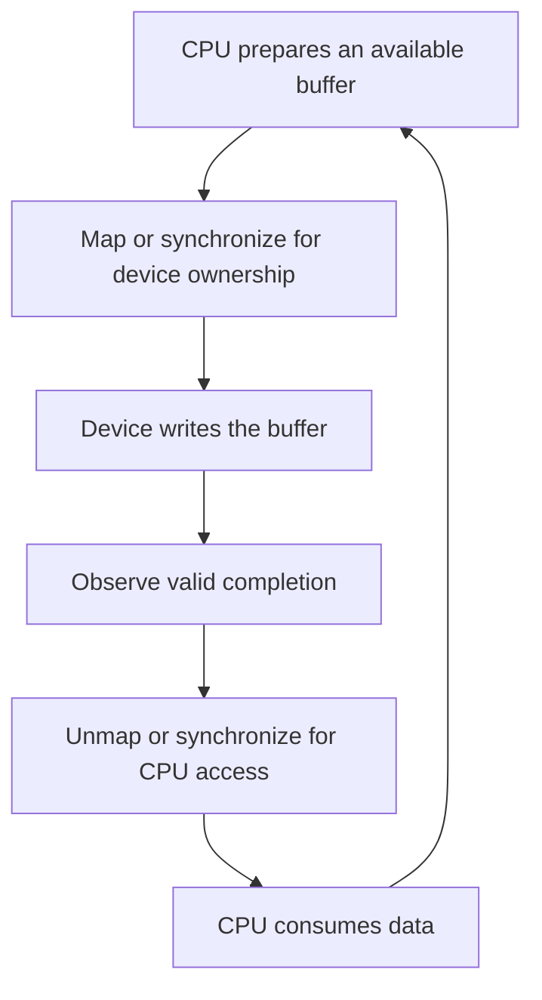

# Jetson kernel customization and driver reasoning

A kernel change connects software assumptions to real hardware. The useful skill is tracing that connection: which source and configuration produced the running kernel, how a device was described, which driver owns it, and how its buffers and interrupts behave during success and failure.

**Outcomes:** identify a coherent kernel build; compile and inspect a device-tree overlay; distinguish CPU and DMA addresses; reason about interrupt and buffer lifetime; and prepare a recoverable deployment. Plan four 60–90-minute sessions. Prerequisites: C, basic Linux, and the [platform guide](../Guide.md).

**Reviewed 2026-10-18.** Use the [compatibility matrix](../../Compatibility.md) for the selected Jetson release. R39.2's build documentation uses `kernel/kernel-noble` and includes separate NVIDIA out-of-tree source/build steps. Old R35/R36 source paths and configuration names are not interchangeable with this workflow. [NVIDIA kernel customization](https://docs.nvidia.com/jetson/archives/r39.2/DeveloperGuide/SD/Kernel/KernelCustomization.html).

## 1. Identify the system before changing it

Record the running kernel, BSP, command line, relevant modules, and boot path:

```bash
uname -a
cat /proc/cmdline
cat /etc/nv_tegra_release
lsmod
```

The BSP file is Jetson-specific and may be absent on a development PC. A kernel release string alone does not capture patches, configuration, toolchain, or out-of-tree modules. Preserve those inputs and their revisions in a build manifest.

On the target, inspect the boot configuration and actual partition/mount layout. Confirm which kernel image, DTB/overlays, initramfs and rootfs are loaded. Copying a new `Image` to an arbitrary `/boot` path does not prove that firmware will use it. The [rootfs/A-B chapter](../Orin-Nano-Rootfs-and-AB-Redundancy/Guide.md) develops this inventory.

**Check:** two systems report the same upstream kernel version but use different configurations and vendor module builds. Can you assume a module built for one works on the other? No; use the matched build artifacts and verify dependencies/symbol compatibility.

## 2. Build a coherent set of artifacts

The build inputs are source revision, configuration, toolchain, target architecture, in-tree modules, NVIDIA out-of-tree modules, and device-tree sources. The deployment outputs include the kernel, matching modules, relevant DTBs/overlays, and possibly an updated initramfs.

Use the release's source synchronization tag or source archive and its reference toolchain. Stage installation into a separate rootfs/build output so you can inspect the result before a device change. Building only `Image` while retaining incompatible modules is an incomplete update. [Matched kernel and module procedure](https://docs.nvidia.com/jetson/archives/r39.2/DeveloperGuide/SD/Kernel/KernelCustomization.html).

For an ordinary external module, kbuild uses the target kernel build directory and `M=MODULE_SOURCE_DIRECTORY`. That directory supplies configuration and generated build information; `modules_prepare` alone does not supply a completed `Module.symvers` when symbol versioning requires it. [External module builds](https://docs.kernel.org/kbuild/modules.html).

The [CPU kernel lab](labs/README.md) includes a small external module that was actually built against the host's x86-64 headers. It was not loaded and is not a Jetson binary. Use it to learn build outputs and target identity before attempting a device-specific driver.

A different upstream kernel may be a valid engineering choice, but use the vendor's bring-your-own-kernel guidance to establish the supported pieces and remaining integration work. “Mainline boots” does not imply camera, GPU, multimedia, power management, and recovery all work. [Bring Your Own Kernel](https://docs.nvidia.com/jetson/archives/r39.2/DeveloperGuide/SD/Kernel/BringYourOwnKernel.html).

## 3. Understand the device tree as a hardware description

A device tree describes hardware and connections that the operating system cannot discover fully on its own. A node's `compatible` string participates in driver matching. Properties such as registers, interrupts, clocks, resets, supplies, and endpoints follow the applicable binding.

Property values are not universal recipes. The meaning of `reg` depends on the parent bus and its address/size cell declarations; a sensor address is not encoded like a memory-mapped register region. A syntactically correct DTB can still describe the wrong clock, polarity, pin, or device.

Complete the [native device-tree lab](labs/README.md). It uses DTC and libfdt to compile a fictional board and apply an overlay. Six tests demonstrate syntax failure, unresolved references, missing symbols, and a merged tree that violates the fixture's device contract.

For real changes, validate the source against the correct binding schema and inspect the resulting tree. Then check the physical interface and actual probe/runtime behavior. Schema validation is a necessary source-level check where supported; it does not verify wiring or electrical timing.

## 4. Distinguish an offline overlay from live reconfiguration

The lab merges an overlay into a binary file. A bootloader applying overlays before Linux starts and the kernel applying/removing an overlay while running are different mechanisms. Runtime overlays have lifetime and dependency rules; removing a description while a driver or other object still relies on it requires appropriate handling. [Kernel overlay semantics](https://docs.kernel.org/devicetree/overlay-notes.html).

On Jetson, select the matched boot/Jetson-IO mechanism and inspect its resulting configuration. Do not place `FDT`/overlay directives inside an unrelated kernel `APPEND` argument and assume they will be interpreted as bootloader directives. Exact boot-file syntax and supported overlay handling depend on the chosen release.

Keep pinmux/pad configuration in the board bring-up plan. A peripheral node with `status = "okay"` cannot by itself prove that pins have the correct mux, voltage, pull, or electrical connection. Continue with [GPIO/SPI/I2C/CAN](../Orin-Nano-GPIO-SPI-I2C-CAN/Guide.md) for the interface-level questions.

## 5. Trace a driver's resource lifetime

A driver typically discovers resources, acquires power/clocks/resets, initializes the device, registers its subsystem interface, and starts activity. Every failure point must unwind the resources already acquired. Removal and shutdown must also account for work that can still run.

Use a state table for a hypothetical sensor driver:

| State | Owned resources | Allowed activity | Required cleanup |
| --- | --- | --- | --- |
| Allocated | Software state | None | Free state |
| Powered | Regulators/clocks, state | Identification/configuration | Stop device, release power |
| Registered | Subsystem interface | User operations under contract | Prevent new operations before teardown |
| Streaming | Queues, buffers, IRQ/work | Device reads/writes buffers | Quiesce device and callbacks, then release buffers |

Managed allocation helpers can simplify cleanup; they do not automatically stop every device, synchronize an IRQ, or cancel every asynchronous work item. Work out the ownership/order explicitly for the chosen subsystem and kernel API.

**Failure exercise:** the driver enables DMA, then fails to register a user-facing interface. Why is returning an error and freeing the buffer insufficient? The device may still write to released memory. Stop and verify the engine, synchronize relevant callbacks, and release mappings/buffers in the correct order.

## 6. Keep CPU pointers, DMA addresses, and synchronization separate

The CPU normally uses virtual addresses. A device performing DMA uses a device-visible address, potentially translated by an IOMMU. Use the Linux DMA API for the device and mapping type; do not cast a CPU pointer and hand it to hardware as an address. Check mapping failures and obey the supported address mask. [Linux DMA mapping guide](https://docs.kernel.org/core-api/dma-api-howto.html).

Coherent allocation concerns cache visibility, not arbitrary execution ordering or safe simultaneous ownership. Streaming mappings have direction and ownership/synchronization requirements. A valid DMA mapping also does not mean the transfer has completed. [DMA API semantics](https://docs.kernel.org/core-api/dma-api-howto.html).

For one receive buffer, draw this sequence:



The precise calls depend on whether mappings are persistent, streaming, coherent, or managed by another subsystem. A camera API may already manage these transitions; adding unrelated mappings can be wrong. Preserve buffer lifetime until every consumer finishes.

For userspace/GPU pipelines, see [memory architecture](../Orin-Nano-Memory-Architecture/Guide.md) and [camera bring-up](../Orin-Nano-Camera-ISP-Sensor-Bringup/Guide.md). Shared physical DRAM does not erase API ownership rules.

## 7. Choose execution context and locking deliberately

An interrupt handler, threaded interrupt, workqueue callback, and process-context operation have different constraints. A blocking operation suitable in process context may be invalid in hard-interrupt context. Keep critical sections short and use a synchronization primitive compatible with every participating context.

PREEMPT_RT changes the behavior of several lock types. `spinlock_t` semantics differ from `raw_spinlock_t`; do not infer that all spinlocks always disable preemption or that every kernel path becomes preemptible. Use the matched kernel's lock documentation. [Lock types and rules](https://docs.kernel.org/locking/locktypes.html).

An IRQ can signal that data is available without making expensive processing part of the hard-interrupt handler. Design bounded work and queue ownership so deferred processing cannot silently accumulate stale sensor data. Account for dropped samples and sequence counters.

The [real-time Linux chapter](../Orin-Nano-RT-Linux-Deep-Dive/Guide.md) covers scheduling and measured latency. Giving an inference process a real-time CPU priority does not give its GPU work, I/O, or lock acquisition a universal deadline bound.

## 8. Debug one layer at a time

Begin with the smallest observable failure: missing node, failed driver match, deferred probe, missing resource, transfer error, timeout, stale data, or bad application output. Keep a hypothesis and an observation that would distinguish it from alternatives.

Useful evidence includes boot logs, the live device tree, module metadata, subsystem status, error counters, tracepoints, and a minimal userspace reproducer. Avoid interpreting an absence of log messages as proof of success. A disabled diagnostic may simply hide the event.

For camera paths, USB UVC, raw CSI, and ISP/Argus pipelines differ. There is no universal chain in which every camera frame passes through one visible `tegra-isp` media entity. Follow the actual negotiated graph and supported API. The [camera chapter](../Orin-Nano-Camera-ISP-Sensor-Bringup/Guide.md) supplies layered debugging and RAW format tests.

Keep enough observability to diagnose field failures. Blanket removal of tracing or dynamic debug is not automatically a good production configuration; assess overhead, access policy, storage, and the evidence needed to support the device.

## 9. Measure boot and runtime without invented targets

For boot work, state the endpoints: power applied, firmware handoff, kernel entry, userspace reached, application ready, or first valid sensor result. Tools that time userspace services do not measure the entire power-to-ready interval.

Measure several runs, retain raw events, and explain cold/warm conditions and device dependencies. A driver made asynchronous may reduce one critical path while changing ordering or delaying readiness elsewhere. Test the application's actual completion point.

For runtime, record input rate, buffer/queue bounds, interrupt behavior, CPU/GPU contention, errors, latency distribution, and thermal state. An average below the deadline can conceal misses. No universal boot-time or interrupt-latency table is claimed for this chapter.

## 10. Deploy with a recoverable test plan

Stage the coherent kernel/module/DT/initramfs set, record hashes, and identify the exact boot entry or image update mechanism. Preserve an eligible recovery path and the ability to observe early boot failures. Secure boot/module signing policies must match the artifact preparation.

Run the smallest change first. Verify the loaded identities, basic boot, required devices, known-input application behavior, suspend/resume if used, and error cleanup. Include at least one controlled failure that tests the claimed recovery path rather than only the successful boot.

**Completion evidence:** the native DT lab; the optional build-only module record; a resource-lifetime diagram; and a device-specific kernel deployment/test plan. Hardware completion requires an actual matched Jetson build, boot, device behavior and recovery evidence. The retained CPU results establish source compilation and file-based overlay behavior only.
