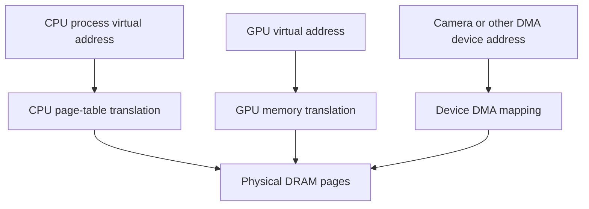

# Jetson memory: capacity, traffic, and buffer ownership

A Jetson robot's CPU, integrated GPU, cameras, and other engines share physical DRAM. This can avoid transfers between separate CPU and GPU memory pools, but it does not remove address translation, cache rules, synchronization, or competition for bandwidth. This lesson teaches you to calculate a memory budget and trace one image through a pipeline.

Allow two study sessions. You need bytes, array shapes, and basic CPU/GPU execution; review the [shapes and bytes lab](../../../Phase%201%20-%20Foundational%20Knowledge/Labs/Numbers-Shapes-and-Bytes.md) if needed. Finish with a one-page memory budget and a buffer ownership diagram. No board is needed for the worked calculations; on-device profiling is an optional second milestone.

**Platform boundary, checked 2026-10-18:** Orin and Thor have different coherency and CUDA capabilities. Read the [compatibility matrix](../../Compatibility.md) and record the exact module, JetPack, and CUDA versions. A property of an 8 GB Orin Nano does not automatically apply to Orin NX, AGX Orin, or Thor.

## 1. Four quantities that should never be confused

| Quantity | Question it answers | Example |
|---|---|---|
| Capacity, bytes | Does the live working set fit? | Three 6 MB image buffers need about 18 MB |
| Traffic, bytes | How much data does this operation move? | A full copy reads and writes the image |
| Bandwidth, bytes/second | How quickly can a path move data? | An assumed 50 GB/s sustained stream |
| Latency, seconds | When does this request finish? | Queue wait plus processing plus transfer |

Use decimal MB/GB for powers of 1000 and MiB/GiB for powers of 1024. A model advertised as “3B parameters” has approximately three billion parameters, not three gibiparameters. Packed weight payload also excludes metadata, scales, padding, activations, and runtime storage.

For a 1920×1080 RGB8 image:

```text
pixels                         = 2,073,600
logical image bytes            = 1920*1080*3 = 6,220,800
one stream at 30 frames/second  = 186,624,000 bytes/second
one full read-and-write copy   = 373,248,000 logical bytes/second
```

Two such copies generate 746.496 MB/s of logical read/write traffic before counting capture, conversion, inference, or display. Actual DRAM traffic may differ because of caching, compression, alignment, and layout. Eliminating a copy saves that copy's work; it does not make the remaining pipeline stop reading and writing memory.

## 2. Follow one allocation through the address spaces

A CPU virtual address belongs to a process. A physical page is storage in DRAM. A device address is what a particular device uses to access a mapped allocation. These numbers need not be equal. A mapping allows access; ownership and synchronization decide when that access is valid.



This is a conceptual diagram, not a complete Orin interconnect schematic. Different engines have different translation paths and constraints. The Linux DMA API may involve an IOMMU, a bus translation, or a direct mapping; drivers must use the device's mapping API rather than assuming a CPU pointer is a DMA address. The [kernel DMA guide](https://docs.kernel.org/core-api/dma-api-howto.html) explains the contract.

An SMMU can translate and restrict accesses for devices configured to use it. It is not evidence that every peripheral is isolated correctly, that every buffer is physically contiguous, or that a software race is impossible. Driver configuration, mapping permissions, and the platform's security design still matter.

Unified virtual addressing (UVA) organizes address spaces so CUDA can identify supported allocation types. Unified Memory is a managed allocation/access facility. Shared physical DRAM is a hardware property. These are related but different concepts; none alone grants arbitrary simultaneous CPU/GPU access to every pointer.

## 3. Select memory by access pattern and actual capabilities

For Orin's integrated GPU, the useful first distinction is who accesses a buffer and how often:

| Use | Starting candidate | What to verify |
|---|---|---|
| Intermediate used repeatedly only on GPU | Device allocation | Lifetime, capacity, and GPU cache reuse |
| Small CPU-produced input read once by GPU | Supported mapped pinned allocation | Mapping capability, ordering, and GPU access cost |
| Large data reused by CPU and GPU | Compare explicit copies with supported managed memory | Coherency overhead and reuse benefit |
| Camera surface shared between supported engines | Documented multimedia interop allocation | Format, plane pitch, mapping, and completion |

Orin supports I/O coherency, but Thor introduces additional full-system coherency features. On Orin, pinned host memory is CPU-cached while GPU access is uncached; repeatedly rereading it can lose a GPU cache advantage. Managed allocations on the applicable single-iGPU configuration can be cached on both processors with driver coherency work at execution boundaries. Consequently “pinned is always fastest” and “managed always migrates like a discrete GPU” are both poor rules. Verify `concurrentManagedAccess`, `pageableMemoryAccess`, and host registration support on the actual device. NVIDIA's [CUDA for Tegra guide](https://docs.nvidia.com/cuda/cuda-for-tegra-appnote/) documents these platform distinctions and their limitations.

A capability does not eliminate synchronization. CPU code must not overwrite an input while a GPU reader is active, even if both addresses refer to the same DRAM. Keep a completion event or another documented synchronization mechanism with each in-flight allocation. On platforms without concurrent managed access, follow the managed-memory CPU access restrictions; do not copy a Thor-specific prefetch recipe to Orin.

For a performance experiment, hold the math, shapes, precision, inputs, and correctness tolerance fixed. Compare end-to-end latency and memory occupancy for the candidate paths. Include a repeated-read kernel as well as a single-pass kernel: their cache behavior can favor different allocations.

## 4. Understand camera surfaces and “zero-copy” precisely

A camera pipeline may use NV12 planes, RGB tensors, block-linear surfaces, pitched linear buffers, or compressed representations. A handle to a surface is not necessarily a tightly packed `width*height*channels` array. Read each plane's dimensions and pitch from the API.

For an illustrative 1920×1080 NV12 frame with tightly packed planes, the payload is `width*height*1.5 = 3,110,400` bytes. If the API reports a larger pitch or padded height, use those values for allocated size and indexing. Do not pass an NV12 buffer to a kernel expecting interleaved RGB without a conversion.

An interop path can let two engines use one allocation. It still needs a producer-completion signal before the consumer reads and a consumer-completion signal before the producer reuses the surface. Mapping and unmapping rules depend on the specific API. NVIDIA's [NvBufSurface reference](https://docs.nvidia.com/metropolis/deepstream/7.1/sdk-api/group__ds__aaa.html) is a versioned example; select the matching API for your installed stack.

Draw the pipeline with both **allocations** and **operations**:

```text
capture surface A → resize/color conversion writes B → inference reads B
                                                   → output tensor C → controller
```

Even if A is imported without a copy, conversion writes B and inference reads it. “No extra staging copy” is a useful claim. “No memory traffic” is not.

A buffer pool solves repeated allocation only when its lifetime is correct. With three frames in flight, each needs a buffer slot or a proven reuse schedule. A slot may return to FREE only after all consumers are done. Increasing the pool can improve overlap but also permit more queued old observations; measure age as well as throughput.

## 5. Budget live memory, including the peak

<a id="memory-planning-for-multi-model-pipelines"></a>
### Memory planning for multi-model pipelines

A useful first budget is:

```text
live memory = persistent weights + live activations + execution workspace
            + input/output pools + KV/state caches + framework/runtime overhead
            + other applications and operating-system use
```

Peak memory depends on lifetime overlap. Adding every tensor ever created overestimates the requirement; summing only weights underestimates it. Two models that execute concurrently may need separate contexts, workspaces, and input pools even when some weights are shared by the runtime.

Use this **hypothetical planning example**, in MiB:

| Component | Budget |
|---|---:|
| OS, services, and other processes | 1,800 |
| Model weights and persistent runtime state | 2,200 |
| Concurrent activation/workspace peak | 900 |
| Camera and tensor pools | 120 |
| KV or recurrent state | 300 |
| Planned free headroom | 800 |
| Total | **6,120 MiB** |

This is not an Orin Nano measurement. Compare it with the memory visible to the running system and its reservations; an “8 GB” product label is not a promise that an application can allocate 8 GiB. Measure the largest transient during startup, model building/loading, resolution changes, and concurrent execution.

Read-only Linux observations include:

```bash
free -h
cat /proc/meminfo
cat /proc/self/status
```

On a Jetson, record `tegrastats` together with workload timestamps. Its fields include used RAM, largest free block, engine utilization, and clocks, but they are not a per-tensor accounting system. [NVIDIA documents their meaning](https://docs.nvidia.com/jetson/archives/r36.4.4/DeveloperGuide/AT/JetsonLinuxDevelopmentTools/TegrastatsUtility.html). An EMC utilization sample alone does not prove the model's critical path is bandwidth-bound.

In PyTorch, autograd mode affects retained training intermediates. `eval()` changes module behavior such as dropout/batch normalization; it does not disable gradient recording. `inference_mode()` or `no_grad()` addresses that separately. Inference does not inherently retain every intermediate until a backward pass. Allocator-reserved memory also differs from live tensor memory; repeatedly emptying the allocator cache does not fix retained Python references or a true leak. See the [PyTorch CUDA memory notes](https://docs.pytorch.org/docs/stable/notes/cuda.html#cuda-memory-management).

## 6. Distinguish CMA, reservations, and allocation failure

CMA reserves a region from which the kernel can satisfy suitable contiguous allocations while allowing eligible movable use under its rules. It is not generally equivalent to a permanently unusable hardware carveout. Do not subtract CMA from total RAM and then count every CMA-backed buffer again as another independent reservation.

Physical contiguity and device-address contiguity differ. An IOMMU can present a suitable contiguous device address range backed by separate physical pages, when that device and API support it. Some hardware still needs physical contiguity or other restrictions. Ask what the consumer requires rather than selecting CMA by habit.

Contiguous allocations can fail despite free memory because of size, alignment, migration, pinned pages, or restrictions on a particular region. The [CMA debugfs documentation](https://docs.kernel.org/admin-guide/mm/cma_debugfs.html) describes observability when enabled. Debug interfaces depend on the kernel build and permissions.

<a id="8-how-to-resize-cma"></a>
### When a CMA configuration change is justified

First establish that the failing allocation actually uses CMA, inspect the requested size and the driver's logs, and reduce unnecessary buffer lifetimes. Only then consider a platform-specific CMA change using the matching BSP documentation. Boot arguments, device-tree reserved-memory nodes, and firmware reservations do not all mean the same thing. A universal “set CMA to 1 GB” recipe can consume useful memory without repairing the failure.

Treat such a change as a board configuration experiment: preserve the working configuration, confirm the effective boot state, repeat the failing workload, and compare memory pressure elsewhere. The portable part of this course requires no bootloader or kernel changes.

## 7. Calculate a KV cache from the model configuration

For a conventional decoder cache storing keys and values for every layer, a useful payload formula is:

```text
bytes = 2 * layers * batch * cached_tokens * kv_heads * head_dimension * bytes_per_element
```

The factor two is for K and V. Use KV heads, not query heads, for grouped-query or multi-query attention. Architectures with latent, sliding-window, compressed, shared, or other specialized caches require their own formulas.

Take an explicitly hypothetical model with 26 layers, eight KV heads, head dimension 128, batch one, and 2048 cached tokens. An INT8 payload needs:

```text
2 * 26 * 1 * 2048 * 8 * 128 * 1 = 109,051,904 bytes = 104 MiB
```

FP16 doubles it to 208 MiB. Quantization scales, page tables, block rounding, alignment, and metadata add storage. If four sessions each reserve the full context, the simple payload model grows by four; a serving runtime may instead allocate cache blocks on demand.

**Exercise:** double context length and batch together. **Answer:** the conventional payload grows by four, not two. Weight memory is unchanged for one shared model copy, but activations and runtime contexts may also grow.

## 8. Use a bandwidth model as a bound

Suppose a dense decoder has 3 billion parameters stored at exactly four bits each. Its ideal packed payload is 1.5 GB before scales or metadata. If a batch-one decoding step reads all those bytes from DRAM and an assumed sustainable path supplies 50 GB/s, weight reads alone need at least:

```text
1.5 GB / 50 GB/s = 0.030 s = 30 ms per step
```

Under those assumptions, no more than about 33.3 such steps/s can be supported by that weight traffic. This is an optimistic bound, not a measured token rate. KV traffic, activations, dequantization, launch overhead, dependencies, and imperfect bandwidth use can make it slower. Cache reuse, batching, sparsity, or a different architecture can change the assumed bytes per step.

The general roofline-style lower bound is `max(operations/compute_rate, bytes/bandwidth)` when ideal overlap is assumed. Real serialization and overhead can exceed it. A low arithmetic intensity suggests a worthwhile bandwidth investigation; it does not prove that every kernel is bandwidth-limited.

Reducing weight precision can lower payload size, but token rate does not scale automatically with bit width. The chosen GPU must support an efficient implementation, and quantization has a quality cost to evaluate. Compare task quality, numerical error, latency, and memory on representative inputs. The [quantization course](../../../Phase%205%20-%20Advanced%20Topics%20and%20Specialization/Track%20G%20-%20ML%20Systems%20Engineering/Hardware-Aware%20LLM%20Quantization/README.md) develops that tradeoff.

## 9. Complete the memory investigation

For one camera-to-model pipeline, submit:

1. A table of every live allocation: shape, dtype, pitch/layout, bytes, owner, consumers, and lifetime.
2. The peak overlap calculation, including multiple in-flight frames and runtime workspace.
3. A diagram showing each copy, conversion, and synchronization boundary.
4. A measured or explicitly analytical traffic estimate with units and assumptions.
5. One proposed improvement and the correctness/quality check that must still pass.

For the no-board route, use the worked RGB8 and KV examples and the hypothetical 6,120 MiB budget. For the board route, add raw telemetry and a profiler trace. Do not turn the hypothetical figures into reported hardware results.

**Self-check answers:** shared DRAM does not make all pointers interchangeable; a zero-copy import can still require conversion; a larger buffer pool can increase observation age; free bytes do not guarantee a particular contiguous allocation; lower bit width does not guarantee proportional speedup; a successful allocation does not prove its lifetime is safe.

Continue to [real-time inference](../Orin-Nano-Real-Time-Inference/Guide.md) to connect memory decisions to queueing, latency, and robot behavior.
