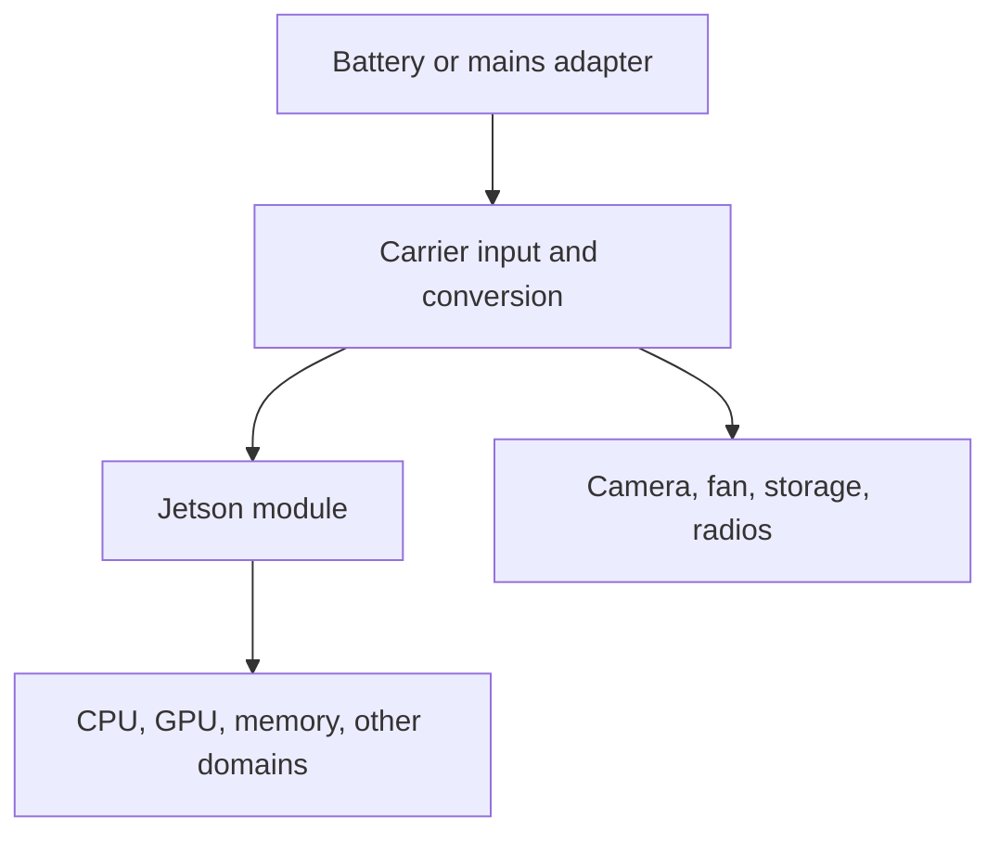

# Jetson power, temperature, and useful work

A robot must keep producing timely results after its electronics warm up. This chapter connects power modes, measurement, thermal design, and application behavior. Start with the CPU lab; use the optional device experiment when you have the exact board and a supported software installation.

**Learning outcomes:** distinguish watts from joules; identify the measurement boundary; compare useful results per joule; explain frequency and thermal limits; and produce a repeatable sustained-workload report. Budget three sessions of 60–90 minutes. Prerequisites are the [platform introduction](../Guide.md), [memory guide](../Orin-Nano-Memory-Architecture/Guide.md), and basic averages.

**Reviewed 2026-10-18.** Version selection belongs in the [compatibility matrix](../../Compatibility.md). NVIDIA's R39.2 tables distinguish standard and Super flash configurations: Nano 8GB standard lists 15 W and 7 W; Super lists 15 W, 25 W, and MAXN_SUPER. Mode IDs are configuration-dependent, and MAXN_SUPER is not a guaranteed best operating point. Orin Nano has no DLA. Consult the table matching the module and flashed configuration. [Official power configurations](https://docs.nvidia.com/jetson/archives/r39.2/DeveloperGuide/SD/PlatformPowerAndPerformance/JetsonOrinNanoSeriesJetsonOrinNxSeriesAndJetsonAgxOrinSeries.html).

## 1. Start with an application requirement

Use a concrete target: a fictional robot receives 30 camera frames per second and requires a usable obstacle result no more than 80 ms after capture. Its computer must work in its intended enclosure throughout a mission. This is a teaching requirement, not a certification target or a measured Nano capability.

Define four separate quantities:

| Quantity | Meaning | Unit |
| --- | --- | --- |
| Power | Rate of energy use at a stated boundary | W = J/s |
| Energy | Power integrated over an interval | J or Wh |
| Temperature | State of a particular sensor or modeled location | °C |
| Useful throughput | Correct, sufficiently fresh results per second | results/s |

A faster inference kernel may increase power but reduce energy per completed task. A lower power mode may save watts but allow the processing queue to grow. A cool device may still miss deadlines. Examine these measurements together.

**Check:** a system draws 12 W for 10 s. It uses 120 J, equivalent to `120 / 3600 = 0.0333 Wh`. This arithmetic does not say whether it processed ten or one thousand useful frames.

## 2. Draw the power boundary before reading a number

A practical diagram is:



The carrier input, module input, and internal rails are different boundaries. A module reading generally excludes some carrier and peripheral consumption. A battery measurement includes conversion losses upstream of the electronics. Do not add a total rail to its own subrails or compare different boundaries as though they were equal.

For a custom carrier, electrical limits come from the exact module and carrier design documentation. The developer-kit quick start specifies its supplied **19 V adapter**; this is not permission to apply that voltage to an arbitrary module pin. Identify the connector, polarity, permitted supply, current capability, and revision before wiring a system. [Developer-kit quick start](https://docs.nvidia.com/jetson/orin-nano-devkit/user-guide/quick_start.html), [hardware layout and specification links](https://docs.nvidia.com/jetson/orin-nano-devkit/user-guide/latest/hardware_layout.html).

Write a measurement worksheet: meter/rail name, units, sample interval, averaging behavior, timestamp source, interval start/end, and which peripherals are included. A long software sample period can hide short current transients; an external instrument may be needed to examine supply integrity.

## 3. Understand modes and clocks

A power-mode configuration constrains resources such as online CPUs and maximum frequencies. Dynamic voltage and frequency scaling chooses operating states within applicable limits. Thermal and electrical constraints may reduce performance further. A mode's name is not a constant reading on your power meter.

On a Jetson, start by recording the installed state:

```bash
cat /etc/nv_tegra_release
uname -a
sudo nvpmodel -q --verbose
sudo jetson_clocks --show
```

These are device-side inspection commands, not CPU-lab prerequisites. Inspect the installed `/etc/nvpmodel.conf` and the release documentation to map mode IDs. If a later experiment changes a mode, record its previous value, the selected supported configuration, any reboot requirement, and restoration. Do not copy a mode number from a different board.

`jetson_clocks` can help investigate performance with clocks constrained by the current configuration. It does not disable every thermal/electrical limit, and locking clocks is a different experimental condition from ordinary dynamic behavior. Save and restore the documented state when using it. [Jetson power tools and limits](https://docs.nvidia.com/jetson/archives/r39.2/DeveloperGuide/SD/PlatformPowerAndPerformance/JetsonOrinNanoSeriesJetsonOrinNxSeriesAndJetsonAgxOrinSeries.html).

A frequency below its configured maximum is not, by itself, proof of thermal throttling. The processor may be idle, waiting for memory, or obeying another limit. Correlate utilization, clocks, temperature, workload phases, and available limit diagnostics.

## 4. Run the energy lab before taking device measurements

Complete the [CPU energy and thermal lab](labs/README.md). It provides tested functions, a hand-worked irregular power trace, failed-input exercises, and an exact solution of a simple thermal model.

Its first trace uses **36 J over four seconds**, averaging 9 W. With 180 valid results on time, that is 0.20 J per useful result. A second fictional setup uses only 7 W but delivers 100 useful results in four seconds: 0.28 J each. Both the count and the energy interval matter.

For an inference workload, distinguish requests submitted, requests completed, outputs accepted by the quality criterion, and outputs delivered before the deadline. Define your final denominator and publish the other counts. A queue drop can reduce computation and energy while reducing coverage; the tradeoff must stay visible.

Idle subtraction is useful for attribution, but publish total system energy too. If a matched idle baseline consumes 16 J during a 36 J workload interval, incremental energy is 20 J. Battery planning uses the total at the chosen boundary.

## 5. Collect useful measurements

The vendor `tegrastats` utility reports resource information and, where supported, power rails. Its power fields distinguish current and average readings; available names depend on the platform. Keep the raw output and the matching documentation instead of assuming a fixed field position. [Tegrastats field reference](https://docs.nvidia.com/jetson/archives/r39.2/DeveloperGuide/AT/JetsonLinuxDevelopmentTools/TegrastatsUtility.html).

```bash
# Optional Jetson measurement; stop with Ctrl+C after the defined experiment.
tegrastats --interval 100 --logfile tegrastats-run.log
```

The 100 ms interval is an example, not a promise of sensor bandwidth. Add application event timestamps and explicit workload start/end markers. Confirm clock relationships before joining the logs. For camera-to-action latency, preserve acquisition time rather than timing only a model call.

Linux hwmon exposes device-specific sensor attributes. Discover labels and read the driver's units; channel numbers and `hwmonN` directories are not stable identifiers. For INA3221, voltage/current are exposed in mV/mA, so their product divided by one million gives watts. Reading voltage and current separately does not guarantee simultaneous samples. [Linux INA3221 interface](https://docs.kernel.org/hwmon/ina3221.html).

Keep missing data visible. Reject an energy estimate if timestamps run backward, units are unknown, or gaps violate the measurement plan. For an uncertainty discussion, include sample timing, meter accuracy, workload variation, and repeated runs; extra decimal digits do not improve the underlying instrument.

## 6. Model temperature, then test the assumptions

A single thermal node has equilibrium `T_ambient + power × thermal_resistance`. If ambient is 35°C, dissipated power is 15 W, and resistance is a hypothetical 2°C/W, equilibrium is 65°C. A heat capacity of 40 J/°C gives an 80-second time constant. After one time constant, temperature has covered about 63% of the rise; after three, about 95%.

These numbers explain why a brief cold benchmark can overstate sustained performance. They are not a measured heatsink model. Real systems have multiple temperature locations, airflow paths, contact resistances, fan behavior, and changing power. A module's electrical input cannot automatically be assigned to one hot spot.

Read the installed thermal-zone labels and trip definitions, and consult the exact module's thermal specifications. Different mechanisms perform active cooling, throttling, orderly shutdown, and hardware shutdown. There is no single course-wide 87°C operating target or 97°C shutdown threshold. Keep the supported thermal protections in the experiment. [Thermal management and specifications](https://docs.nvidia.com/jetson/archives/r39.2/DeveloperGuide/SD/PlatformPowerAndPerformance/JetsonOrinNanoSeriesJetsonOrinNxSeriesAndJetsonAgxOrinSeries.html).

For a read-only inventory on Linux:

```python
from pathlib import Path
for zone in sorted(Path('/sys/class/thermal').glob('thermal_zone*')):
    try:
        print(zone.name, (zone / 'type').read_text().strip(),
              float((zone / 'temp').read_text()) / 1000, 'C')
    except (OSError, ValueError) as error:
        print(zone.name, 'unavailable:', error)
```

Document enclosure, orientation, ambient measurement location, heatsink, interface material, fan policy, and sensor positions. Do not equate a die sensor, case temperature, and ambient temperature.

## 7. Improve efficiency in a controlled order

First remove work that does not improve the required outcome: repeated conversions, duplicate copies, unbounded queues, unnecessary model invocations, or oversized input tensors. Preserve accuracy, frame coverage, and control behavior while doing so.

Next compare supported modes with the same data and application criteria. Keep warm-up, measurement window, enclosure, and background workload consistent. Repeat runs and alternate order when practical, so one mode does not always inherit a hotter starting state.

Then examine scheduling and duty cycling. Sleeping between requests helps only if the remaining wake/compute time meets the requirement. A useful break-even estimate is:

\[
t_{idle}>\frac{E_{transition}}{P_{awake}-P_{sleep}},
\]

with a positive power difference. For hypothetical transition energy 0.5 J, awake idle 5 W, and sleep 1 W, the energy break-even is 0.125 s. Wake latency, unavailable sensors, retained state, and unsuccessful resume paths are additional constraints. These figures are not SC7 measurements.

A robot may need continuous sensing even when the accelerator is idle. System-level sleep therefore requires an explicit account of which processor or sensor remains responsible for wake events and safe control.

## 8. Plan a battery from measured system power

Suppose a battery stores 45 Wh, conversion from battery to the measured DC-input boundary is 85% efficient, and the complete system averages 12 W at that boundary. The idealized runtime estimate is `45 × 0.85 / 12 = 3.1875 hours`.

If the 12 W was measured at the battery, do not apply the conversion factor a second time. Capacity also varies with load, temperature, age, and cutoff policy; account for reserve and measure a representative mission. A mode label such as 15 W is not a measured complete-system mission average.

For mobile robots, motors can dominate the energy budget and inject supply disturbances. Keep computation, sensing, actuation, and conversion in the same mission-level budget, with their respective measurement boundaries. Average energy planning and peak-current design answer different questions.

## 9. Complete a sustained-inference experiment

Choose one existing model pipeline with fixed inputs and an explicit quality/freshness criterion. Use the [real-time inference guide](../Orin-Nano-Real-Time-Inference/Guide.md) for its queue and timing contract.

1. Save the board, release, model/data hashes, supported mode, software versions, and enclosure configuration.
2. Define measurement boundaries, success counts, sampling policy, and start/end markers.
3. Run until your stated temperature-stability criterion is satisfied, then collect a fixed evaluation window. Report the criterion and observed drift; do not silently discard throttling periods.
4. Repeat at another supported mode and repeat enough runs to expose variation.
5. Compare total energy, energy per useful result, quality, drops, deadline misses, latency distribution, temperatures, and clocks.
6. Save raw logs, explain anomalies, and restore any experiment settings.

A passing report supports a claim about those conditions. A warmer enclosure, different camera rate, changed model, or aging fan can change the result. Make those assumptions explicit so the next engineer knows what to retest.

## 10. Check your understanding

**Why is a low current clock not proof of overheating?** Dynamic behavior, idle time, memory stalls, and power constraints can also lower clocks; inspect correlated evidence.

**Why can a fast cold run fail after several minutes?** Stored heat raises component temperatures, and the system may reach a different sustained operating point.

**Can module power predict whole-robot battery life?** Only as one part of a budget with correctly separated boundaries; include carrier, sensing, communication, actuation, and losses.

**What is the best mode?** The supported configuration that meets the application's quality, timing, thermal, and energy requirements under the tested conditions. Its name alone cannot answer that question.

**Completion evidence:** the CPU lab calculations and negative tests, a filled measurement worksheet, and either a measured hardware comparison or an explicitly unexecuted device experiment plan. No performance or temperature table in this chapter is claimed as an Orin measurement.
