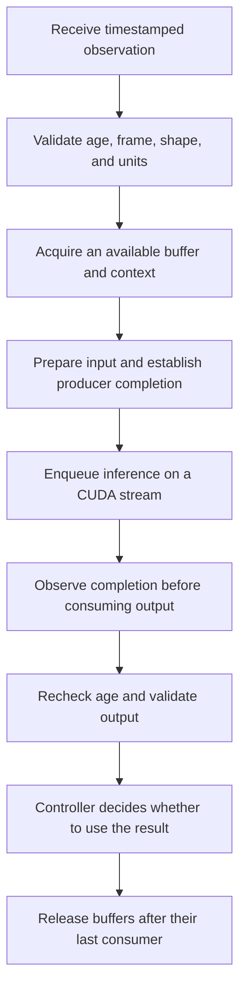

# Build an inference pipeline that respects robot deadlines

A model result is useful only when its values, coordinate frame, and timestamp are appropriate for the next action. This guide takes you from a tested model to a bounded queue and a reproducible latency report. It focuses on Orin Nano GPU inference; that module has **no DLA**.

Plan three sessions: establish a correctness baseline, design the asynchronous pipeline, then evaluate timing and failure behavior. Read the [memory lesson](../Orin-Nano-Memory-Architecture/Guide.md) and run the [Linux timing lab](../Orin-Nano-RT-Linux-Deep-Dive/labs/README.md) first. You can complete the first session on a CPU. GPU deployment requires the appropriate Jetson and its supported software stack.

**Version checkpoint, 2026-10-18:** use the [Jetson compatibility matrix](../../Compatibility.md). JetPack's supported TensorRT 10.x package and the newest TensorRT documentation are different things. NVIDIA currently states that **TensorRT 11.4 does not support JetPack**. This guide links the [10.x Python API](https://docs.nvidia.com/deeplearning/tensorrt/10.x.x/inference-library/python-api-docs.html) for the deployment concepts and the [Jetson migration status](https://docs.nvidia.com/deeplearning/tensorrt/latest/api/migration/tensorrt-10x-to-11x-jetson.html) for the current support boundary. Do not install an unsupported runtime merely because its version number is higher.

## 1. Specify the model and timing contracts together

A model contract includes input names, shapes, types, layout, units, normalization, coordinate frames, output interpretation, and numerical tolerance. A timing contract adds observation timestamps, maximum accepted age, deadlines, queue policy, and failure behavior.

For example, a stop classifier might consume distance in metres and speed in metres per second. Feeding centimetres into a correctly shaped FP32 tensor can produce a numerically valid but behaviorally wrong answer. A detector's boxes can be correct in a resized image and wrong when applied to the original camera frame without the inverse resize/crop transform.

Write down a concrete request:

```text
request_id: 417
observation_time: 12.000 s in robot monotonic clock
frame: base_link
features: [distance_m, closing_speed_m_per_s]
maximum accepted age at control use: 20 ms
on stale or invalid input: reject prediction; controller selects its defined fallback
```

“Fallback” must be an implemented controller behavior with its own assumptions. A classifier returning “stop” is not proof that the actuator stopped. Keep the actuator and supervisory control contracts separate from the learned prediction.

Hard, firm, and soft real-time describe how timing failures affect correctness or utility. They are not fixed millisecond ranges attached to an application category. A late firm-deadline result may be worthless; a soft-deadline result may still have reduced utility. The full system determines what failures can be tolerated.

## 2. Establish an executable CPU baseline

Complete the [PyTorch robot-stop lab](../../../Phase%203%20-%20Artificial%20Intelligence/2.%20Deep%20Learning%20Frameworks/PyTorch/CPU-Robot-Stop-Lab/Guide.md). It trains a small model, separates episodes across datasets, selects the operating threshold on validation data, saves/reloads the model, and checks an exported representation.

The synthetic lab is useful because its failure is understandable: biasing the distance sensor can reduce stop recall even when the clean test accuracy is high. Its model is not a deployed robot safety system. Use the analytic baseline, class-specific errors, and shifted-input tests to understand what is being learned.

Save a reference input/output set before optimization. Include normal cases, boundary shapes, invalid data, cases close to the decision threshold, and difficult slices. Freeze the preprocessing and label meaning. A serialization round trip should preserve outputs within the chosen tolerance; a compiler change needs the same check.

For a perception model, add task metrics after decoding outputs. Small tensor error does not guarantee identical boxes after thresholding or non-maximum suppression. For a policy, inspect action saturation, trajectory feasibility, and closed-loop behavior; a low one-step error alone is insufficient.

## 3. Build the engine outside the timed control path

A TensorRT engine is a compiled deployment artifact with hardware/software compatibility constraints. Keep the source model, preprocessing specification, builder configuration, plugins, and verification fixtures. Do not assume one engine file runs on every Jetson or every TensorRT release.

For a TensorRT 10.x installation, the following is an **on-device command template**, not a recorded run in this repository:

```bash
trtexec --help
trtexec --onnx=model.onnx --saveEngine=model.plan --skipInference
trtexec --loadEngine=model.plan --warmUp=1000 --duration=10
```

Provide your validated `model.onnx` first, and resolve the `trtexec` executable from the installed package if it is not on PATH. A dynamic model also needs valid minimum, optimum, and maximum input shapes using its actual input names. Inspect the installed tool's help and the [TensorRT 10.x command reference](https://docs.nvidia.com/deeplearning/tensorrt/10.x.x/reference/command-line-programs.html). These commands benchmark an engine, not a complete camera-to-actuator system, and random inputs do not validate model quality.

Precision is a model-quality decision as well as a performance option. For TensorRT versions that support weakly typed FP16 build flags, enabling one permits tactics; it does not promise every operation executes in FP16. Strongly typed models encode precision in the graph. Explicit quantization uses quantize/dequantize operations and appropriate scales. Choose a supported workflow for the installed version and compare results with the reference fixtures.

Workspace is temporary storage available to implementation tactics. An arbitrarily tiny limit can exclude a good implementation or make a build fail; a huge limit can exceed the deployment's concurrent memory budget. Measure the resulting engine and peak runtime memory rather than prescribing a universal 64 MB workspace.

Optimization profiles must describe the application's real shapes. A broad profile can cost memory or performance, while an overly narrow profile rejects valid requests. Test the minimum and maximum cases and a deliberately out-of-range input.

## 4. Make asynchronous ownership visible

A typical request follows this order:



TensorRT's named I/O interface uses `set_tensor_address` and `execute_async_v3`. For dynamic inputs, select a compatible optimization profile and establish the input shapes before resolving output sizes. Check shape-setting failures and any remaining shape-inference inputs. An output dimension can still be data-dependent and remain `-1`, for example after a nonzero-selection operation; do not multiply that placeholder into an allocation size. Use a supported `IOutputAllocator` strategy or a documented sufficient bound for those outputs. Profile changes and inference also need the documented stream ordering. See [TensorRT 10.x dynamic shapes](https://docs.nvidia.com/deeplearning/tensorrt/10.x.x/inference-library/dynamic-shapes-basics.html#dynamically-shaped-output). A returned enqueue success means work was accepted; it does not mean the output is ready.

This is **ordering pseudocode**, not a complete Python program:

```text
validate request
select a context that is not executing another request
select the profile and set input shapes; resolve sizes or configure an output allocator
bind input/output addresses with the required size and memory location
make the inference stream wait for input preparation
enqueue inference; reject an enqueue failure
record completion event on the same stream
when completion succeeds:
    validate outputs and freshness
    publish the accepted result
    return buffers only after all downstream readers finish
```

Use one execution context per concurrently executing inference path unless the runtime explicitly documents another supported arrangement. Shared weights do not imply shared mutable context state is safe. Keep allocations alive through completion and check CUDA/runtime errors. A failed asynchronous operation must not silently publish the previous request's output.

CUDA stream priority expresses a scheduling preference; it is not a guaranteed preemption mechanism for every running kernel or an end-to-end deadline bound. Multiple streams can expose overlap, but they can also compete for shared memory bandwidth and execution resources. Profile the actual workload before adding concurrency.

For a tested CUDA starting point, use the [compiled correctness lab](../../../Phase%205%20-%20Advanced%20Topics%20and%20Specialization/Track%20A%20-%20GPU%20Infrastructure/Nvidia%20GPU/HPC%20Setup/CUDA-Advanced-Optimization/labs/README.md). Its CPU references and compiler results are recorded separately from GPU execution availability.

## 5. Design queueing and batching for observation age

Suppose a sensor produces 100 requests/s and inference can complete only 50 requests/s. A FIFO that retains everything accumulates approximately 50 requests each second under this simplified steady workload. A larger queue delays the failure; it does not create compute capacity.

For a controller that needs the newest state, a bounded “replace an unstarted old observation” policy may be appropriate. For a recorder or an estimator that requires every measurement, dropping data has different consequences. State the policy per consumer.

The [observation freshness lab](../../../Phase%202%20-%20Embedded%20Systems/Labs/Observation-Freshness.md) lets you test stale, future, and reordered data on a CPU. The [ROS 2 integration lab](../../../Phase%205%20-%20Advanced%20Topics%20and%20Specialization/Track%20D%20-%20Robotics/Robotics%20Foundations/ROS2-Lab.md) exercises real message and transform contracts without an actuator.

Batching adds another wait. With one 30 Hz camera and a batch of four consecutive frames, the first frame waits about `3/30 = 0.1 s` for the fourth frame before inference begins. A batch can improve throughput while failing a 20 ms age limit. Multiple simultaneous cameras, relaxed deadlines, or offline workloads can change the tradeoff. Batch one is a useful baseline for interactive control, not a universal optimum.

A batching timeout should use one monotonic deadline. Repeatedly waiting the full timeout after each new item can extend the total wait unexpectedly. Record whether an incomplete batch executes, waits, or drops. Check API units: for example, seconds and microseconds are not interchangeable merely because both arguments are called “timeout.”

Expire a request at both admission and consumption. A fresh input can become stale during execution. If GPU work cannot be cancelled cheaply, discard its stale result and avoid admitting more obsolete work.

## 6. Measure engine time and application time separately

CUDA event timing measures intervals on the relevant device stream. A host wall-clock timer around only an asynchronous enqueue mostly measures submission. Synchronizing every frame makes a simple correctness baseline but changes the overlap of a pipelined implementation.

For application timing, keep request IDs and timestamps from acquisition through consumption. Report at least:

| Measurement | Why it matters |
|---|---|
| Acquisition-to-use age | Determines whether the action uses current evidence |
| Queue wait | Reveals overload and batching delay |
| Device execution interval | Helps diagnose model/kernel performance |
| Completion-to-use delay | Exposes callback and control scheduling |
| Deadline misses and stale rejections | Shows failures hidden by average FPS |
| Peak live memory and sustained power/thermal state | Tests deployment feasibility |

Warm-up can include model load, tactic initialization, memory allocation, and lazy setup. Report cold-start behavior separately; it still matters after process restart. Repeat steady-state measurements long enough to observe thermal behavior and representative interference. A short benchmark at a favorable clock is not a sustained deployment result.

Do not average per-stage p99 values or assume their sum is the end-to-end p99. Compute the full request distribution from paired events. Define the quantile convention and sample count. The [timing lab](../Orin-Nano-RT-Linux-Deep-Dive/labs/README.md) demonstrates nearest-rank quantiles and why a finite maximum is not WCET.

The optimization sequence is: verify correctness, measure the limiting path, change one relevant factor, repeat the same quality and timing checks. Useful candidates include reducing needless copies, narrowing supported shapes, fusing operations, reducing model cost, changing precision, and revising queue policy. None has a universal speedup.

## 7. Handle platform resources honestly

**Orin Nano has no DLA.** On a module that has DLA, software support is also required. TensorRT's current documentation states that JetPack DLA support is absent from TensorRT 11.4 and directs DLA users to supported earlier configurations. Consult the installed JetPack's matrix and the [DLA lesson](../Orin-Nano-DLA-Deep-Dive/Guide.md); do not infer capability from a family block diagram or blindly replace the packaged runtime.

Separate compute engines still share resources such as DRAM, power, and host scheduling. GPU fallback can move unsupported subgraphs back to the GPU and add conversion/coordination work. A DLA path therefore does not establish deterministic latency or independent fault containment by itself.

CPU scheduling affects preprocessing, dispatch, completion handling, and control. PREEMPT_RT can improve schedulability of parts of the kernel, but it cannot repair an overloaded inference queue. Use the [RT Linux guide](../Orin-Nano-RT-Linux-Deep-Dive/Guide.md) to analyze priorities, blocking, and timer behavior before applying privileged tuning.

Power modes and clocks affect sustainable execution. Record the actual mode, cooling, temperature, and throttling alongside the benchmark. Higher requested clocks may increase heat and later reduce sustained performance. Compare completed, correct work per unit energy at a stated measurement boundary.

## 8. Make failures part of the capstone

Build a replayable test with the following injections:

1. An input older than the age limit before admission.
2. A fresh input whose result becomes stale during processing.
3. A wrong shape, nonfinite value, or incompatible frame.
4. A burst that exceeds the bounded queue capacity.
5. A model/runtime failure that must not publish an earlier output.
6. A restart that exercises warm-up and controller readiness.

For each, record whether the request was admitted, executed, used, rejected, or replaced, and why. The controller should retain responsibility for command limits and its designed fallback behavior. Passing replay tests does not establish real-robot safety, but failing them identifies defects before connecting actuators.

Your final artifact contains the model and preprocessing versions, reference fixtures, quality report, deployment manifest, queue/expiry rules, raw timing traces, and a failure table. The CPU route earns completion for contracts and evaluation. Add an actual Jetson run to claim device deployment; add controlled closed-loop testing to claim robot behavior.

**Self-check:** a pipeline reports 60 FPS while every action uses a 200 ms-old frame. Has it met a 20 ms age requirement? **Answer:** no. Throughput is not freshness. A faster kernel may help, but queueing and timestamps must be fixed and remeasured.
