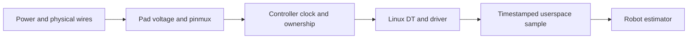

# Customize Jetson Linux with a reproducible BSP

L4T

Track B3 · L4T Customization

Connect the schematic, boot configuration, kernel, and deployed image.

Artifact: a versioned BSP change with build and boot evidence

A robot can run a correct neural network and still fail because its camera reset line, storage driver, or boot firmware is wrong. This module teaches how to trace a product requirement to the configuration that owns it, then prove that the intended artifact reached the target.

**Prerequisites:** Linux files and processes, basic device trees, and the [carrier-board lesson](../2.%20Custom%20Carrier%20Board%20Design%20and%20Bring-Up/Guide.md). Allow three study sessions plus the optional hardware project. The CPU device-tree lab works without a Jetson.

## Release scope

Reviewed **2026-10-18**: JetPack **7.2.1** pairs with Jetson Linux **39.2.1**, Ubuntu **24.04**, and Linux **6.8**; its supported hardware includes Orin and Thor. This module's concrete hardware discussion is **Orin NX/Nano, T234**, not Thor/T264. Older R35/JetPack 5 and R36/JetPack 6 examples remain useful only with their matching packages. [Pinned NVIDIA release](https://developer.nvidia.com/embedded/jetpack/downloads/archive-7.2.1).

Do not combine a new userspace package set with an arbitrary older bootloader, kernel, or device tree. A release is a compatibility set. An existing product may deliberately remain on a maintained older branch: state that choice and its update policy instead of silently following the newest tutorial.

## Learn in this order

| Session | Read and do | Result |
| --- | --- | --- |
| 1: configuration ownership | [BCT contracts and worked examples](T23x-Deployment.md), then [ODMDATA and GPIO](ODMDATA-and-GPIO-Jetson-Linux.md) | Explain which change belongs in boot firmware, Linux DT, or an application |
| 2: build and inspect | [Adaptation lesson](Jetson-Module-Adaptation-Bring-Up-Orin-NX-Nano.md), then the real [CPU device-tree lab](../1.%20Nvidia%20Jetson%20Platform/Orin-Nano-Kernel-Internals/labs/README.md) | Compile, merge, inspect, and deliberately break an overlay |
| 3: deliver and diagnose | [Deployment](Deployment.md), then [custom-carrier engineering flow](Orin-Nano-8GB-Custom-Board-L4T-Engineering-Flow.md) | Build a traceable release bundle and a staged bring-up plan |
| Extension | [SPE firmware and its native protocol lab](../4.%20FSP%20%28Firmware%20Support%20Package%29%20Customization/Guide.md) | Define ownership and timeout behavior across Linux and firmware |

## One feature crosses several layers

Suppose an IMU should produce a sample every 5 ms. Its complete path is:

A node with `status = "okay"` only declares that the device is available to its consumer. It does not create a wire, supply power, choose a valid voltage, or guarantee that a probe will succeed. A device-tree compiler can accept a physically wrong description. The lab makes that distinction visible by compiling an invalid sample-rate setting and rejecting it at the contract-checking stage.

The 5 ms period is a rate requirement, not a measured deadline guarantee. Budget acquisition, queueing, driver work, delivery, and estimator processing separately. Record where the timestamp is taken: interrupt delivery time and sensor capture time describe different events.

## What belongs in each artifact?

| Requirement | Likely owner | Evidence to retain |
| --- | --- | --- |
| Safe pin state before Linux | MB1 pinmux/GPIO and electrical design | Generated configuration, flash inputs, measured reset/boot waveform |
| Physical bus and device description | Kernel device tree and binding | Source diff, compiled property, driver probe and known transaction |
| Firmware peripheral permission | Matching firewall/SCR configuration | Named entry and rationale, firmware access test, Linux ownership removed |
| New driver | Matched kernel/module build | Config, compiler, module identity, probe and failure tests |
| Startup service | Rootfs package/systemd unit | Installed package/unit, boot log, restart behavior |
| Model or application revision | Versioned application artifact | Input/output checks and runtime dependencies |
| Recoverable update | Partition/boot/update design | Actual rollback and interrupted-update evidence on target |

Do not solve every item by editing a kernel source file. Conversely, a container cannot change early boot pinmux or repair a missing host driver.

## Begin with a small, reversible change

First compile the fictional sensor overlay in the CPU lab. Then, on a supported physical board, choose a documented overlay or a small service change. Keep the original image and serial recovery path. Track four identities: the edited source, the built artifact, the selected flash input, and the observed running configuration.

For a DT change, inspect the merged blob before deployment and the live tree after boot. Those blobs need not have identical hashes because boot firmware may add properties. Compare the intended properties and record the boot path; retain the exact input hashes separately.

For a service, test failure as well as startup. A process that repeatedly restarts but never makes its sensor available is not healthy. A service's readiness contract should cover the dependency it promises to downstream applications.

## Rootfs, kernel, and update decisions

Choose NVIDIA's release-matched rootfs construction method or the supported [Yocto route](../1.%20Nvidia%20Jetson%20Platform/Orin-Nano-Yocto-BSP-Production/Guide.md). Record packages and repository snapshots. Deleting desktop packages from a running development board is not a reproducible rootfs recipe; package dependencies and NVIDIA integration files still matter.

For Orin NX/Nano production image flows, use the documented **initrd flashing** path. NVIDIA distinguishes its layout from `flash.sh` and ties production OTA compatibility to the initrd layout. Partition-only development commands are separate procedures. [R39.2.1 flashing support](https://docs.nvidia.com/jetson/archives/r39.2.1/DeveloperGuide/SD/FlashingSupport.html#using-flash-sh-with-orin-nx-and-nano).

The current developer-kit installation route also includes a unified ISO. Customizing the ISO has its own package, squashfs, boot, and checksum workflow; copying an edited DTB somewhere inside an ISO does not establish that the target will select it. [NVIDIA ISO customization](https://docs.nvidia.com/jetson/archives/r39.2.1/DeveloperGuide/SD/JetsonISOCustomization.html).

## Check your understanding

1. **The new overlay compiles, but no sensor appears. What next?** Inspect the merged/live properties, driver binding and probe logs, regulator/reset/clock dependencies, then a documented transaction and the electrical signals. Compilation covers syntax, not that chain.
2. **Can changing only the rootfs alter a pin's MB1 reset state?** No. Rebuild and deploy the relevant early-boot configuration as part of a consistent artifact set.
3. **Does an identical Git revision guarantee identical images?** No. Toolchain, package repositories, generated files, timestamps, signing and other inputs may differ. Record both source identities and output hashes; distinguish reproducible procedure from bit-for-bit reproducibility.
4. **Does a successful flash prove the robot is ready?** No. It establishes only that the flash operation completed. Boot, drivers, application behavior and update recovery need separate evidence.

Continue to [BCT contracts](T23x-Deployment.md). The platform [kernel](../1.%20Nvidia%20Jetson%20Platform/Orin-Nano-Kernel-Internals/Guide.md), [rootfs/A-B](../1.%20Nvidia%20Jetson%20Platform/Orin-Nano-Rootfs-and-AB-Redundancy/Guide.md), [OTA](../1.%20Nvidia%20Jetson%20Platform/Orin-Nano-OTA-Deep-Dive/Guide.md), and [security](../1.%20Nvidia%20Jetson%20Platform/Orin-Nano-Security/Guide.md) chapters provide deeper implementations.
