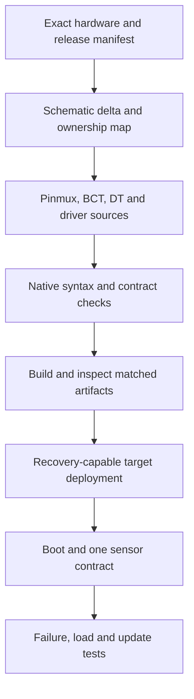

# Orin Nano 8 GB: a gated custom-carrier project

**Project:** boot a matched Jetson Linux image on a custom carrier and verify one sensor path used by a robot. The current course baseline is **JetPack 7.2.1 / R39.2.1**; an existing R35/R36 product should explicitly use its matching branch. No custom-carrier hardware execution is claimed by this page.

Choose the **exact module SKU** and carrier revision first. Commercial and developer-kit Nano 8 GB modules are distinct products. Keep a reference system available to separate a BSP regression from a carrier issue. Use the [release notes/download](https://developer.nvidia.com/embedded/jetpack/downloads/archive-7.2.1) and matching [quick start](https://docs.nvidia.com/jetson/archives/r39.2.1/DeveloperGuide/IN/QuickStart.html) for current host and installation prerequisites.

## The project has two routes

**CPU route:** complete the native device-tree/overlay lab, map a schematic requirement to source/build artifacts, and submit a deployment review. This route is complete without a board, but it does not qualify hardware.

**Hardware route:** continue through the gates below with the actual module, carrier, power supply, recovery connection, serial interface and required measurement equipment. The board-specific procedure must be reviewed against its schematic before applying power or flash commands.

## Gate 1: freeze the compatibility set

Record module SKU, carrier revision, BSP/rootfs/source releases, toolchain and the chosen update/boot-security policy. Save archive identities and hashes. Avoid a wildcard extraction such as `Jetson_Linux_R*`: a directory containing two releases should not silently choose or combine them.

Create separate unmodified and product staging trees. Keep product changes as patches and generated configuration inputs, not undocumented edits scattered across an SDK Manager workspace. The [deployment manifest](Deployment.md#2-capture-a-release-manifest) gives a starting template.

**Pass evidence:** another engineer can identify every input without asking which downloaded archive was used.

## Gate 2: assign ownership to every change

Use the [adaptation delta table](Jetson-Module-Adaptation-Bring-Up-Orin-NX-Nano.md). For the first sensor, specify power, bus/address, reset, interrupt, timestamp origin and software owner. Decide whether Linux or SPE owns the controller. “Both, depending on who accesses first” is not a protocol.

Preserve the module's supported memory configuration. A carrier change does not make a random DRAM timing change necessary. Treat boot-time pin state separately from runtime direction.

**Pass evidence:** every source change has a reason linked to the schematic or a product requirement.

## Gate 3: execute a small native check

Run the [device-tree lab](../1.%20Nvidia%20Jetson%20Platform/Orin-Nano-Kernel-Internals/labs/README.md). It uses real `dtc`, `fdtoverlay` and `fdtget`, with fictional hardware descriptions. Retain one valid merge, one unresolved-symbol failure and one structurally valid but contract-invalid result.

For a real BSP, build through the matched source tree and run applicable binding checks. Direct `dtc` on a source requiring C preprocessing/includes is not a universal substitute for the kernel build. Rebuilding a DTB does not necessarily require a full new kernel image, but the compiler/includes/bindings must match the intended source context.

**Pass evidence:** explain exactly what compilation and validation established, and which electrical/driver questions remain open.

## Gate 4: assemble the bootable set

Follow the selected release's kernel and rootfs flow, including NVIDIA integration, required modules and initramfs regeneration. Install the actual generated DTBs selected by the board configuration. R39.2.1 uses current source/build layouts; `tegra_defconfig` and `nvbuild.sh` from archived R35 instructions are not generic current commands.

Build a minimal image by specifying needed packages and services. Ensure a startup service declares its dependencies and publishes meaningful readiness. An application image with a working Python import is not proof that its sensor, CUDA driver or model contract works.

**Pass evidence:** source inputs, selected outputs and their hashes agree; no stale prebuilt artifact remains selected accidentally.

## Gate 5: review the flash plan

Orin NX/Nano production image flows use the supported initrd flashing path. The method and layout must agree with the update design. Commercial Nano/NX modules do not inherit eMMC merely because an old example uses `mmcblk0p1`; target storage names are workflow-specific. The current developer-kit ISO route is another documented installation path, with its own customization process. [Flashing support](https://docs.nvidia.com/jetson/archives/r39.2.1/DeveloperGuide/SD/FlashingSupport.html).

Before writing, confirm the exact target, recovery access, capacity/layout, generated artifact selection and retained recovery image. `--no-flash` prepares files and may still require real board metadata; it is not a harmless general-purpose linter.

**Pass evidence:** the command is specific to the intended board/media and the team can recover a failed deployment. Hardware writes were not executed during the CPU course review.

## Gate 6: prove boot and one transaction

Capture serial logs from power-on. Record bootloader/kernel/rootfs identities and the running DT properties relevant to the change. Verify storage and a single documented sensor transaction. If it fails, use the [stage-based diagnosis table](Deployment.md#8-diagnose-by-the-last-stage-that-worked).

Do not infer driver correctness from the existence of a device node. Read a known identifier and then validate actual sample units, byte order, sign extension and timing. An IMU's stationary acceleration magnitude should be interpreted using the selected scale and gravity convention, not raw counts mislabeled as m/s².

**Pass evidence:** a repeatable input/output contract, with units and a recorded failure case.

## Gate 7: test the robot-facing behavior

Suppose a 200 Hz sensor produces one sample every 5 ms. If an application blocks for 40 ms, eight samples may arrive during the pause. A queue with eight slots has no spare capacity for boundary alignment or preexisting occupancy. Choose and test an overflow policy: drop oldest, drop newest, stop acquisition, or signal a fault according to the estimator's needs.

A sample dequeued now may have been captured much earlier. Include capture time and an age limit; a backlog of stale data is not current feedback. Test sensor disconnect, malformed sample, delayed consumer, process restart and loss of the firmware reply. The [SPE protocol lab](../4.%20FSP%20%28Firmware%20Support%20Package%29%20Customization/labs/README.md) exercises timeout and restart correlation on a CPU.

**Pass evidence:** deterministic handling of each injected failure, plus target latency/thermal/load measurements where required.

## Gate 8: qualify updates and retain the release

Use the platform [rootfs/A-B](../1.%20Nvidia%20Jetson%20Platform/Orin-Nano-Rootfs-and-AB-Redundancy/Guide.md) and [OTA](../1.%20Nvidia%20Jetson%20Platform/Orin-Nano-OTA-Deep-Dive/Guide.md) procedures. Test the actual old-to-new transition and application data compatibility. A rollback image cannot help if the new application irreversibly changed shared data without a migration policy.

Archive the manifest, inputs, outputs, test logs, known limitations and recovery procedure. A clean cold boot is one result; it does not establish all power states, all update interruptions or an industrial qualification.

## Submission and answers

Submit a dependency diagram, native lab output, exact release manifest and a table separating **executed CPU checks**, **documented target procedures**, and **executed hardware checks**. For the CPU route, leave the last category explicitly unexecuted.

**Review question:** why might the same DT overlay work after Linux boots but fail to make storage accessible during flashing? **Answer:** the recovery environment is a separate boot context with its own selected tree and drivers. The normal rootfs cannot supply a missing dependency before it is mounted.

**Review question:** why is “repeat Steps 4–6 until stable” insufficient? **Answer:** without a hypothesis and retained evidence, changing several layers at once can hide intermittent faults and lose the causal link between source and observed behavior.
