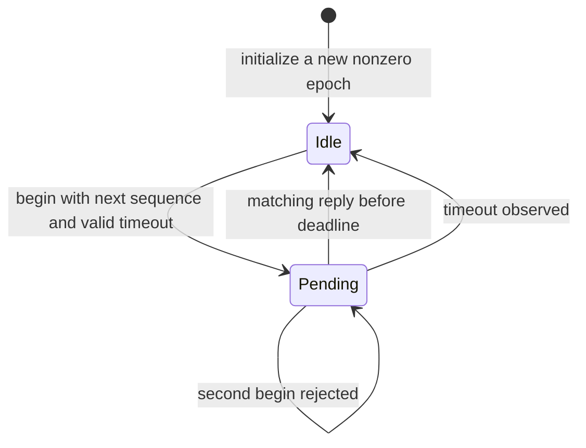

# Native C lab: replies, deadlines and firmware restarts

**Time:** 45–60 minutes. **Tools:** Python 3 and a C11 compiler (`cc`). No Jetson, Arm toolchain, FreeRTOS download or administrator privileges are needed.

You will execute a small request/reply state machine, inspect its bytes, and observe why a late reply from an earlier session must not satisfy a new request. The code is a **teaching protocol**, not NVIDIA IVC framing or an SPE firmware image. It exercises ordinary CPU memory; it does not implement mailbox interrupts, shared-memory cache maintenance, DMA or a physical sensor.

## 1. Run the real C implementation

From this folder, run:

```bash
python3 -m unittest discover -s . -p 'test_*.py' -v
```

The four tests compile and run [request_protocol.c](request_protocol.c) with [verify_protocol.c](verify_protocol.c). One run uses AddressSanitizer and UndefinedBehaviorSanitizer. Two others compile deliberate broken implementations and require the native checks to fail. A missing C compiler is reported as a skip, not as completed execution.

For an individual optimized build, use a temporary directory:

```bash
build_dir=$(mktemp -d /tmp/course-spe-protocol.XXXXXX)
cc -std=c11 -Wall -Wextra -Werror -pedantic -O2 \
  request_protocol.c verify_protocol.c -o "$build_dir/verify"
"$build_dir/verify"
```

Expected successful output:

```text
100 deadline boundary cases including counter wrap passed
native protocol checks passed: codec, identity, deadlines, restart, exhaustion
```

The [recorded validation](validation.json) identifies the reviewed sources, compiler and actual test outcome. It is CPU execution evidence only.

## 2. Read the wire format before the structure

Each frame is exactly **16 bytes**:

| Byte range | Field | Rule |
| --- | --- | --- |
| 0 | Version | Exactly 1 |
| 1 | Kind | 1=request, 2=reply |
| 2–3 | Reserved | Must be zero |
| 4–7 | Epoch | Nonzero uint32, big-endian |
| 8–11 | Sequence | Nonzero uint32, big-endian |
| 12–15 | Value | uint32, big-endian |

A request's value is a selector for an imagined measurement; a reply's value is the returned scalar. No physical units or sensor driver are implied. The transport is assumed to deliver a complete frame with a supplied length. This lab has no authentication or checksum; correlation fields are not security credentials.

The C structure is an internal convenience. The encoder writes fields explicitly rather than copying `sizeof(struct)` bytes, which would depend on compiler padding and host byte order. The decoder uses byte operations and rejects truncated, oversized, wrong-version, reserved-bit and invalid-identity frames before publishing the decoded result. The tests deliberately use an unaligned byte address.

**Predict the bytes:** reply kind 2, epoch `0x12345678`, sequence 42, value `0xFFFFFFFF` becomes:

```text
01 02 00 00 12 34 56 78 00 00 00 2A FF FF FF FF
```

A successful decode says the frame matches the format. It does not establish that its value is a physically valid measurement.

## 3. Trace the state machine

The client allows **one outstanding request**. One serialized caller owns the state; functions are not thread-safe and must not be called concurrently from a task and ISR.



`course_begin` records the start tick and timeout, increments the sequence and returns the request. An invalid call leaves state and the output message unchanged. After a successful begin, the transport must copy or retain the frame according to its own ownership rules. A stack buffer going out of scope is not safe for an asynchronous transport still using it.

`course_receive` accepts only a valid **reply** matching both current epoch and current sequence while the request is pending. A duplicate after completion is rejected. A stale reply from the previous request cannot complete the next one. Malformed/unrelated frames do not overwrite the result or erase a valid pending request.

Call `course_poll` periodically even when no frames arrive. It expires a pending request once, then returns false on later polls. Receiving a matching but expired reply also records timeout. Unrelated traffic alone does not drive the client's timeout transition; the application still owes the periodic poll.

## 4. Work through the deadline boundary

The rule is **strictly before** the deadline. A reply at the deadline is late.

For start tick 100 and timeout 10:

| Observation tick | Elapsed ticks | Result |
| --- | --- | --- |
| 109 | 9 | A matching reply is accepted |
| 110 | 10 | Timeout |
| 111 | 11 | Timeout or rejection after the pending state was already cleared |

The clock belongs to the client, so no synchronization with the firmware clock is needed to measure this request/response interval. That still does not prove sensor freshness: the firmware could return an old cached value. A real sampling protocol needs an acquisition timestamp/age contract as well.

For a wrapping uint32 clock:

```text
start = 0xFFFFFFFD
now   = 0x00000001
elapsed = uint32(now - start) = 4
```

At `now=2`, elapsed is 5. A timeout of 5 must therefore remain pending at 1 and expire at 2. Comparing `now >= start + timeout` directly fails around wrap.

The contract accepts timeouts from 1 through `2^31 - 1` ticks and requires the client to be serviced before an outstanding interval reaches half the counter range. Time must advance monotonically modulo the counter; it must not jump backward or reset within a session. Reinitialize the session if its clock domain restarts. A uint32 counter cannot tell whether no wrap or an entire extra cycle elapsed during an unobserved pause.

The native reference uses **unwrapped uint64 durations** to predict 100 cases across start values, timeout extremes and deadline boundaries. This gives an independent comparison for the modular implementation instead of repeating its formula in the expected result.

## 5. A timeout is not cancellation

Imagine request `(epoch=7, sequence=1)` expires. A delayed device reply may still arrive. The next request uses sequence 2, so that reply is rejected.

Now imagine the Linux process restarts and resets its sequence to 1. If it also reuses epoch 7, the old reply can look current. Initializing a **new epoch 8** distinguishes the sessions. Epoch allocation is an application responsibility: this lab requires a value that will not be reused while old frames may remain. A hard-coded epoch 1 on every restart violates the contract. Production designs may need persistent counters, a negotiated session reset, or a sufficiently large nonce with an explicit collision policy.

Sequence `UINT32_MAX` may be used once; the next begin is rejected until a new epoch is initialized. Silently wrapping to sequence 1 inside the same epoch would reopen the stale-reply problem.

Changing an epoch only changes correlation. It does not stop old firmware work, cancel DMA, release a shared buffer or prove an actuator command was never applied. This lab models a read request. Exactly-once actuation needs additional device-side semantics, acknowledgment/deduplication and a defined recovery protocol.

## 6. Read the failures the tests must detect

| Test family | Counterexample |
| --- | --- |
| Codec and bounds | Every short length 0–15, overlength, bad version/kind/reserved bytes, zero epoch/sequence, unaligned buffer |
| Correlation | Wrong epoch, wrong sequence, request mistaken for reply, duplicate and old reply |
| Deadlines | Just before, exactly at and after deadline; wrap near `UINT32_MAX`; timeout limits |
| Lifetime of identity | Restart with same sequence/new epoch; sequence exhaustion without reuse |
| Sanitizers | Actual native executions checked for the sanitizer-detectable errors they reach |
| Mutations | Ignoring epoch and using an unsafe absolute deadline comparison each fail the native checks |

The checks do not establish interrupt latency, shared-memory coherence, firmware availability or physical signal behavior. Those require the matched transport and board.

## 7. Extend the contract deliberately

Add an explicit response status and distinguish a valid “sensor unavailable” reply from malformed bytes. Decide whether that status completes the request. Add tests before changing the protocol version so an older receiver rejects unsupported frames cleanly.

For a continuous stream, a single outstanding request model is insufficient. Define sequence gaps, queue capacity, overflow handling, acquisition timestamp units and stale-sample limits. Keep event count and payload ownership visible rather than hiding loss in a log message.

For an SPE port, use the matching FSP/FreeRTOS task and ISR APIs. A short ISR can enqueue bounded work for a task, but it cannot block waiting for the Linux process. Verify the transport's cache/barrier and buffer-lifetime rules independently of this state machine.

## 8. Submit your explanation

Submit actual test output and the predicted bytes. Explain why a reply at tick 110 is late, why unsigned elapsed-time arithmetic survives one nearby wrap, why a restarted client needs a new epoch, and why discarding a late reply does not cancel hardware work.

**Answers:** the interval is `[start, start + timeout)`; modulo subtraction preserves a bounded elapsed interval; the epoch separates reused sequence values across sessions; correlation is software bookkeeping while the device may still own buffers or execute work. Continue with the [SPE guide](../Guide.md) to map these contracts onto a release-supported channel.
