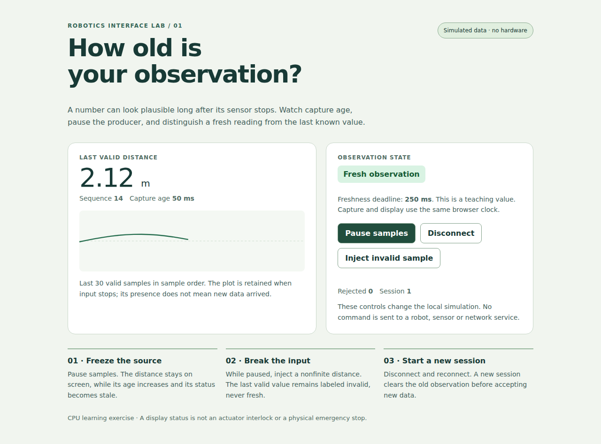

# Robot interfaces: show what is known, fresh and actionable

**Goal:** build a small operator view that preserves units, observation age, connection state and failure information. **Pace:** three 60–90-minute sessions. Start with the [interactive CPU dashboard lab](CPU-Dashboard-Lab.md); it needs only a browser and uses simulated data.

A dashboard can keep displaying a plausible distance after its sensor disconnects. A useful interface makes that difference visible: “last valid distance 1.2 m, captured 800 ms ago” is more informative than a green label saying “running.” This lesson connects presentation to the actual data contract.

## 1. Run the complete interface first

Open the [observation dashboard](labs/dashboard.html). The standalone HTML and [JavaScript model](labs/telemetry.js) contain no external libraries, network calls or actuator controls. The local simulation emits a distance every 100 ms and uses a teaching freshness deadline of 250 ms.

Pause samples. The last valid distance stays visible, but capture age increases and the state becomes stale. Inject an invalid sample while paused; it must not turn the last value fresh again. Disconnect and reconnect; the new session clears the old observation before accepting new input.



The lab has seven tests that execute the actual JavaScript model in Node and four actual Chromium interaction tests, including a 390-pixel viewport. Those checks validate the teaching interface. They do not establish physical sensor behavior, a Jetson display stack or an actuator safety function.

## 2. Choose the display path that actually exists

The Orin Nano developer kit exposes **DisplayPort**. Its USB-C connector is data-only and does not carry DisplayPort/HDMI; the kit does not provide a native HDMI connector. A custom carrier must use a supported, correctly designed display path. A display interface listed for another Jetson family is not evidence that it is exposed on your module/carrier. [NVIDIA hardware layout](https://docs.nvidia.com/jetson/orin-nano-devkit/user-guide/latest/hardware_layout.html).

Separate physical output, kernel/display driver, compositor/window system, toolkit and application. Diagnose them in that order. A working headless browser screenshot proves application rendering in that environment; it does not prove that a panel, cable, touch controller or target GPU display path works.

On a running desktop, inspect the session rather than replacing it blindly:

```bash
printf '%s\n' "${XDG_SESSION_TYPE:-unknown}"
```

`xrandr` is an X11 tool; its view in an Xwayland session is not a universal description of physical outputs. Use the tools and documentation matching the selected Jetson BSP and compositor. Do not assume every JetPack release ships the same default desktop/display configuration.

Direct framebuffer access is not just writing width×height×4 bytes. Pixel format, line stride, virtual offsets, mapping size, ownership and the active display stack matter. The old “write zeroes through tr to make a red screen” pattern does not implement a correct framebuffer pixel format. Prefer a supported toolkit or DRM/compositor path appropriate to the product.

## 3. Select a toolkit by the integration requirement

| Approach | Useful fit | Questions to resolve |
| --- | --- | --- |
| Browser interface | Local/remote dashboards, familiar layout/accessibility tools | Data transport, authentication, reconnects, resource budget, kiosk lifecycle |
| Qt Widgets/Quick | Native application and embedded interaction | Target Qt build, platform plugin, graphics backend, deployment/licensing |
| Lightweight embedded toolkit | Constrained/simple panel interface | Supported display/input backend, memory, rendering and event integration |
| Direct graphics/DRM work | Specialized rendering requirements | Buffer/display ownership, synchronization and the complete target driver contract |

Qt's platform plugins include Wayland, EGLFS and LinuxFB, with availability depending on the build. Wayland uses a compositor; EGLFS provides a different fullscreen arrangement; LinuxFB renders through the framebuffer with software limitations. Selecting `-platform eglfs` is not a guarantee that an arbitrary Qt package and Jetson graphics stack support that backend. [Qt embedded Linux documentation](https://doc.qt.io/qt-6/embedded-linux.html).

Pin the Qt/application/toolchain combination that the target supports. Avoid obsolete `qt5-default` package instructions or downloading an x86 desktop Qt kit as if it were automatically an aarch64 Jetson SDK. A real cross-build needs the matching target libraries/sysroot, target compiler, host build tools and correct dependency discovery. Copying two directories from a target is not a complete cross-compilation design.

The browser lab gives a complete CPU route while target-specific toolkit installation remains a separate choice. Its learning outcomes apply to a native Qt view too.

## 4. Define the view model before drawing widgets

A view model converts validated observations and system state into what the user sees. It should distinguish at least:

- no observation yet;
- fresh valid observation;
- stale last valid observation;
- invalid input received;
- disconnected transport;
- new session after reconnect/reset.

The lab's `create`, `receive`, `disconnect` and `view` functions implement those transitions. A message includes session, sequence, capture time and distance in metres. The model rejects nonfinite/out-of-range values, old sequence values, unexpected sessions and invalid time relationships. Accepted values are copied into an immutable sample so a producer cannot change the displayed observation by mutating its old object.

**Worked time example:** a sample was captured at 100 ms, received at 300 ms and displayed at 350 ms on the same clock. Capture age is 250 ms; time since receipt is only 50 ms. Subtracting receipt time would hide 200 ms of already-known delivery delay. The lab treats exactly 250 ms as fresh and a greater age as stale; choose and document the actual product's rule.

For a remote source, the browser's monotonic clock and the device's timestamp generally have different origins. Do not subtract them directly. Establish a clock relationship, carry a justified age/uncertainty estimate, or display local time since receipt with that narrower label. The [network lab](../2.%20Network%20and%20Connectivity/Localhost-Network-Lab.md) explains why RTT is also not automatically one-way observation age.

## 5. Keep data arrival separate from rendering

A sensor may produce 200 samples/s while a display renders 60 frames/s and the operator needs a slower status view. Preserve the data required by logging/control separately, then choose a bounded presentation policy. Rendering every intermediate event can build a queue and make the view increasingly old.

In the lab, the source runs every 100 ms and the view refreshes every 50 ms. Age is recomputed from the current monotonic clock even when no new sample arrives. It is not reset by repainting the same value. Browser scheduling and background-tab throttling can delay the refresh; this display policy is not a hard real-time interlock.

Retain a bounded history with explicit axis meaning. The example graph shows the last 30 valid samples **in sample order**, not a uniformly timed physical trajectory. If time intervals vary and timing matters, use capture time on the x-axis and show gaps. A smooth line can otherwise disguise missing observations.

Keep long inference, disk access and blocking communication off the UI event loop. In a native application, deliver data through the toolkit's supported thread/message mechanism and keep widget access in its required thread. In a browser, use asynchronous transport and appropriate workers for costly computations. Both designs still need bounded queues and cancellation/reconnect behavior.

## 6. Separate requested, acknowledged and observed state

For a read-only dashboard, displaying observations is enough. An operator command interface has additional states: requested, accepted/rejected by the authoritative service, in progress, completed and timed out. Do not immediately change a device indicator to “stopped” merely because a button was clicked.

Commands need an identity, authorization, parameter units/ranges, expiry and an acknowledgement tied to the correct session/request. Retrying after a lost acknowledgement must not accidentally execute a one-time action twice. The localhost network lab demonstrates that protocol issue using a harmless counter.

A graphical stop button, a browser connection and a green status are not substitutes for the independently designed controller/interlock behavior required by the robot. The teaching dashboard intentionally has only local simulation controls so the observation exercise can be understood and tested without implying physical actuation.

## 7. Make failures readable and accessible

Use text as well as color for state. Keep units adjacent to values, show whether a value is last-known, and avoid displaying a missing measurement as numeric zero. Preserve error reason and session identity so a learner can explain the transition.

Provide meaningful button names, keyboard focus and sufficient touch targets. Announce status changes to assistive technology without replacing the same live-region text on every repaint. The lab updates its live status only when the text changes; rapidly updating numeric age is separate.

Test narrow screens, enlarged text, long device names, disconnected state and absent data. A large desktop screenshot alone is insufficient. The [mobile screenshot](labs/dashboard-mobile.png) and actual viewport check document the example's behavior at 390 pixels; other devices and accessibility needs remain worth testing for a product.

## 8. Test the model and the rendered interface

The JavaScript tests check capture-age boundaries, stale input, bad numbers, duplicate/old sessions, disconnect/reset, recovery after valid data and source-object mutation. These tests execute the same file the browser loads.

The browser checks click the actual buttons, advance a controlled clock, verify state/value changes, check disabled controls and inspect horizontal overflow. They also fail on JavaScript page errors. Read the [lab](CPU-Dashboard-Lab.md) for exact commands and evidence. A screenshot records appearance; interaction assertions test behavior.

For a target extension, add boot/startup, display/touch configuration, compositor restart, network loss, long-run memory use and application restart tests. Exercise the interface while the actual inference/camera workload competes for CPU/GPU/memory. Preserve which checks ran on a workstation and which ran on the Jetson.

## 9. Completion exercise

Extend the lab with one additional observation, such as a temperature or model-result confidence. Define its unit/range, capture time, validity and display label. Add a test showing that a disconnected source cannot refresh it, and explain whether its deadline should match distance.

**Answer key:** a frozen numeric value can remain useful if explicitly labeled last-known; repainting does not create freshness; reconnect should establish a new session; a received acknowledgement is not the same as observing completed physical action; and a passing browser test does not validate the electrical display or robot controller.
