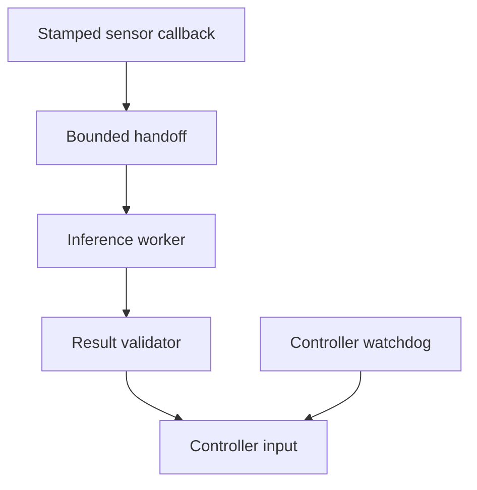

# ROS 2: connect perception to a robot controller

<div class="course-identity auto-course" style="--course-accent: #ca8a04; --course-accent-rgb: 202, 138, 4;" markdown="1">
<div class="course-identity__icon">ROS</div>
<div markdown="1">
<p class="course-identity__eyebrow">Jetson Track · Application Development</p>
<p class="course-identity__title">Build a stamped sensor pipeline, validate frames and age, then measure deployment behavior.</p>
<p class="course-identity__meta">Artifact: runnable observation loop and failure trace</p>
</div>
</div>

**Before:** Python functions, Linux terminals, and the [robotics foundations](../../../Phase%205%20-%20Advanced%20Topics%20and%20Specialization/Track%20D%20-%20Robotics/Robotics%20Foundations/README.md). **Time:** three 60–90 minute sessions for the core route. **Equipment:** a computer with ROS 2 Jazzy for the executed lab; a Jetson is optional until the deployment extension.

**Start with the [software compatibility record](../../Compatibility.md).** The core lab uses Jazzy on Ubuntu 24.04. Existing JetPack 6/Humble projects and current Isaac ROS releases use different setup instructions. Match the whole stack before installing packages.

**Hub:** [Application Development](../Guide.md).

## 1. Understand the four interfaces

ROS 2 lets separate components exchange typed information. A node is a participant in that graph. It can own publishers, subscriptions, timers, services, and action endpoints. A process may contain several nodes.

| Interface | Robot example | What the caller needs |
|---|---|---|
| Topic | Camera publishes stamped frames | A stream; a new sample need not wait for a reply |
| Service | Ask for a calibration record | A short request and response |
| Action | Navigate to a goal | Progress, cancellation, and a final outcome |
| Parameter | Configure a maximum observation age | Configuration with a defined update policy |

A service is not a good interface for a long navigation operation that needs feedback and cancellation. A topic is not automatically reliable, timely, or safe to act upon. Those properties require explicit contracts.

ROS 2 uses a middleware abstraction called **RMW**. Common implementations use DDS, but ROS 2 is not restricted to DDS. Record the selected RMW and its supported features. Changing middleware can change discovery, transport, buffering, and performance.

**Checkpoint:** name one topic, service, and action for a robot that collects objects. Explain which operation may take seconds and must be cancellable.

## 2. Give every observation a meaning

Suppose a camera reports a point `(1,0,0)`. The controller cannot use it until it knows:

- the units and frame in which the point is expressed;
- the capture time and clock domain;
- the calibration/transform valid at that time;
- whether the value is finite, sufficiently fresh, and consistent with the current robot session.

A `PointStamped` provides a frame name and timestamp as well as coordinates. It does not enforce all these conditions for you. The publisher and consumer still need an agreement about units, time, and validity.

**Worked transform:** a sensor sits at `(1,2.2,0)` metres in a world frame and is rotated 90° about world z. The sensor point `(1,0,0)` becomes `(1,3.2,0)` in world coordinates. Rotate first into world axes, then add the sensor origin. Applying the inverse transform answers a different question.

**Worked age:** capture at 12.000 s, inference finishes at 12.020 s, command validation occurs at 12.044 s. Inference took 20 ms, but the observation is **44 ms old** when used. These subtractions require a common or explicitly related clock. A simulator reset or system-clock adjustment can invalidate a naive subtraction.

Use TF at the **capture timestamp** for moving frames. A successful lookup of the newest transform does not establish the historical pose. Distinguish `map` (global corrections may jump), `odom` (locally continuous but drifting), and `base_link` (robot body). See [REP 103](https://www.ros.org/reps/rep-0103.html) and [REP 105](https://www.ros.org/reps/rep-0105.html).

## 3. Run a real middleware and TF exercise

From the repository root:

```bash
source /opt/ros/jazzy/setup.bash
python3 "Phase 5 - Advanced Topics and Specialization/Track D - Robotics/Robotics Foundations/labs/ros2_integration_lab.py" --domain-id 71 --output /tmp/ros-observation-results.json
```

Read the [complete lab setup and recorded run](../../../Phase%205%20-%20Advanced%20Topics%20and%20Specialization/Track%20D%20-%20Robotics/Robotics%20Foundations/ROS2-Lab.md) first if ROS is not installed. The command was executed locally on ROS 2 Jazzy. It creates two nodes, transports messages, and obtains the transform through TF. It uses isolated names and localhost discovery and publishes no actuator commands.

| Input case | Required outcome | Why |
|---|---|---|
| Fresh expected frame | Accept; world point `(1,3.2,0)` | Frame, transform and age agree |
| Capture time 2 s old | Reject stale | Exceeds the lab's 0.5 s limit |
| Capture time 2 s ahead | Reject future | Violates the lab's same-clock contract |
| Unknown frame | Reject frame | Coordinates have no accepted interpretation |

The four cases are correctness checks. They do not establish network tail latency or a physical stop distance. Save the JSON and identify the field that explains each rejection.

**Guided change:** move the sensor translation to `(2,2.2,0)` and predict `(2,3.2,0)` for the fresh point before editing the known-answer check. Keep the rejection cases passing.

**Independent change:** use a moving transform and query between two known timestamps, then outside available history. Predict interpolation and extrapolation behavior. This is an extension to implement, not a result already established by the saved static-transform run.

## 4. Choose QoS from the consumer's job

For live control, an old but eventually delivered image may be less useful than the newest image. For recording, missing an image may be unacceptable. These are different contracts.

| Policy | What it controls | What it does not establish |
|---|---|---|
| Reliability | Best-effort or reliable delivery behavior | A maximum application response time |
| History / depth | Middleware sample history | Every upstream and downstream queue |
| Durability | Availability of retained samples to late joiners | That retained state is still valid now |
| Deadline | Expected publication/reception intervals and missed-deadline events | Scheduler enforcement or automatic motor stop |
| Lifespan | Middleware expiration of samples | The controller's complete age and session checks |

Compatibility is directional. A reliable publisher can serve a best-effort subscriber. A best-effort publisher cannot satisfy a subscriber that requests reliability. Durability and other policies also affect matching. See the [ROS QoS compatibility tables](https://docs.ros.org/en/jazzy/Concepts/Intermediate/About-Quality-of-Service-Settings.html).

A queue depth of one can still coexist with an old frame currently executing inside an inference callback, a camera-driver queue, and another output queue. Measure age at the decision point.

**Exercise:** a sensor produces 100 frames/s and processing consumes 50 frames/s. An unbounded FIFO accumulates approximately 50 frames each second after startup. A latest-value handoff bounds pending work but drops intermediate frames. Run the [observation freshness exercise](../../../Phase%202%20-%20Embedded%20Systems/Labs/Observation-Freshness.md), then explain which policy suits live control and which suits a recording task.

## 5. Keep callback work bounded

A single-threaded executor runs one callback at a time. A long inference callback can delay unrelated timers. A multithreaded executor permits concurrency only when callback groups and available threads allow it; it does not make shared state race-free.

Use a clear ownership design:



The sensor callback validates and hands off a sample. The inference worker owns its buffers until computation finishes. The result validator checks frame, age, session and model contract again. The watchdog detects missing valid updates. A physical controller needs its own defined fallback behavior; a logging node saying “stopped” does not prove an actuator stopped.

Composable C++ nodes and intra-process communication can reduce serialization and copying. Whether a specific edge avoids a copy depends on message ownership, subscriber topology, middleware, and type adaptation. A `sensor_msgs/Image` also does not automatically become a CUDA device buffer. Inspect buffer lifetimes and profile copies on the selected path. See the [official intra-process demonstration source](https://raw.githubusercontent.com/ros2/ros2_documentation/jazzy/source/Tutorials/Demos/Intra-Process-Communication.rst).

**Failure experiment:** add 40 ms of processing to a worker that receives at 50 Hz. Record sequence number and capture-to-validation age. Then use a bounded latest-value handoff. Explain any dropped samples and show that the age policy still rejects late results.

## 6. Add navigation after the observation loop works

Nav2 organizes navigation through a behavior tree, planners, controllers, costmaps, and recovery behaviors. The global planner proposes a path; a controller computes motion commands under its constraints. A valid geometric path is not yet an executable, collision-free robot motion.

Start with a small known map and a correctly sized footprint. Check TF, odometry, sensor timestamps and map resolution before tuning planners. A 0.4 m-wide passage cannot safely admit a 0.5 m-wide robot merely because its centerline fits.

MPPI is an existing Nav2 controller option; learn to configure and evaluate it before treating a new MPPI implementation as a beginner assignment. Multiple namespaced Nav2 instances do not by themselves provide fleet traffic negotiation or deadlock avoidance. That needs a separate coordination system and tests.

**Navigation milestone:** in simulation, save a map, footprint, start/goal, planner/controller settings, and a trace of success and one blocked-path failure. Score task completion, collision checking, path length and recovery behavior. Use the [Nav2 documentation](https://docs.nav2.org/) for the selected release. Physical movement remains a later integration milestone.

For manipulation, add robot description, joint limits, collision geometry, planning and a controller interface. A MoveIt plan and an executed joint trajectory are distinct results. Use the [robotics track](../../../Phase%205%20-%20Advanced%20Topics%20and%20Specialization/Track%20D%20-%20Robotics/Guide.md) for the longer route.

## 7. Deploy to Jetson and measure the full path

Carry the CPU exercise's contracts into the [Jetson environment record](../../Compatibility.md). Preserve model input layout, normalization, output interpretation and tolerances when switching to TensorRT or an accelerated ROS component.

For each observation, trace:

```text
capture -> receive -> preprocess -> inference -> postprocess -> validate -> consume
```

Distinguish latency from throughput. Three overlapped stages taking 3, 4 and 2 ms have at least 9 ms of stage work per item but may sustain one item every 4 ms under ideal steady-state overlap. Queueing, synchronization and transfer costs must be added to an actual measurement.

Report sample count, warmup, clock domains, median, p95/p99, maximum observed age, rejected observations, queue depths, memory, power mode and temperature. A maximum observed in a finite run is not a proven worst-case bound.

PREEMPT_RT reduces important kernel non-preemptible regions; it does not make every interrupt, driver, GPU operation or application callback preemptible. Memory locking must be combined with prefaulting and avoiding uncontrolled allocation in critical paths. Timer frequency and deadline QoS do not establish worst-case execution time. Follow the [ROS real-time programming demonstration](https://raw.githubusercontent.com/ros2/ros2_documentation/jazzy/source/Tutorials/Demos/Real-Time-Programming.rst), then measure the complete application under stated load.

## 8. Diagnose a failing system

| Symptom | First checks | Evidence to save |
|---|---|---|
| Nodes do not discover one another | ROS domain, discovery settings, RMW, network scope | Node/topic listing and environment |
| Topic exists but no messages arrive | Requested/offered QoS and exact type | `ros2 topic info --verbose` output |
| TF extrapolation error | Capture clock, transform history, publisher timing | Requested time and available interval |
| Fresh input, stale command | All queues, processing time, executor contention | Sequence-linked end-to-end trace |
| GPU memory rises continuously | Buffer ownership and retained references | Allocation trace and bounded-work count |
| New container breaks a camera | Host BSP/driver, sensor setup, device access | Host and container manifests |

Use pure numerical unit tests for transforms and validators; use `launch_testing` or `launch_pytest` for process startup, interaction and shutdown checks. An integration test needs a timeout and a meaningful output assertion. Merely keeping nodes alive is insufficient. See [ROS launch testing](https://github.com/ros2/launch/tree/jazzy/launch_testing) and [launch_pytest](https://github.com/ros2/launch/tree/jazzy/launch_pytest).

## Completion and answers

Submit the environment record, runnable core lab, four expected outcomes, a hand-derived transform, one changed-condition experiment, and an explanation of the untested hardware boundary. The Jetson extension additionally needs a target correctness result and a sustained-load trace.

- **Does reliable QoS make a 20 ms deadline hold?** No; delivery policy and scheduling/timing guarantees are different properties.
- **Does rejecting stale input demonstrate safe stopping?** No; controller timeout and physical response require separate evidence.
- **Does composition guarantee zero-copy camera-to-GPU inference?** No; verify the particular buffer and transport path.
- **Why test the frame and age again after inference?** A valid input can become stale while queued or executing, and restarted components may change the accepted session or calibration.

**Continue:** [real-time inference](../../1.%20Nvidia%20Jetson%20Platform/Orin-Nano-Real-Time-Inference/Guide.md), then [advanced ROS](../../../Phase%205%20-%20Advanced%20Topics%20and%20Specialization/Track%20D%20-%20Robotics/Advanced%20Robot%20Operating%20System/Lecture-01.md).
