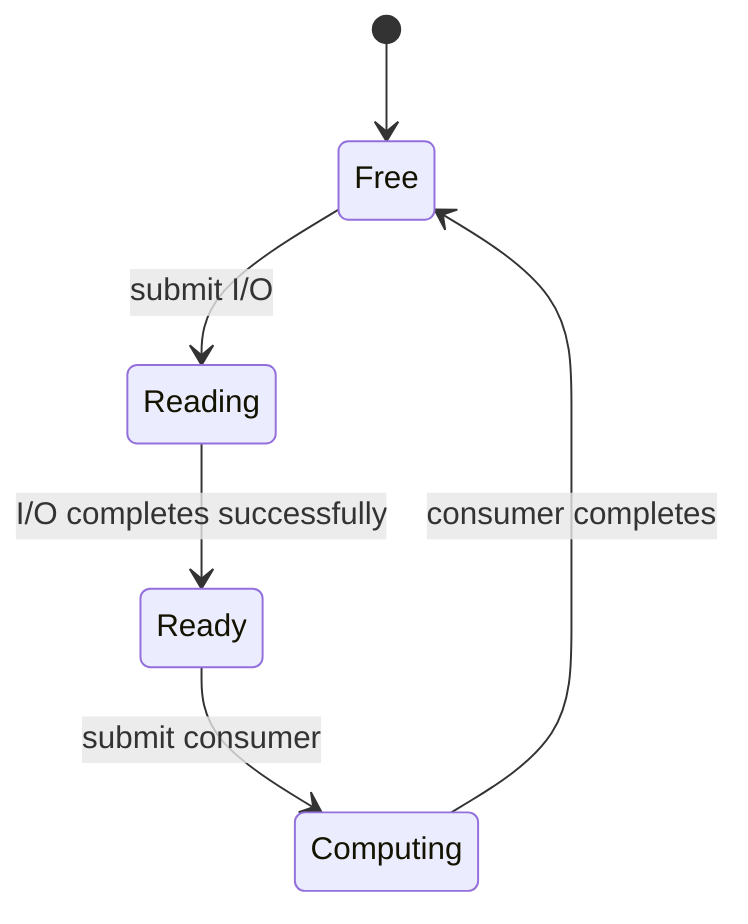

# 04 — cuFile API: counts, offsets, and ownership

A storage API call is correct only when it transfers the intended bytes into a
buffer whose lifetime covers every consumer. This lesson starts with that
contract, then maps it to cuFile.

**Prerequisite:** [supported setup](03-Software-Stack.md). **Artifact:** an exact
payload round trip and a trace showing when a buffer can be reused. Allow 1–2
hours for CPU study; GPU execution requires the supported stack. API examples
are source-checked on October 18, 2026, and **not compiled or run against a GPU
in this revision**.

## 1. Keep the resource lifecycle visible

The [cuFile API reference](https://docs.nvidia.com/gpudirect-storage/api-reference-guide/index.html)
distinguishes initialization/registration status from I/O byte counts:

| Operation | Role | Result to check |
|---|---|---|
| `cuFileDriverOpen` | Explicit initialization before timed work | `CUfileError_t` |
| POSIX `open` | Acquire an OS file descriptor | Descriptor or `-1`/`errno` |
| `cuFileHandleRegister` | Register that descriptor with cuFile | `CUfileError_t` |
| CUDA allocation | Acquire the destination buffer | CUDA status |
| `cuFileBufRegister` | Optional explicit buffer registration | `CUfileError_t` |
| `cuFileRead` / `cuFileWrite` | Synchronous transfer | `ssize_t` byte count or negative error |
| Deregistration/close/free | Release successfully acquired resources | Follow each function's signature |

After an error, release only resources that were actually acquired. In C++, use
RAII wrappers or a cleanup path that tracks acquisition. Do not hide calls with
side effects inside `assert`: a release build can remove assertions.

## 2. Check returned bytes, not a made-up status structure

This C++ fragment assumes a valid handle, buffer, size, and offsets; the caller
owns allocation and cleanup. It illustrates a strict whole-record contract:

```cpp
#include <cerrno>
#include <stdexcept>
#include <string>
#include <system_error>
#include <cufile.h>

// Inside an initialized, checked read operation:
ssize_t transferred = cuFileRead(handle, base, requested_bytes,
                               file_offset, buffer_offset);
if (transferred == -1) {
    throw std::system_error(errno, std::generic_category(), "cuFileRead");
}
if (transferred < 0) {
    throw std::runtime_error("cuFile operation error: " +
                             std::to_string(transferred));
}
if (static_cast<size_t>(transferred) != requested_bytes) {
    throw std::runtime_error("incomplete record: check EOF and transfer count");
}
```

Use the installed header and API documentation for interpreting negative cuFile
errors. A short successful read is different from a full record. Decide whether
your application retries a partial transfer or rejects incomplete input; never
pass uninitialized tail bytes into inference.

**Worked example:** a 12,345-byte file read in chunks of at most 4,096 bytes needs
lengths `4096, 4096, 4096, 57`. Rounding the last request up and pretending every
byte was read corrupts the record contract.

## 3. File offset and buffer offset are separate coordinates

Suppose the desired file region begins at byte 8192 and must land 4096 bytes into
a registered GPU allocation. The file offset is 8192; the buffer offset is 4096.
For a registered buffer, retain its registered base pointer and use the offset
argument according to the API contract. Validate that offset plus size fits the
allocation. A changed pointer can defeat the intended registered-buffer path.

A tensor adds another layer: shape, dtype, strides, byte order, and any header
must match the stored payload. Correct byte transfer is not proof of a correctly
interpreted tensor.

## 4. Alignment is a path condition, not a universal 512-byte rule

The synchronous API supports unaligned requests, although the implementation and
performance can differ. Consult the selected release's
[O_DIRECT requirements](https://docs.nvidia.com/gpudirect-storage/o-direct-guide/index.html)
and [best practices](https://docs.nvidia.com/gpudirect-storage/best-practices-guide/index.html)
for filesystem, pointer, size, and offset conditions. Modern cuFile use should not
be described as universally requiring an `O_DIRECT` descriptor.

The CPU lab models a hypothetical 4,096-byte aligned cover. Requesting 5,000 bytes
at offset 100 covers `[0, 8192)` at that granularity. The logical payload remains
`[100, 5100)`. If the file ends at 5100, the cover extends beyond EOF: alignment
arithmetic has not made those extra bytes exist.

Likewise, rounding an allocation's size does not prove its pointer alignment.
`numpy.require(..., ALIGNED)` concerns NumPy dtype alignment, not an arbitrary
4,096-byte requirement. State the allocator's actual contract and verify the
property needed by the selected path.

## 5. Completion makes reuse legal



Launching a GPU kernel is not the same as completing it. Returning its buffer to
a pool immediately can allow a later read to overwrite data still being consumed.
A synchronous `cuFileRead` blocks the calling thread until I/O completes; creating
an unrelated CUDA stream does not turn that call into stream-ordered async I/O.

For batch or stream APIs, follow the corresponding completion semantics in the
installed release and official [NVIDIA sample programs](https://github.com/NVIDIA/MagnumIO/tree/main/gds/samples).
Keep request descriptors, scalar parameters, file handles, buffers, and events
alive for the required duration. Submit only initialized entries: a batch capacity
of 16 does not justify submitting 16 requests when you filled only 3.

## 6. A documented Python route

Use the maintained [KvikIO Python API](https://docs.nvidia.com/kvikio/latest/python/)
and a compatible CUDA array implementation. Python imports use `kvikio`; the
installation distribution depends on the package manager and CUDA version
(for example, `kvikio-cu12` or `kvikio-cu13` on PyPI). After following the selected
version's [installation instructions](https://docs.nvidia.com/kvikio/latest/install/),
run this optional correctness example from a writable test directory. It creates
its own fixture and removes it afterward. It is **source-checked, not GPU-tested
here**; the required CPU exercise below has no CUDA dependencies.

```python
import hashlib
from pathlib import Path
import tempfile

import cupy as cp
import kvikio

expected = bytes((i * 17 + i // 256) % 256 for i in range(4096))
with tempfile.TemporaryDirectory(prefix="kvikio-record-", dir=".") as directory:
    fixture = Path(directory) / "record.bin"
    fixture.write_bytes(expected)
    payload = cp.empty(len(expected), dtype=cp.uint8)
    with kvikio.CuFile(fixture, "r") as source:
        count = source.read(payload)
    if count != len(expected):
        raise RuntimeError(f"short record: received {count} bytes")
    received = cp.asnumpy(payload).tobytes()
    if received != expected:
        raise RuntimeError("payload differs from the independent CPU fixture")
    print("Payload matches:", hashlib.sha256(received).hexdigest())
# This confirms correctness through the selected path, not direct DMA or speed.
```

The tiny 4 KiB request intentionally tests correctness. The documented default
`gds_threshold` is 16 KiB: smaller parallel reads use KvikIO's POSIX shortcut, and
`read` is the blocking form of `pread`. Thus this example normally bypasses GDS
even on a capable machine. In a later direct-path experiment, record the actual
threshold and compatibility settings, use a suitable larger request, and verify
the observed path. KvikIO's compatibility mode and cuFile's own compatibility
mode are separate settings; disabling one does not establish direct DMA.
See [KvikIO runtime settings](https://docs.nvidia.com/kvikio/latest/runtime_settings/).

Pin the actual KvikIO, CUDA, and CuPy versions in your experiment environment.
Do not put CUDA/cuFile initialization into forked DataLoader workers without a
supported process and ownership design.

## Practice and answer guidance

Run the [CPU contract program](labs/io_contract.py) and its tests:

```bash
python3 -m unittest discover -s 'Phase 5 - Advanced Topics and Specialization/Track A - GPU Infrastructure/Nvidia GPU/HPC Setup/GPUDirect-Storage/labs' -p 'test_*.py'
```

1. **Predict the last chunk** after changing the fixture size to 12,288. It is
   4,096 bytes at offset 8,192; there is no empty fourth chunk.
2. **Inject truncation.** The expected behavior is an explicit incomplete-record
   failure, not zero padding reported as successful input.
3. **Try early reuse.** The ownership model rejects another read while compute
   owns the buffer. A real port needs actual completion events to enforce it.
4. **Independent transfer:** add a record header and two tensors. Validate logical
   shapes, byte ranges, and the first/last element of each tensor independently.

Continue to [measurement and tuning](05-Performance-Tuning.md) after correctness
passes. CPU fixtures verify these small contracts; they do not validate a GPU API
binding or storage performance.
