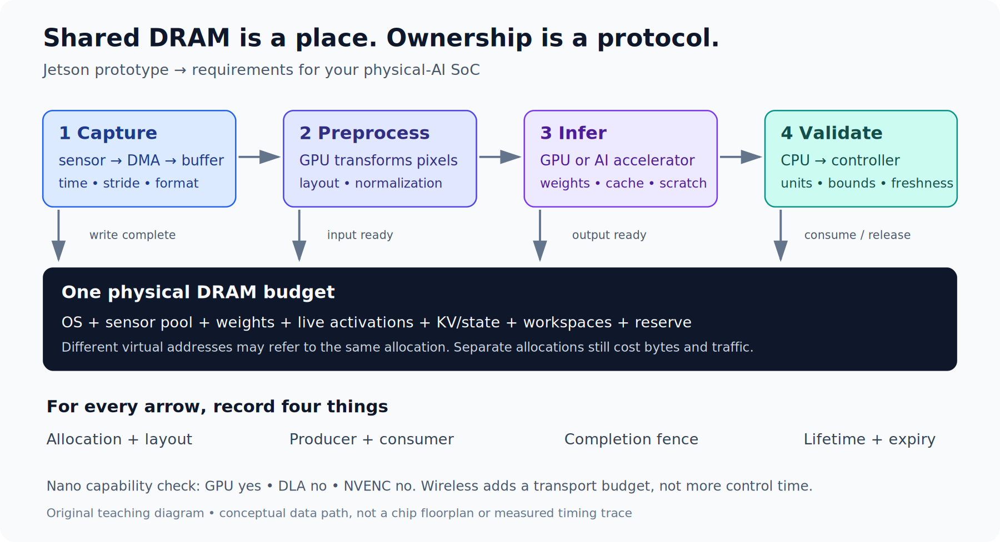

# Track C: Edge AI you can measure and explain

**Reviewed 18 October 2026.** Learn to deploy models under memory, latency, sensor, power and update constraints. Start on a CPU, then carry the same contracts and measurements to a supported device. You do not need to buy hardware to complete the numerical and replay exercises.

**Prerequisites:** [Python and systems foundations](../../Start-Here.md), [AI workloads](../../Phase%203%20-%20Artificial%20Intelligence/Guide.md), and basic matrix/probability calculations. For device deployment, add [embedded systems](../../Phase%202%20-%20Embedded%20Systems/Guide.md) and the relevant platform course. Use the [learning guide](../../Learning-Guide.md) to predict, run, explain one failure, and review after two days and one week.

Shared DRAM does not remove format conversion, access cost, or synchronization. A fast inference kernel can still produce a stale result if input collection and queues are slow.

## Begin with three short experiments

| Session | Run and learn | Required output |
|---|---|---|
| 1: memory and shapes, 60–90 min | [Edge LLM inference lab](Edge%20LLM%20Inference%20Internals/Lecture-01.md) | projection table, weight/KV budget, eight passing checks |
| 2: model output contracts, 60–90 min | [Tool-dispatch evaluation](Agent%20Tool-Dispatch%20Evaluation%20with%20BFCL/Lecture-01.md) | a passing report and a deliberately failing report; ten checks |
| 3: streaming and distribution shift, 60–90 min | [Wireless receiver lab](AI-Driven%20Wireless%20Communication/Lecture-01.md) | measured BER, changed-channel failure and lossless windowing; nine checks |

All three required paths use the Python standard library. The wireless lesson also includes an actually executed Sionna 2.2.0/PyTorch CPU example. Follow its optional environment instructions separately.

These are tests of mechanisms. They do not establish pretrained model quality or target-device performance. Each lesson states exactly what executed and what remains an optional hardware experiment.

## Choose a specialization route

| Route | Lessons | What you learn to preserve |
|---|---|---|
| Small/large language-model inference | [Qwen six-lesson course](Qwen%20Inference%20Optimization/README.md) and [CPU lab](Qwen%20Inference%20Optimization/Lab-Guide.md) | checkpoint shapes, positions, scales, cache state, parallel reductions, performance workload |
| Current multimodal edge-model deployment | [Gemma 4 six-lesson course](Gemma%204%20Edge%20Deployment/README.md) | total versus effective weights, local/global attention, physical cache sharing, processor and assistant pairing |
| Radio/stream processing | [Wireless course](AI-Driven%20Wireless%20Communication/Lecture-01.md) | sample order, signal/noise conventions, radio deadlines and network-control interfaces |
| Camera/robot perception | [Jetson platform](../../Phase%204%20-%20Track%20B%20-%20Nvidia%20Jetson/1.%20Nvidia%20Jetson%20Platform/Guide.md) and [robotics foundations](../Track%20D%20-%20Robotics/Guide.md) | sensor formats, timestamps, frames, observation age and controller boundaries |
| MCU inference | [Embedded systems](../../Phase%202%20-%20Embedded%20Systems/Guide.md) and [inference optimization](../../Phase%204%20-%20Track%20C%20-%20DL%20Inference%20Optimization/Guide.md) | static memory, supported operators, input quantization and measured cycle/energy budget |

The Qwen route supplies 14 portable checks plus a current Transformers 5.20.1 CPU/cache exercise. The Gemma route supplies seven cache/metadata checks plus executed meta-device architecture inspection. Model weights and target accelerators are optional extensions, with explicit validation limits.

## Build a complete system in eight steps

### 1. Write a workload contract

Choose one task: local tool selection, object detection from recorded frames, keyword recognition, or radio demapping. Define input schema, sampling/capture rate, expected output, task metric, memory limit, and maximum acceptable result age. Give every dimension and timestamp a unit.

**Worked timing example:** an observation is captured at 1,000 ms, inference completes at 1,070 ms, and its consumer uses it at 1,180 ms. Computation may be only 40 ms, but observation age is **180 ms**. A 150 ms validity limit rejects it. Improving inference by 10 ms while adding a 30 ms queue worsens age by 20 ms.

### 2. Establish a simple reference

Use a known algorithm or an unoptimized model with fixed inputs. In the wireless lab this is an analytic matched detector. In the dispatcher lab it is an exact fixture response and local simulator. In the model routes it is a pinned configuration and supported numerical implementation. A smaller random model can test interfaces but cannot establish pretrained task quality.

Keep training/calibration and held-out evaluation separate. Split sensor data by recording/session/environment where adjacent samples are correlated. Save at least one case that fails when you intentionally change the input contract.

### 3. Budget memory and movement

List weights, KV/state, activations, scratch, sensor buffers, runtime, OS and reserve. Separate resident bytes from bytes touched per inference. Count scale metadata and mixed formats. For shared buffers, count each physical allocation once and document ownership; a shared address does not remove synchronization requirements.

**Worked capacity example:** two 1,920×1,080 RGB8 frame buffers use `2*1920*1080*3=12,441,600` bytes before alignment. At 30 frames/s, one copy of the RGB payload moves 186.624 MB/s. An NV12 or RAW pipeline has different formats and strides; recompute from its actual layout.

### 4. Choose one supported runtime path

Check model architecture, operations, quantization layout, modality processor, CPU architecture, accelerator, driver/BSP and runtime version together. Start with one correct inference before comparing runtimes. TensorRT, ONNX Runtime, LiteRT, TFLM and vendor backends have different contracts; “supports 4-bit” is not enough.

For Jetson, use the maintained [compatibility matrix](../../Phase%204%20-%20Track%20B%20-%20Nvidia%20Jetson/Compatibility.md). Current datacenter package versions are not automatically supported on JetPack. For a model conversion, retain source and output hashes, converter version and preprocessing/template settings.

### 5. Connect a bounded sensor or replay pipeline

Preserve capture timestamps, sequence IDs, coordinate frames, sample formats and partial windows. Define queue capacity and overflow policy. A latest-frame queue can suit a perception task; dropping arbitrary samples can break a signal decoder. Restarted producers need an epoch so old data cannot masquerade as fresh output.

Use recorded or synthetic inputs first. Report drops and stale-result rejections along with successful work. A classifier's confidence or generated JSON does not by itself authorize a robot movement; the robotics course defines the additional action contract.

### 6. Optimize one measured cost

Separate preprocessing, inference, postprocessing, queueing and transfer. Test one change while preserving task inputs and quality evaluation. Examples include a supported lower-precision representation, a fused projection, a smaller image budget, bounded buffering or a different batch size.

Report latency distributions and workload, not only average FPS. Batching can improve completed throughput while increasing one request's wait. A source-derived roofline estimate is a hypothesis; a measured trace decides whether it explains the result.

### 7. Test sustained behavior and recovery

On actual hardware, record power mode, temperature, clocks, memory and background load during a sustained workload. Distinguish cold startup from steady state. Inject an input gap, oversized request, expired result and restart. Check that the next request receives the right state and buffer contents.

Without hardware, run the numerical/replay failure cases and label power, thermal and target timing as **not run**. Do not replace those measurements with a vendor TOPS number.

### 8. Package and update the artifact

Save model/processor/config hashes, runtime compatibility, input/output schemas and health checks. Define how a version is admitted, how a failed update is detected, and how a known-good version is restored. A process restart test is not a boot-slot rollback test. Use the platform course for device-specific OTA and storage procedures.

A deployment decision should state the accepted workload and the evidence that supports it. If a configuration fails, retain its result and explain whether quality, memory, timing, compatibility or recovery caused rejection.

## Finish with a reproducible case study

Submit the workload contract, code/configuration, passing and deliberately failing cases, raw results and source/package identities. Include separate columns for **executed**, **calculated**, and **not run**. Hardware-dependent claims need a named device and workload; the CPU route can finish with a rigorous numerical/replay case study and an explicit device experiment plan.

A useful capstone is one well-explained system: an offline tool dispatcher with measured quantization quality, a timestamped camera perception replay, a bounded radio classifier, or an MCU keyword pipeline. Carry its timing/memory/schema contract into [robotics](../Track%20D%20-%20Robotics/Guide.md), [autonomous vehicles](../Track%20E%20-%20Autonomous%20Vehicles/Guide.md), or [ML systems engineering](../Track%20G%20-%20ML%20Systems%20Engineering/Guide.md).
