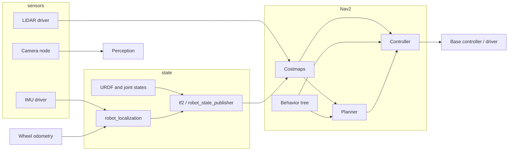

# Lecture 1: Advanced Robot Operating System (ROS / ROS 2)

**Prerequisites:** complete the [Robotics Foundations diagnostic and labs](../Robotics%20Foundations/README.md), especially frames, timestamps, feedback, and planning. This lecture integrates those ideas. **Layer mapping:** robot application, middleware/runtime, and embedded interfaces. **Artifact:** a reproducible ROS graph with a known transform, timing record, and a detected integration fault. **Next:** industrial deployment or perception below.

**Practice alongside this survey:** the [QoS and backlog integration lab](Integration-Lab.md)
contains a worked queue model, four actual ROS publisher/subscriber compatibility
cases, and two late-subscriber experiments. It names the executed Jazzy baseline
and the current distribution choices; use one coherent package set.

## Overview

This lecture treats **ROS 2** as the integration layer between **sensors**, **estimators**, **planners**, and **actuators** on real robots. Unlike a shallow tutorial that only publishes strings on a topic, the goal here is a **systems** view: you can explain why Nav2 drops commands when TF is wrong, why a bag replay desynchronizes without matching QoS, and how manipulation and navigation coexist in one compute graph.

**By the end of this lecture you should be able to:**

* Draw the ROS 2 **compute graph** for a mobile manipulator (base + arm) and name the main message types on each edge.
* Configure **DDS QoS** for sensor streams vs low-rate commands and justify the choice.
* Trace a navigation failure through **TF2**, **costmaps**, and **Nav2** recovery behaviors.
* Compare **SLAM** back ends (SLAM Toolbox, Cartographer, RTAB-Map) at a “which tool for which robot” level.
* Describe how **`robot_localization`** fuses odometry and IMU into a filtered state for Nav2.
* Outline the **MoveIt 2** planning scene → planner → trajectory → `ros2_control` execution path.

---

## Recommended courses (this track)

Structured courses that align with this lecture (full catalog: [The Construct — Robotics & ROS](https://www.theconstruct.ai/robotigniteacademy_learnros/ros-courses-library/)):

* [ROS 2 Basics in Python](https://app.theconstruct.ai/courses/ros2-basics-in-5-days-v2-python-268/) or [ROS 2 Basics in C++](https://app.theconstruct.ai/courses/ros2-basics-in-5-days-c-325/) — pick one language first, then add the other.
* [TF ROS 2](https://app.theconstruct.ai/courses/tf-ros2-217/) — frames and `robot_state_publisher` patterns.
* [Intermediate ROS 2](https://app.theconstruct.ai/courses/intermediate-ros2-113/) — launch, parameters, QoS, lifecycle.
* [ROS 2 Navigation](https://app.theconstruct.ai/courses/ros2-navigation-galactic-109/) and [Advanced ROS 2 Navigation](https://app.theconstruct.ai/courses/advanced-ros2-navigation-116/) — Nav2-style stacks.
* [ROS 2 Manipulation Basics](https://app.theconstruct.ai/courses/ros2-manipulation-basics-81/) or [ROS 2 Manipulation & Perception](https://app.theconstruct.ai/courses/ros2-manipulation-perception-master-103/) — MoveIt 2–style manipulation.
* [Robotics Specialization](https://www.coursera.org/specializations/robotics) (University of Pennsylvania) — aerial robotics, planning, perception, mobility, capstone; strong on math and control (often MATLAB in assignments; not ROS-version-specific).

**Official references (bookmark these):**

* [ROS 2 documentation](https://docs.ros.org/) (select a named distribution compatible with your OS and packages; the linked foundation exercise uses Jazzy).
* [Navigation2](https://navigation.ros.org/)
* [MoveIt 2](https://moveit.picknik.ai/)
* [ros2_control](https://control.ros.org/)

---

## 1. ROS 2 architecture: graph, DDS, and executors

### 1.1 Mental model

ROS 2 uses a middleware abstraction rather than the ROS 1 master. In the DDS-based setup used in this lesson, participants discover peers under the configured network and middleware rules. **Topics** carry typed streams; **services** handle request/response; **actions** support long-running goals with feedback, cancellation, and results. Discovery does not make frame, unit, or timing contracts agree automatically.



### 1.2 QoS: why your bag “almost” works

**Quality of Service** profiles control policies including reliability, history, durability, and deadline. Compatibility is directional: a **best-effort publisher cannot satisfy a reliable subscriber**, but a **reliable publisher can satisfy a best-effort subscriber**. All other required policies must also be compatible. An incompatible pair may exchange no messages; this differs from occasional loss on a compatible best-effort connection. [ROS 2 Jazzy QoS source](https://github.com/ros2/ros2_documentation/blob/jazzy/source/Concepts/Intermediate/About-Quality-of-Service-Settings.rst)

| Traffic type | Typical reliability | Notes |
|--------------|---------------------|--------|
| Camera / LiDAR at high rate | Often **best effort** | Lossy OK; reduce backlog |
| Command / goal | Often **reliable**, according to the interface | Retries do not guarantee freshness or a control deadline; define expiry and timeout behavior |
| TF (if using `/tf` heavily) | Match publisher | Mismatches cause missing transforms |

**Practical rule:** Inspect both endpoints with `ros2 topic info /topic_name --verbose`; check offered/requested compatibility and backlog. A bag recording/replay also needs its own QoS configuration checked against the live endpoints. Matching topic names and types is insufficient.

### 1.3 Lifecycle nodes

Many Nav2 and ros2_control components are **managed nodes** (unconfigured → inactive → active). Launch files bring the stack up in order; a node in the wrong state yields empty behavior trees or zero velocity. When something “does nothing,” check **lifecycle state** before diving into parameters.

### 1.4 Executors and threading

Single-threaded executors are simpler; **multi-threaded** executors help when callbacks must not block each other (e.g. heavy perception). Cost: you must reason about **locks** and **callback re-entrancy**. For learning, start single-threaded; add threads when profiling shows starvation.

Adding executor threads alone may change nothing: callbacks in one node's default
**mutually exclusive callback group** still cannot overlap. Separate groups or
reentrant groups permit concurrency, which then requires appropriate shared-state
ownership. A synchronous service wait can deadlock if the response callback needs
the group currently held by the waiting callback. Prefer an asynchronous flow
and measure the actual critical path. [Jazzy callback-group guide](https://github.com/ros2/ros2_documentation/blob/jazzy/source/How-To-Guides/Using-callback-groups.rst)

---

## 2. TF2: the spine of robotics integration

**TF2** maintains a **time-varying tree** of coordinate frames. A typical mobile manipulator has `map` → `odom` → `base_link`, then separate camera and arm/tool branches under the base. A tool is not normally a child of a fixed camera. Nav2 depends on consistent **map–odom–base_link** semantics; manipulation depends on the arm and tool transforms too.

**Common failures**

* **Missing transform:** Usually forgotten `static_transform_publisher`, wrong timestamp, or sensor publishing in the wrong frame.
* **Extrapolation into the future:** The requested time is newer than the latest available transform; investigate publisher lag, clock mismatch, and timestamp assignment.
* **Extrapolation into the past:** The requested time precedes the retained history; investigate old queued observations or insufficient history. Increasing buffer length does not cure a clock mismatch.

**Debugging commands**

* `ros2 run tf2_tools view_frames` (generate PDF of the tree).
* `ros2 topic echo /tf --once` combined with `tf2_monitor`.

**Study focus:** `odom` provides a continuous local reference that can drift; `map` provides a globally corrected reference whose estimate can jump during localization corrections. Neither guarantees zero physical error. `base_link` is attached to the robot body. [ROS REP-105 source](https://github.com/ros-infrastructure/rep/blob/master/rep-0105.rst)

---

## 3. Tools: bags, RViz2, rqt, launch

| Tool | Use |
|------|-----|
| `ros2 bag record` / `play` | Reproduce bugs without hardware; tune Nav2 on identical data |
| `rviz2` | Visualize TF, costmaps, laser scans, planned paths |
| `rqt_graph` / `rqt` | Inspect graph and tune dynamic parameters |
| `ros2 launch` | Compose parameterized stacks; use YAML for overrides |

**Bag workflow:** Record **all inputs** needed to replay the failure (TF, scans, cmd_vel, odometry). Name bags with **date + scenario**; document ROS distro and package versions alongside.

---

## 4. Nav2: navigation stack

Nav2 is a **behavior-tree-driven** stack: it selects among **compute path**, **follow path**, **recovery** (spin, backup, wait), and **global localization** behaviors depending on costmap state and planner feedback.

### 4.1 Costmaps

* **Global costmap:** Long-horizon planning over mostly static obstacles.
* **Local costmap:** Short horizon, updated fast; feeds the **controller** (often DWB, RPP, or similar plugins).

Inflation layers turn obstacles into **gradients** so the robot does not graze corners. Wrong **footprint** or **inflation radius** is a top cause of “robot never enters doorways.”

### 4.2 Planners

**Global planner** examples: NavFn, Smac Planner (grid-based, often better in structured spaces). **Controller** follows the local costmap and produces `cmd_vel`. When the robot oscillates or stops, split the issue: **global path** vs **local tracking**.

Check the installed `cmd_vel` interface with `ros2 topic info /cmd_vel --verbose`
and inspect the matching message definition. A topic name alone does not tell
you whether the configured endpoints use `Twist` or `TwistStamped`, which frame
they expect, or how an old command expires. A timestamped message still needs a
consumer that validates the timestamp against the intended clock.

### 4.3 Recovery

Recoveries exist because **local minima** happen in real buildings. Learn to read **Nav2 logs** to see which recovery fired and why.

---

## 5. SLAM and localization

You rarely “use SLAM” as a black box without choosing a **map representation** and **sensor suite**.

| Package | Typical use | Notes |
|---------|-------------|--------|
| **SLAM Toolbox** | 2D LiDAR, lifelong mapping | Popular on mobile bases |
| **Cartographer** | 2D/3D, submaps | Upstream is no longer actively maintained; assess the particular ROS fork and release before adopting it |
| **RTAB-Map** | RGB-D, stereo, LiDAR | Strong when cameras are primary |

The [Cartographer repository](https://github.com/cartographer-project/cartographer)
explicitly describes its maintenance status. An existing tutorial or binary
package does not by itself imply ongoing feature development or compatibility
with a new ROS distribution.

**Localization without mapping:** Once a map exists, **AMCL** (or an appropriate alternative) estimates the robot pose in that map. Combined with the odometry pose, localization can provide **map → odom** while the local estimator provides **odom → base_link**. Give each transform one authoritative publisher; do not publish conflicting estimates on the same edge.

---

## 6. Sensor fusion: `robot_localization`

`robot_localization` implements **EKF/UKF** to fuse configured odometry, pose,
velocity, and IMU measurements. Choose the state components each sensor actually
observes and supply covariance in the required frame. Raw `NavSatFix` is not a
Cartesian EKF input: `navsat_transform_node` combines geographic position,
heading, and a world-frame odometry reference to produce compatible odometry.
[Geographic transform documentation](https://github.com/cra-ros-pkg/robot_localization/blob/rolling-devel/doc/navsat_transform_node.rst)

For example, wheel-derived position and wheel-derived velocity may come from the
same encoder samples. Treating both as independent measurements can count the
same evidence twice. A local continuous estimator and a globally corrected
estimator also serve different frame roles: keep jumps from global corrections
out of the continuous `odom` trajectory and give each TF edge one owner.

**Why it matters:** complementary measurements can reduce some errors, while
slip, IMU bias, wrong covariance, or duplicated information can still corrupt
the fused state. Inspect innovations and compare with independent evidence.

---

## 7. `ros2_control`: from messages to torque

**ros2_control** separates **hardware interfaces** (read joints / write efforts) from **controllers** (PID, trajectory following). MoveIt 2 typically sends **trajectories** to a trajectory controller; mobile bases use **diff_drive** or similar.

Work through [torque and actuator limits](../Robot%20Dynamics%20and%20Task%20Execution/Lecture-01-Dynamics.md)
before interpreting a successful command submission as physically achievable
motion. The interface can expose position, velocity, or effort commands according
to the hardware and controller configuration.

Conceptual pipeline:

```text
MoveIt 2 → FollowJointTrajectory action → joint trajectory controller → hardware interface → driver
```

The action carries a joint trajectory and provides execution feedback/result semantics. Some controllers also expose a trajectory topic; check the installed configuration. You do not need to write a custom hardware interface on day one, but you **do** need to know which **controller is active**, which **joint names** match the URDF, and whether commands represent positions, velocities, or efforts. [MoveIt controller configuration](https://moveit.picknik.ai/main/doc/examples/controller_configuration/controller_configuration_tutorial.html), [Jazzy joint trajectory controller](https://control.ros.org/jazzy/doc/ros2_controllers/joint_trajectory_controller/doc/userdoc.html)

---

## 8. MoveIt 2: manipulation

**MoveIt 2** connects **perception (optional)** → **planning scene** (collision geometry) → **motion planner** (OMPL, Pilz, CHOMP, …) → **trajectory execution**.

* **Planning scene:** Mesh and primitive obstacles; often updated from depth or table plane segmentation.
* **Planning groups:** Arm vs gripper; **end-effector** poses are planned in Cartesian or joint space.
* **Pipeline integration:** Pick-and-place is **state machine** glue: locate object → plan approach → grasp → retreat → place.

Check the timed and interpolated motion after planning, including attached-object
geometry. Then evaluate the object, not only the tool pose: the
[grasp/task-success exercise](../Robot%20Dynamics%20and%20Task%20Execution/Lecture-04-Grasp-and-Task-Success.md)
shows two identical hand motions with different pick outcomes.

---

## 9. Integrated projects (from this roadmap)

* **Autonomous mobile robot:** SLAM → map → AMCL → Nav2 → goal poses in RViz2; log a bag and replay after changing costmap parameters.
* **Robotic arm:** URDF + MoveIt 2 config → plan in RViz2 → execute on sim (`ros2_control` + Gazebo) then on hardware if available.

---

## 10. Self-check

1. Explain the difference between **`map`→`odom`** and **`odom`→`base_link`** transforms.
2. Name two reasons Nav2 would publish **zero velocity** despite a valid goal.
3. Why might **increasing LiDAR rate** make TF lookups fail if timestamps are inconsistent?
4. What does **`robot_localization`** improve compared to raw wheel odometry alone?

**Answer guidance:** (1) `map → odom` applies global localization corrections; `odom → base_link` tracks continuous local motion. (2) An inactive controller or a blocked/invalid local costmap can prevent motion; inspect lifecycle and planner/controller feedback separately. (3) A higher rate does not fix clock inconsistency and may increase queued work; compare capture timestamps with transform availability. (4) A configured filter can combine complementary measurements and track uncertainty, but bad covariances, duplicated information, or wrong frames can make the fused result worse.

## 11. Build and measure the first integration

Start with the [known-transform ROS exercise](../Robotics%20Foundations/Lecture-06.md#optional-ros-exercise-inspect-a-known-transform). It names its teaching distribution and separates upstream-checked commands from local execution. Save the composed transform, endpoint QoS, and actual package versions. Then use a simulator or recorded sensor stream to connect one estimator and one consumer; capture source timestamps, receive timestamps, and the frame required at lookup time.

Inject one stale observation and show that the consumer rejects it or enters its documented fallback. Collect message-age distribution, missing-transform count, and missed update deadlines. Repeat on identical input after fixing the fault. Finish with the graph, configuration, raw trace, fault explanation, and reproduction commands. Merely seeing nodes in `rqt_graph` is not the completion criterion.

---

## Resources

* **Structured courses:** See **Recommended courses** above; the [main Robotics Application guide](../Guide.md) lists all tracks (§1–§3).
* **"Programming Robots with ROS"** by Quigley, Gerkey, and Smart — ROS concepts (ROS 1 heritage; still useful for ideas; pair with ROS 2 docs).
* **ROS 2 documentation:** [docs.ros.org](https://docs.ros.org/)
* **MoveIt 2 documentation:** [moveit.picknik.ai](https://moveit.picknik.ai/)

---

## Next in this roadmap

* **Industrial deployment, simulation, embedded:** [Lecture 2 — Industrial and Embedded Robotics](../Industrial%20and%20Embedded%20Robotics/Lecture-01.md)
* **Perception, tracking, deep learning:** [Lecture 3 — Advanced Perception and AI for Robotics](../Advanced%20Perception%20and%20AI%20for%20Robotics/Lecture-01.md)
