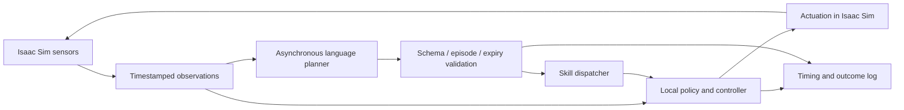

# Lecture 21 — Capstone: a language-guided robot with measured deadlines

**Prerequisites:** Lectures 14–20; optional [DeepSeek inference part](../../Track%20G%20-%20ML%20Systems%20Engineering/AI%20Inference%20Engineer%202026/Part%205%20-%20DeepSeek%20V4.1%20Flash%20NVFP4/README.md). **Time:** 4–6 hours integration plus evaluation. **Outcome:** connect asynchronous language planning to a tested simulated robot skill.

## Project brief

In a small Isaac Sim work cell, accept an instruction such as “move the red block to the left tray.” A language/vision service produces a bounded skill request; an Isaac Lab-trained or scripted skill executes it. Use DeepSeek V4.1 Flash only when the chosen deployment has passed the inference course's compatibility and quality gates. A deterministic planner stub is sufficient to develop the robotics half.

The language model is an asynchronous planner. It does not set the robot's hard control-loop period. Keep perception, skill execution, joint control, and timeout handling locally bounded.

The local controller owns its period and continues the defined behavior while the planner is pending. The log joins the two timelines by request and episode ID.

## Interfaces to define

| Boundary | Required fields |
|---|---|
| Scene observation → planner | Episode ID, observation time, object IDs, poses/frames, available skills |
| Planner → dispatcher | Episode ID, schema version, skill name, object/target IDs, expiry |
| Dispatcher → controller | Validated target in the controller frame, limits, skill state |
| Controller → evaluator | Success/failure reason, completion time, violations, last applied command |

Use allowlisted skill names and validate target existence and workspace constraints before execution. A syntactically valid JSON response can still name an absent object or stale episode.

A text-generating multimodal model is not automatically a VLA policy. Converting its output into a discrete skill plan is an application design choice; it does not establish learned low-level robot control.

## Worked latency budget

Suppose the local policy runs at 50 Hz while a planner takes 2 seconds. The control loop must continue its documented hold or ongoing skill behavior for about 100 cycles. Blocking the physics/control thread on the planner request destroys this separation.

If the planner shares a GPU with RTX rendering and policy inference, test resource contention explicitly. The full DeepSeek checkpoint generally requires a separate capacity-planned service; do not assume it fits alongside simulation on a workstation.

## Integration lab

1. Start with a scripted skill and a planner stub returning a fixed valid plan.
2. Test wrong schema, unknown object, expired command, and previous-episode response.
3. Add measured network delay, dropped responses, and retries with duplicate request IDs.
4. Connect an evaluated model service only after the dispatcher tests pass.
5. Compare stub and model outcomes on the same held-out scenes.
6. Sweep inference load while measuring robot observe-to-act latency and task success.
7. Save every prompt/response, scene ID, dispatch decision, and controller outcome.

Keep evaluation scenes distinct from prompt-development scenes. Include ambiguous language and unavailable targets so the system can demonstrate a clear refusal to dispatch an invalid skill.

## Final evidence

Submit the scene/task/policy manifest, interface schema, rejection tests, timing traces, success/failure counts with uncertainty, GPU memory profile, and a video illustrating one success and one handled failure. The video supplements the logs.

Use the [shared rubric](../../../Learning-Guide.md#completion-rubric). Passing requires correct stale/invalid-plan handling and a reproducible simulated demonstration. If the language service was stubbed, state that explicitly; full-model inference and real-robot transfer remain separate milestones.

## Self-check

Explain why a faster planner may not improve task completion time, why a language-model benchmark cannot certify robot success, and how a delayed response from episode k is prevented from acting in episode k+1.

[Previous](Lecture-20.md) · [Lab sequence](Lab-Guide.md) · [Course overview](README.md)
