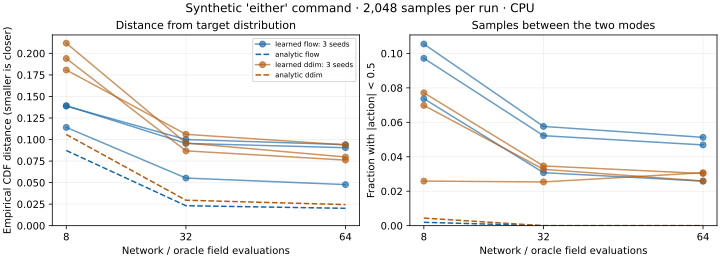

# Action generation: learn diffusion and flow with a tiny distribution

[Lecture 11](Lecture-11.md) · [Lecture 12](Lecture-12.md) · [Lab guide](Lab-Guide.md)

**Time:** 20–30 minutes for the arithmetic, 45–90 minutes for training and interpretation. **Hardware:** CPU. **First route:** Python standard library. **Optional training:** CPU PyTorch. You will inspect why an average action can be wrong, run two numerical samplers, train both objectives, reload the resulting models, and break the conditioning and time direction deliberately.

This lab uses one normalized action coordinate and three supplied category labels. It has no images, learned language encoder, physical dynamics, or robot controller. It is a worked experiment for the equations, not a small reproduction of ACT, Diffusion Policy, or π₀.

## Predict before running

The synthetic demonstrations have standard deviation 0.1. `left` draws from a Gaussian centered at −1; `right` draws from one centered at +1; `either` draws equally from both. Each training example supplies one action, its label, fresh Gaussian noise, and a noise level or interpolation time.

What should a squared-error point predictor output for `either`? Its population optimum is zero. But almost none of the demonstrations lie near zero. A correct mean is therefore a poor description of the action distribution. We will measure the fraction of generated samples between −0.5 and +0.5, as well as the entire cumulative distribution.

These Gaussians are unbounded mathematical fixtures. The reported fraction outside ±1.5 is an outlier diagnostic. It is not a physical actuator limit, and the generated numbers are not commands to send to hardware.

## First run: check the equations without installing a framework

From the **repository root**:

```bash
VLA_ACTION_COURSE='Phase 5 - Advanced Topics and Specialization/Track D - Robotics/VLA Foundations to Frontier 2026'
python3 -m unittest discover -s "$VLA_ACTION_COURSE/labs" -p 'test_action_math.py' -v
```

The seven tests use independent checks: perfect-noise reconstruction, a finite-difference derivative of mixture density, the known Gaussian marginal trajectory, both sides of empirical CDF jumps, and deterministic normal quantiles. They also reject invalid schedules and detect a reversed flow direction. No neural network runs in this first step.

Open [action_math.py](labs/action_math.py). Its oracle knows the specified distribution, rather than the hidden component or exact clean action that produced a noisy observation. This distinction matters: the population optimum predicts a **conditional expectation**, not an inaccessible per-example answer.

For one Gaussian component with mean \(m\), the diffusion-corrupted variable has mean \(\sqrt{a}m\) and variance \(a\sigma^2+1-a\), where \(a=\bar\alpha\). For a mixture, Bayes weights say how plausible each component is at the observed noisy value. The oracle epsilon is the weighted conditional mean noise. The test independently verifies the identity \(\epsilon^*(x)=-\sqrt{1-a}\,\partial_x\log p_a(x)\).

For flow matching, \(X_t=(1-t)Z+tA\) and target velocity is \(A-Z\). Within one component,

\[
\operatorname{Var}(X_t)=(1-t)^2+t^2\sigma^2,\qquad
\operatorname{Cov}(A-Z,X_t)=t\sigma^2-(1-t).
\]

These determine the conditional mean velocity; mixture weights combine the components. A useful single-Gaussian check is the exact marginal trajectory \(X(t)=tm+\sqrt{(1-t)^2+t^2\sigma^2}\,Z\). Differentiate it and compare with `flow_velocity`.

## Two samplers, two explicit conventions

| Choice | Diffusion experiment | Flow experiment |
|---|---|---|
| Training target | Added Gaussian noise \(\epsilon\) | Velocity \(A-Z\) |
| Starting state | Gaussian noise at index 64 | Gaussian noise at time 0 |
| End state | Clean index 0 | Data time 1 |
| Update | DDIM with \(\eta=0\) | Forward Euler |
| Inference budget | 8, 32, or 64 network evaluations | 8, 32, or 64 network evaluations |
| Extra numerical choice | Reconstructed clean value clipped to ±2 in the learned sampler | No clipping |

DDIM jumps use the cumulative signal powers of **both selected endpoints**. Skipping iterations of a DDPM update would be a different and generally inconsistent procedure. The supplied cosine signal schedule ends at \(10^{-4}\), so its terminal distribution is close to Gaussian noise but not exactly equal to it. Starting from a standard Gaussian is an approximation recorded in the result. The clean-value clipping is also recorded; it can change the sampled distribution. The 64-level schedule must remain strictly decreasing; this particular fixed-floor construction rejects more than 157 levels because they would duplicate endpoints. Increasing training levels requires changing the training and sampling contract together. [DDIM paper, v4](https://arxiv.org/abs/2010.02502v4)

Flow uses zero for noise and one for data. The pinned openpi code discussed in Lecture 12 reverses this convention. Both directions can work with matching targets and integration signs. Here, negating the learned field while still integrating from zero to one is a deliberate failure, not another valid convention. [Flow matching paper, v2](https://arxiv.org/abs/2210.02747v2)

## Train real models on CPU

Use the course's existing CPU PyTorch environment if available. To create the recorded Linux x86-64 / CPython 3.12 environment, run this setup from the **repository root**. Installation downloads PyTorch; the arithmetic route above needs no download. The hash lock is platform-specific, not a universal installation recipe.

```bash
python3.12 -m venv /tmp/course-vla-actions-venv
/tmp/course-vla-actions-venv/bin/python -m pip install --require-hashes -r 'Phase 3 - Artificial Intelligence/2. Deep Learning Frameworks/PyTorch/CPU-Robot-Stop-Lab/labs/requirements-linux-cpu-py312.txt'
```

Then run from the repository root, keeping `VLA_ACTION_COURSE` from the first block:

```bash
/tmp/course-vla-actions-venv/bin/python -m unittest discover -s "$VLA_ACTION_COURSE/labs" -p 'test_action*.py' -v
/tmp/course-vla-actions-venv/bin/python "$VLA_ACTION_COURSE/labs/action_generation.py" --output /tmp/vla-action-run --updates 4000 --seeds 7 19 31
python3 "$VLA_ACTION_COURSE/labs/action_results.py" /tmp/vla-action-run/results.json
```

The supplied [training code](labs/action_generation.py) uses a 5,121-parameter MLP, one-hot categories, time features, batch size 256, Adam at 0.001, and one CPU thread. Each objective trains separately for 4,000 updates under each of three fixed seeds. Validation uses separately seeded noise/data from the **same synthetic distribution**; this is not an out-of-distribution test. All six final checkpoints are retained. There is no selection of the best seed or best validation checkpoint.

The program saves six `.pt` state dictionaries and `results.json`, loads each checkpoint, verifies exact output parity on a separate probe, and evaluates the restored model. Nonfinite or unequal reload outputs stop the experiment before sampling; a test deliberately changes a checkpoint bias to verify this failure path. Losses from the two objectives have different targets and are not directly comparable as model-quality scores. Sampling quality must be measured separately.

## Read the actual result

The recorded run used Python 3.12.3 and PyTorch 2.14.0+cpu. All 13 numerical/framework tests passed, including the actual tensor DDIM endpoint/clipping path and a corrupted-checkpoint rejection. Six trainings took about 32 seconds in total on this particular host; setup, tests, sampling, and reports are additional work. This timing is not a laptop runtime promise. The [saved result](labs/action-generation-results.json) retains every seed and condition; [validation metadata](labs/action-generation-validation.json) records source hashes and commands.

For the `either` command, each sampling run contains 2,048 values:

| Sampler | Evaluations | Empirical CDF distance, range over 3 training seeds | Fraction between modes, range |
|---|---:|---:|---:|
| Learned flow | 8 | 0.114–0.139 | 7.4–10.5% |
| Learned flow | 32 | 0.055–0.100 | 3.1–5.8% |
| Learned flow | 64 | 0.048–0.094 | 2.6–5.1% |
| Learned DDIM | 8 | 0.181–0.212 | 2.6–7.7% |
| Learned DDIM | 32 | 0.087–0.106 | 2.5–3.5% |
| Learned DDIM | 64 | 0.076–0.094 | 2.6–3.1% |



[Open the plot at full size](labs/action-generation.svg).

These are ranges across three training seeds, **not confidence intervals**. Noise is paired across labels and inference budgets within the learned experiment. The analytic experiment uses a separately generated Python noise sample; it is a reference distribution check, not a paired learned/oracle trial. At 64 evaluations, its empirical CDF distances are about 0.020 for flow and 0.024 for DDIM. Finite sample variation and integration error both remain.

The conditional-mean baseline puts every `either` action at zero: 100% between modes and CDF distance 0.5. The learned models represent both modes much better, while still having visible model and sampling errors. More integration steps do not guarantee every metric improves: the network is approximate, and the diffusion clipping can affect tails. Do not describe these results as a general ranking of diffusion versus flow policies.

The JSON also reports median time for three **warm batches of 2,048 samples**, after a warm-up call. It does not measure single-request latency, a vision encoder, cold startup, camera age, or robot control deadlines. Do not divide batch time by batch size and call that a robot's response latency.

## Break it, explain it, then extend it

The experiment generates right-conditioned samples but scores them against the left target. It also reverses the flow field. Read those failures in `negative_controls`; the correct label and sign are part of the model's interface. All six checkpoint reload probes had zero maximum absolute error in the recorded environment.

1. Predict why the point baseline has the correct `either` mean but the wrong samples. Explain using the distribution, not just a loss number.
2. Compare 8 and 64 evaluations for one fixed model and noise seed. Which remaining error can a better solver address, and which requires a better learned field?
3. Inspect left and right separately. A balanced `either` histogram can hide condition-specific errors.
4. Change one training seed or the demonstration standard deviation in a separate experiment. Retain the original result; do not overwrite it to report only the preferred run.
5. As an extension, replace the scalar with a correlated action chunk. Define masks and covariance, then check that generated trajectories remain coherent. The scalar lab alone does not validate this extension.

**Completion:** reproduce the tests, explain both oracle equations, retain the full three-seed report, identify at least one learned error and one injected failure, and state the execution boundary. Continue to the [dataset and execution lab](Dataset-and-Execution-Lab.md) to connect generated values to timestamps and action contracts.
