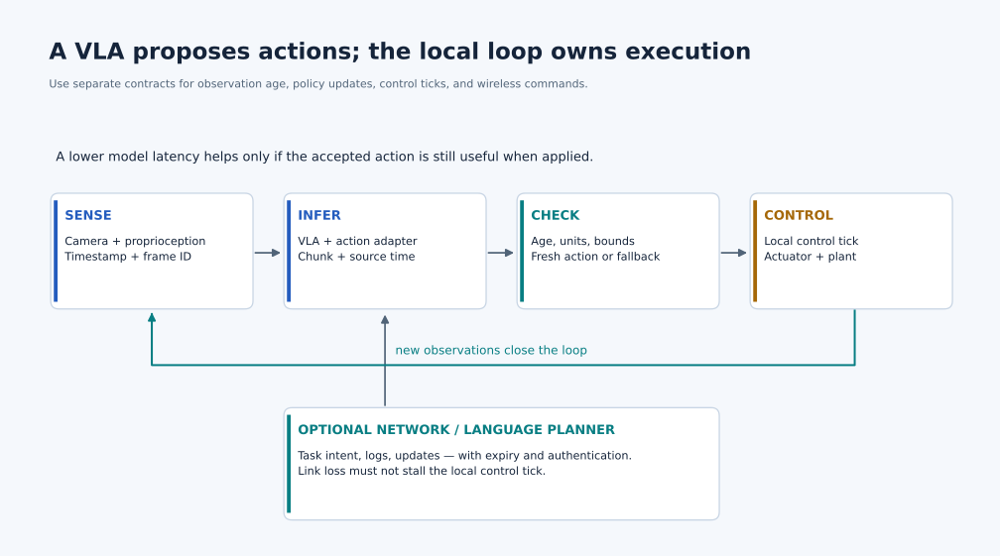

# VLA Optimization and Action-Parity Harness — Special Course

<div class="course-identity robotics" markdown="1">
<div class="course-identity__icon">VLA</div>
<div markdown="1">
<p class="course-identity__eyebrow">Phase 5 · Robotics · Special Course</p>
<p class="course-identity__title">Shrink and accelerate Vision-Language-Action policies until they run on a real robot, then prove the optimized policy still does the task.</p>
<p class="course-identity__meta">Artifact: optimized VLA + action-parity harness · Measure: tokens/s, control-loop latency, action MSE, task success-rate parity</p>
</div>
</div>

> *Optimization is only credible when the robot still picks up the cup.*

This special course pairs two halves that almost always have to ship together:

1. **VLA optimization** — quantization, KV/action-chunk caching, distillation, speculative action decoding, and runtime tricks that take a 3-7B-parameter Vision-Language-Action model from "runs in a notebook on a H100" to "runs at usable rate on a Jetson AGX Orin or a single workstation GPU on a real robot."
2. **Action-parity harness** — the measurement framework that decides whether each optimization is safe to deploy: per-step action error, trajectory divergence, closed-loop sim success-rate parity, and on-robot regression gating against a reference policy.

The two halves are inseparable: an optimization that you cannot measure against the reference policy is not an engineering result, it is a vibe.

**Comprehensive VLA companion:** [VLA Foundations to Frontier 2026](../VLA%20Foundations%20to%20Frontier%202026/README.md) provides 32 lectures spanning history, architectures, data, imitation/flow/RL training, evaluation, deployment, and the research frontier verified through October 13, 2026. Use its [CPU labs](../VLA%20Foundations%20to%20Frontier%202026/Lab-Guide.md) and capstones alongside this specialization.

**Scope:** inference and deployment of pretrained VLAs (released checkpoints such as OpenVLA, π₀ / π0.5, NVIDIA GR00T N-series, RDT, and Octo; RT-2/RT-2-X are research comparisons, not assumed downloadable deployment artifacts). This specialization focuses on inference; for VLA pretraining and fine-tuning use the comprehensive companion above. For deeper reinforcement learning, take the [Deep RL for Robot Learning](../Deep%20RL%20for%20Robot%20Learning/README.md) special course (imitation learning through RL post-training of π0.5), or the shorter [Robot Learning section of Lecture 3](../Advanced%20Perception%20and%20AI%20for%20Robotics/Lecture-01.md#c1-reinforcement-learning) of the Perception lecture.

**Layer mapping:** L3-L8. Touches model architecture, runtime / kernels, edge accelerators, ROS 2 integration, and the closed-loop sim / real evaluation harness.

**Role targets:** Robot Learning Engineer · Robotics Foundation-Model Engineer · Edge AI / Embodied AI Runtime Engineer · Applied Research Engineer (VLA deployment) · Eval Infra Engineer for Robot Foundation Models.

**Prerequisites:**

* Phase 5 — Robotics — [Advanced Perception and AI for Robotics, Part C (Robot Learning)](../Advanced%20Perception%20and%20AI%20for%20Robotics/Lecture-01.md) — you need to already understand what a VLA *is* and how it sits above ROS 2 skills.
* Phase 5 — Edge AI — [Qwen Inference Optimization](../../Track%20C%20-%20Edge%20AI/Qwen%20Inference%20Optimization/README.md) — the LLM half of a VLA is a transformer; the optimization toolkit transfers.
* Phase 4 Track B — [Jetson Real-Time Inference](../../../Phase%204%20-%20Track%20B%20-%20Nvidia%20Jetson/1.%20Nvidia%20Jetson%20Platform/Orin-Nano-Real-Time-Inference/Guide.md) — Jetson Orin is the default reference edge target.
* Phase 4 Track C — [Quantization](../../../Phase%204%20-%20Track%20C%20-%20DL%20Inference%20Optimization/04%20-%20Quantization/Guide.md) — quantization methods can transfer to supported VLA components, but calibration, runtime support, and closed-loop action quality require separate validation.

**What comes after:** a reproducible repo containing an optimized policy checkpoint, a runtime config, a harness CLI, a CSV of parity metrics across optimization levels, and an on-robot or closed-loop sim recording of the optimized policy hitting the parity bar.

---

## Lecture map

<div class="lecture-map" markdown>

| # | Title | Focus |
|---|-------|-------|
| 01 | [VLA Optimization for Real-Time Control](Lecture-01.md) | What a VLA actually executes per control tick · quantization of the LLM backbone · vision-tower fusion · action-chunk and KV caching · speculative action decoding · Jetson / single-GPU deployment paths |
| 02 | [The Action-Parity Harness](Lecture-02.md) | Reference vs candidate rollouts · per-step action error · trajectory divergence · closed-loop success-rate parity (LIBERO / RoboCasa / Isaac Lab) · tolerance budgets · CI gating · on-robot canary protocol |

</div>

Each lecture follows the standard *Why it matters → Mental model → Build it → Measure it → Ship it* shape from the [Curriculum Authoring Guide](../../../Curriculum-Authoring-Guide.md), with a self-check and a runnable lab.

---

## Why this is a hardware-first course

A VLA is, mechanically:

```text
images (N cameras, ~224x224 or 384x384)
   └─► vision encoder (SigLIP / DINOv2 / EVA-style, ~300M-1B params)
        └─► projector / Perceiver resampler
              └─► LLM backbone (Llama-7B / Gemma-2B / Qwen2-VL-class, 2-8B params)
                    └─► action head (discretized tokens, MLP regression, or diffusion head)
                          └─► embodiment-specific action vector or chunk (representation and rate must be stated)
```

### Measure the full robot path

[](../../../Assets/illustrations/learning-path/robot-loop.svg)

*Trace the source timestamp through each box. Which component rejects a late action? [Download PNG](../../../Assets/illustrations/learning-path/robot-loop.png).*

Separate **policy update rate**, **action-chunk horizon**, and **local controller frequency**. An action dimension is not automatically a robot degree of freedom: a 7-component command might encode position, rotation, and gripper intent for a controller with different joint dimensions.

Measure the vision encoder, backbone, action head, preprocessing, queueing, and dispatch. Token counts and denoising steps depend on the selected architecture. Account for camera buffers, ROS nodes, live tensors, and workspace when budgeting shared memory. Use supported runtime/precision combinations; a text-LLM optimization does not automatically support a VLA's action head.

For a stochastic policy, fixed-input action MSE is only a diagnostic. Record sampling settings, compare paired episode outcomes with uncertainty, and test closed-loop recovery. A successful frozen-observation comparison does not prove task success after the first changed action.

**Starting references:** [OpenVLA](https://openvla.github.io/) and [openpi](https://github.com/Physical-Intelligence/openpi). Pin a checkpoint, embodiment adapter, normalization statistics, and runtime revision before the first benchmark.

---

## What you ship

By the end of the course you should have, in one repo:

* a **baseline reference** — the unmodified policy at fp16/bf16 on a desktop GPU, with logged actions on a fixed task suite
* at least **three candidate variants** at increasing aggressiveness — e.g. AWQ-INT4 backbone, INT4 + FP8 KV cache + action-chunk caching, distilled student with 1.5-2B-param backbone
* a **parity report** (CSV + a short markdown writeup) covering per-step action MSE, per-axis error, trajectory divergence under closed-loop sim, and success-rate parity vs the reference on a fixed seed list
* a **runtime config** for the deployment target (Jetson AGX Orin or a single L4 / RTX 6000 Ada workstation) with measured P50 / P95 / P99 control-loop latency
* a **CI-style gate script** that another engineer can run on a new checkpoint and get a pass/fail against the parity tolerances you defined

That bundle — optimization recipe + parity harness + reproducible numbers — is the differentiating artifact. It is what a robotics foundation-model team actually hires for.

---

## Exit criteria

You are done with this special course when you can:

* draw the per-tick compute and memory diagram for one specific VLA (OpenVLA, π₀, or GR00T-N) including vision tower, projector, LLM backbone, action head
* name which optimization saves which milliseconds, and which milliseconds are unrecoverable
* defend a tolerance budget for action MSE and success-rate parity to a roboticist who does not trust your optimization
* explain why a passing sim-parity check is necessary but not sufficient for on-robot deployment, and what your canary protocol looks like
* point to one body of work (the repo above) that another team could fork

If you cannot do these things, you have built an optimization demo, not a deployment artifact. Re-run the harness.

**Study method:** use the [shared lesson cycle and completion rubric](../../../Learning-Guide.md) with this course's existing labs. Predict first, test one variation, retain a failure case, and revisit the self-check after two days and one week.


## Carry this course into the physical-AI system

**Start from:** A frozen VLA reference, paired episode list, and declared acceptance tolerances.

**Build and challenge:** Optimize one component at a time. Compare same-observation numerics and paired closed-loop outcomes separately; test stale observations and recovery as well as average success.

**Pass forward:** A passing candidate plus measured critical-path operator shapes for compiler and accelerator design. Continue with [the connected course](../../Track%20G%20-%20ML%20Systems%20Engineering/TVM%20Deep%20Dives/README.md) and keep the artifact in the [Physical AI Design Studio](../../../Physical-AI-Design-Studio.md).
