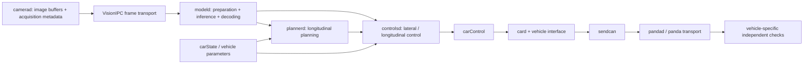

# openpilot flow: predictions, controls and transport

This diagram describes the source snapshot pinned in the [module guide](Guide.md). It omits many management, monitoring, calibration and UI paths so that the principal data boundaries remain readable. It is not a complete deployment architecture.

The last stages describe responsibilities, not an assertion that the safety checks occur in one particular host process. Follow the pinned panda/opendbc implementation and hardware path to establish where each check runs.

## Read each arrow as a contract

| Arrow | Key question | Consequential mistake |
|---|---|---|
| Camera → frame transport | Which frame, acquisition interval and buffer lifetime? | Reusing an overwritten image while preserving its old metadata |
| Frame → model | Which warp, calibration, history and dtype/layout? | Correct weights applied to the wrong preprocessing |
| Model → plan/controller | What are the output units and valid time horizon? | Interpreting curvature as wheel angle |
| Plan → controller | Does the current state still match the plan start? | Following a feasible but obsolete trajectory |
| Controller → interface | Which normalized/physical actuator fields and bounds? | Treating torque request as a universal angle |
| Interface → transport/checks | Which platform encoding, counters and independent limits? | Assuming the application publisher is the only enforcement layer |

`modelV2` has a nominal 20 Hz service rate in the reviewed snapshot. `controlsd` and `card` run 100 Hz loops. Multiple control updates per model prediction are expected; they do not create new perception observations. Other messages and calibration/state updates have their own clocks and rates.

## Walk one signed value

An illustrative curvature of `-0.1/m` means a rightward curve under a forward/left convention. An ideal 2.8 m wheelbase bicycle would require `atan(-0.28)≈-0.273 rad` at the road wheels. The selected vehicle controller and interface still need their own mapping and constraints. The diagram does not justify sending that floating-point value directly as a CAN field.

## Exercise

Pick one source line that publishes `modelV2`, one that publishes `carControl`, and one that publishes `sendcan`. Record the producer, input validity checks and relevant timestamp. Then inspect a subscriber and explain how it detects a missing or stale producer. Complete the [replay fault lesson](Replay-Lab.md) before claiming any property of the full stack.

Pinned source: [modeld](https://github.com/commaai/openpilot/blob/b1e88c2357f07dfc4e0872370b64d97ad606391b/openpilot/selfdrive/modeld/modeld.py), [plannerd](https://github.com/commaai/openpilot/blob/b1e88c2357f07dfc4e0872370b64d97ad606391b/openpilot/selfdrive/controls/plannerd.py), [controlsd](https://github.com/commaai/openpilot/blob/b1e88c2357f07dfc4e0872370b64d97ad606391b/openpilot/selfdrive/controls/controlsd.py), [card](https://github.com/commaai/openpilot/blob/b1e88c2357f07dfc4e0872370b64d97ad606391b/openpilot/selfdrive/car/card.py).
