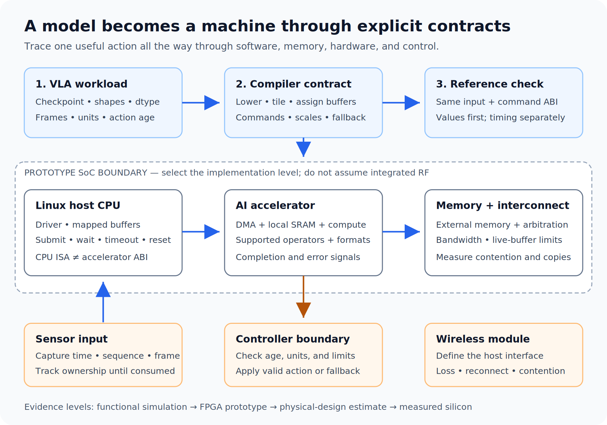

# Phase 5 — Track F: AI Chip Design (18-36 months)

ASIC

Track 5F · AI Chip Design

Design a physical-AI inference SoC: VLA accelerator, compiler, embedded Linux, and wireless integration.

Artifact: reproducible model-to-machine prototype · Measure: task success, latency, energy, memory, area

## Mission: build the computer inside an autonomous machine

The destination is a custom system on chip for physical AI: a processor running embedded Linux, a dedicated AI accelerator, memory and sensor interfaces, wireless connectivity, and the compiler and runtime that turn an advanced vision-language-action (VLA) model into useful robot behavior. Robots, drones, and other autonomous machines supply the requirements. The design must explain how observations become actions within a measured latency, energy, and memory budget.

Begin with the [professional VLA course](../Track%20D%20-%20Robotics/VLA%20Foundations%20to%20Frontier%202026/README.md) and profile an executable reference model. Treat the latest model as a versioned workload, with explicit operator, precision, shape, and action contracts. A programmable design and documented fallback path should accommodate evolving architectures. A chip optimized for one checkpoint alone does not establish support for future models.

## Recommended course: programmable VLA inference accelerator

Take the [10-lecture accelerator design course](Programmable%20VLA%20Inference%20Accelerator/README.md) after establishing a reproducible VLA reference. It turns the project goal into a workload dossier, tensor/vector architecture, memory-traffic model, precision/reuse contract, compiler/runtime ABI, and prototype evidence. CPU labs make the first architecture decisions testable before hardware is available.

Carry its outputs into the SoC capstone below. Use [memory residency](Programmable%20VLA%20Inference%20Accelerator/Lecture-04.md) to justify SRAM and bandwidth, [compiler integration](Programmable%20VLA%20Inference%20Accelerator/Lecture-06.md) to define executable commands, [scheduling](Programmable%20VLA%20Inference%20Accelerator/Lecture-07.md) to bound action age, and [prototype-to-silicon feasibility](Programmable%20VLA%20Inference%20Accelerator/Lecture-09.md) to distinguish measured results from implementation estimates.

## Physical-AI SoC capstone

Progress through these review gates. Each produces evidence that another learner can inspect or reproduce; choose the final implementation level according to available tools and hardware.

1. **Freeze the workload contract.** Select one robot or drone task, checkpoint revision, observation stream, and action interface. Record sensor timestamps, coordinate frames, control rate, action horizon, numerical tolerance, and task-success definition. Profile the complete pipeline, including preprocessing, transfers, vision encoding, language conditioning, and action generation. Deliver a reference runner and measurements that justify the proposed accelerator.

2. **Co-design accelerator and SoC.** Specify supported operations, numeric formats and scale metadata, local SRAM, external-memory traffic, DMA, interconnect, interrupts, and CPU responsibilities. Allocate budgets to sensing, inference, communication, and control. Build a functional simulator and a resource/performance model before selecting an RTL subset or FPGA prototype. Compare predictions with measurements and retain error bars. Report unsupported operations and their execution cost.

3. **Make the compiler produce executable work.** Follow the [compiler stack](../../Phase%204%20-%20Track%20C%20-%20DL%20Inference%20Optimization/03%20-%20Compiler%20Stack/Guide.md) and this track's [LLVM/MLIR lectures](Lectures/Lecture-01.md). Define lowering, tiling, buffer lifetimes, instruction or command encoding, and runtime synchronization. Validate compiled outputs against the reference across representative shapes and precisions. Deliver a documented compiler/runtime ABI, driver-facing command path, correctness suite, and end-to-end benchmark, including fallback execution.

4. **Boot Linux and connect the system.** Use [embedded Linux](../../Phase%202%20-%20Embedded%20Systems/3.%20Embedded%20Linux/Guide.md) to build the boot chain, board support, device tree, accelerator driver, and reproducible filesystem image. Specify a Linux-capable CPU subsystem, memory management, and interrupt behavior. Bring up sensor I/O and wireless using the [ESP-Hosted integration course](../../Phase%202%20-%20Embedded%20Systems/3.%20Embedded%20Linux/Jetson%20ESP-Hosted%20Host%20Code/Guide.md) as a reference pattern. State whether the radio is an external module, companion die, or integrated RF block; monolithic RF requires its own mixed-signal design and verification work. Measure link loss, interference, reconnect behavior, and inference contention.

5. **Close the loop on a machine.** Start with [Isaac Sim and Isaac Lab](../Track%20D%20-%20Robotics/Isaac%20Sim%20and%20Isaac%20Lab/README.md), then transfer to the selected platform when available. Evaluate task success, observation-to-action latency, deadline misses, sustained power, thermal behavior, and recovery from stale sensors or dropped links. Define the boundary between VLA decisions and deterministic motor or flight control. Compare against the original CPU/GPU baseline under the same scenarios.

6. **Declare the implementation maturity.** Deliver source revisions, build instructions, traces, test results, and unresolved limitations. A simulator demonstrates modeled behavior; an FPGA demonstrates a hardware prototype. A synthesis or place-and-route report supports an implementation estimate. Tapeout readiness additionally requires a specific process/IP flow, timing and physical verification, power integrity, test strategy, packaging, and signoff evidence. Fabrication and measured silicon are separate milestones. Name the level achieved rather than presenting projected silicon performance as a measurement.

**Prerequisite: Master AI/Software Stack First**

* **Why Software First:**
    * **Hardware-Software Co-Design:** AI chip design requires deep understanding of the software stack—training frameworks, inference runtimes, and operator semantics. Design hardware that software actually needs.
    * **Workload Characterization:** Profile real AI workloads (training, inference) to identify bottlenecks. Understand memory bandwidth, compute intensity, and data reuse patterns before designing hardware.
    * **Reference: tinygrad:** Study tinygrad—a minimal, readable deep learning framework. It exposes the essence of tensor operations, autograd, and code generation. Understanding tinygrad helps you see what hardware must accelerate.

* **tinygrad and Minimal ML Frameworks:**
    * **tinygrad Architecture:** Study tinygrad's lazy evaluation, linearized IR (intermediate representation), and code generation for different backends (CPU, GPU, custom).
    * **Operator Semantics:** Understand how tinygrad implements conv2d, matmul, attention, and other ops. Trace the graph and memory access patterns.
    * **Extending tinygrad:** Add a custom backend or new op. This teaches you the interface between software and hardware.
    * **Other Minimal Frameworks:** Explore mlx, JAX (for understanding tracing and compilation), or Triton (for GPU kernel design).

**Resources:**

* **tinygrad GitHub:** https://github.com/tinygrad/tinygrad — Minimal and readable. Study the codebase.
* **tinygrad Learning Materials:** See [5. Autonomous Vehicles/tinygrad](../Track%20E%20-%20Autonomous%20Vehicles/3.%20tinygrad%20for%20Inference/Guide.md) for hands-on guides, ops reference, and Jetson support.
* **"Tinygrad: A Simple Autograd Engine" (blog/videos):** George Hotz's explanations of tinygrad design.
* **"Computer Architecture: A Quantitative Approach" (Hennessy & Patterson):** Foundation for understanding accelerator design.

**Projects:**

* **Implement a Custom tinygrad Backend:** Target a simple accelerator (e.g., FPGA, custom simulator) from tinygrad.
* **Profile and Optimize a Model in tinygrad:** Identify compute-bound vs. memory-bound layers. Propose hardware optimizations.

**2. AI Accelerator Architecture**

* **Compute and Memory:**
    * **Systolic Arrays and TPUs:** Understand systolic array architecture for matrix multiplication. Study Google TPU and similar designs.
    * **Dataflow Architectures:** Learn dataflow (e.g., Eyeriss, NVDLA) vs. control-flow architectures. Understand spatial vs. temporal compute.
    * **Memory Hierarchy:** Design for memory bandwidth—on-chip SRAM, HBM, and data reuse. Roofline model for accelerators.

* **Quantization and Precision:**
    * **INT8/INT4 Inference:** Quantization-aware design for low-precision compute. Understand the trade-offs for different precisions.
    * **Mixed-Precision Training:** FP16/BF16 for training. Study gradient scaling and loss scaling.

* **Compiler and Runtime:**
    * **LLVM:** Understand LLVM IR, the three-phase compiler design (frontend → optimizer → backend), and how to write a backend for a custom accelerator. Study passes critical for AI: loop vectorization, alias analysis, instruction selection via TableGen.
    * **MLIR:** Study multi-level intermediate representation — dialects (linalg, tensor, memref, affine, vector, gpu), progressive lowering, and how to define a custom dialect for your accelerator.
    * **TVM and MLIR-Based Compilers:** Study TVM's schedule-based approach (TIR + auto-tuning), MLIR-based compilers (IREE, Triton-MLIR, torch-mlir), and tinygrad's minimal compiler design. Understand how ML models are compiled to hardware-specific code.
    * **Kernel Fusion and Scheduling:** Learn how compilers fuse ops (linalg fusion, tinygrad scheduler) and schedule kernels for optimal performance.
    * **Detailed Lectures:** See the [LLVM & MLIR Lecture Series](Lectures/Lecture-01.md) for in-depth coverage:
        * [Lecture 1: LLVM IR & Architecture](Lectures/Lecture-01.md) — IR types, SSA, address spaces, intrinsics
        * [Lecture 2: LLVM Passes & Code Generation](Lectures/Lecture-02.md) — optimization passes, TableGen, backend pipeline
        * [Lecture 3: MLIR Fundamentals](Lectures/Lecture-03.md) — dialects, operations, progressive lowering
        * [Lecture 4: MLIR for ML Compilers](Lectures/Lecture-04.md) — linalg, tensor, affine, vector dialects
        * [Lecture 5: ML-to-Hardware Compilation Pipelines](Lectures/Lecture-05.md) — TVM, IREE, Triton-MLIR, tinygrad

**Resources:**

* **"Eyeriss: A Spatial Architecture for Energy-Efficient Dataflow for CNN" (paper):** Classic accelerator architecture.
* **"A Full-Stack Accelerator for Deep Learning" (NVDLA):** Open-source Nvidia design.
* **TVM and Apache TVM:** Compiler stack for deep learning.
* **[LLVM Language Reference](https://llvm.org/docs/LangRef.html):** Authoritative LLVM IR specification.
* **[MLIR Documentation](https://mlir.llvm.org/):** Official MLIR docs, dialect references, and tutorials.

**Projects:**

* **Design a Simple Matrix Multiply Accelerator:** Specify the architecture (e.g., systolic array) for a small accelerator in RTL or high-level synthesis.
* **Map a tinygrad Model to Your Accelerator:** Define the mapping from tinygrad ops to your hardware.

**3. From Software to Silicon**

* **RTL and Verification:**
    * **Verilog/SystemVerilog for Accelerators:** Implement key datapath and control blocks for an AI accelerator.
    * **High-Level Synthesis (HLS):** Use HLS (Vitis HLS, etc.) to accelerate design for matrix ops and custom kernels.
    * **Formal Verification:** Apply formal methods for critical datapath correctness.

* **FPGA Prototyping:**
    * **FPGA as Accelerator:** Deploy a small AI accelerator on FPGA. Use frameworks like FINN (Xilinx) for quantized neural networks.
    * **Co-Design with CPUs/GPUs:** Integrate FPGA accelerators with host systems. Understand PCIe, DMA, and driver interfaces.

* **ASIC and Tape-Out (Advanced):**
    * **Physical Design:** Overview of place-and-route, timing closure, and power analysis for AI chips.
    * **Industry and Startups:** Study commercial AI chips (Nvidia, AMD, Cerebras, Groq, etc.) and startup approaches.
    * **RISC-V AI Platforms:** Study RISC-V as an AI-chip design point, including vector AI CPUs, CPU+NPU SoCs, RISC-V control cores inside accelerators, and market positioning. See the focused course: [RISC-V Based AI Chip Design and Market Analysis](RISC-V-AI-Chip-Design-and-Market/Guide.md).

**Resources:**

* **FINN (Xilinx):** Framework for building fast, flexible FPGA accelerators for neural networks.
* **NVDLA (Nvidia):** Open-source deep learning accelerator.
* **Chip design courses (e.g., Berkeley, Stanford):** Online courses on digital design and computer architecture.

**Projects:**

* **Implement a Small Accelerator on FPGA:** Build a matrix multiply or conv2d accelerator using HLS or RTL.
* **Compare tinygrad on CPU vs. Your FPGA Accelerator:** Benchmark and analyze the speedup and efficiency.

**Phase 2 (Significantly Expanded): AI Chip Design (36-60 months)**

**1. Advanced Accelerator Microarchitecture**

* **Dataflow Optimization:**
    * **Dataflow Architectures (In-Depth):**  Study the "energy-efficient dataflow for CNN" design space from the Eyeriss framework. Compare weight-stationary, output-stationary, input-stationary, no-local-reuse, and row-stationary mappings and their memory bandwidth and energy trade-offs.
    * **Spatial vs. Temporal Compute:**  Design spatial architectures (like TPUs, Groq TSP) where computation is statically mapped to processing elements. Compare with temporal architectures (like GPUs) that share resources across time.
    * **Dataflow Compilers:**  Study dataflow compilers (Halide, TVM schedules, MLIR Linalg dialect) that map tensor operations onto spatial architectures. Understand the affine loop analysis and polyhedral optimization that underpins them.

* **Processing Element (PE) Design:**
    * **Systolic Array Design:**  Implement a parameterized systolic array for matrix multiply in RTL—configure PE count, data precision, and accumulation depth. Analyze throughput, latency, and area via FPGA or synthesis reports.
    * **Mixed-Precision and Approximate Computing:**  Design PEs that support multiple precisions (FP32, FP16, BF16, INT8, INT4) with configurable precision at runtime. Explore approximate computing (stochastic rounding, reduced-precision accumulation) for energy efficiency.
    * **Sparse Accelerators:**  Study architectures that exploit sparsity in weights and activations—Nvidia's A100 structured sparsity (2:4 sparsity), SCNN (sparse CNN accelerator), and Cambricon-X. Implement sparse GEMM on FPGA.

* **On-Chip Network (NoC) and Memory System:**
    * **NoC Design:**  Design on-chip interconnect for multi-PE accelerators—mesh, ring, and hierarchical NoC topologies. Analyze bandwidth, latency, and power for different workload communication patterns.
    * **Scratchpad vs. Cache:**  Understand the trade-offs between scratchpad (programmer-managed SRAM) and cache-based on-chip memory. Design scratchpad controllers with DMA engines for bulk data movement.
    * **HBM Interface Design:**  Study HBM2/HBM3 interface requirements—PHY, memory controller design, and request scheduling. Understand how on-chip bandwidth limits accelerator performance and design memory subsystems accordingly.

**Resources:**

* **"Eyeriss: A Spatial Architecture for Energy-Efficient Dataflow for CNN" (Chen et al., ISCA 2016):**  Foundational paper on CNN accelerator dataflow and energy analysis.
* **"Efficient Processing of Deep Neural Networks" by Sze, Chen, Yang, and Emer:**  Comprehensive book and MIT OCW course on DNN hardware acceleration.
* **Timeloop and Accelergy:**  Architecture-level modeling and evaluation framework for DNN accelerators—maps workloads to architectures and estimates performance, energy, and area.
* **Halide** — [github.com/halide/Halide](https://github.com/halide/Halide): Language for fast, portable data-parallel computation (image processing, GPU). Study the schedule/algorithm separation and how it maps to spatial architectures.

**Projects:**

* **Parameterized Systolic Array:**  Implement a scalable systolic array (e.g., 16×16 PEs) in SystemVerilog with configurable data width (INT8/FP16). Report FPGA resource use and achieved clock after implementation; measure board power separately before reporting operations per joule. Synthesis alone does not measure energy.
* **Dataflow Analysis with Timeloop:**  Use Timeloop to evaluate three different dataflows (Weight Stationary, Output Stationary, Row Stationary) for ResNet-50 on a hypothetical accelerator. Compare energy efficiency and identify optimal dataflow.
* **Sparse GEMM on FPGA:**  Implement a 2:4 structured sparse matrix multiply on FPGA using HLS. Compare performance and resource utilization against dense GEMM.

**2. Chip Architecture and Physical Design**

* **RTL-to-GDS Flow:**
    * **Synthesis and Timing:**  Run logic synthesis with commercial tools (Synopsys Design Compiler, Cadence Genus) or open-source (Yosys + ABC). Understand technology mapping, multi-corner multi-mode (MCMM) timing, and area/power/timing optimization.
    * **Floorplanning and Placement:**  Plan chip floorplan—allocate areas for compute arrays, SRAM, I/O, and control logic. Understand placement density, routing congestion, and power/ground distribution network planning.
    * **Routing and Signoff:**  Complete physical routing (global + detailed), perform signoff checks—DRC (Design Rule Check), LVS (Layout vs. Schematic), and timing signoff with parasitic extraction (RC extraction, STA with SPEF).

* **Open-Source EDA and OpenROAD:**
    * **OpenROAD Flow:**  Run the OpenROAD open-source RTL-to-GDS flow for a small AI accelerator design. Use the SkyWater 130nm or GlobalFoundries 180nm PDK as a process-specific educational implementation study; GDS generation alone does not establish manufacturing readiness.
    * **Magic and KLayout:**  View and edit VLSI layouts using Magic and KLayout. Understand GDSII format, layer mappings, and design rule enforcement.
    * **Efabless Chipignite:**  Explore multi-project wafer (MPW) shuttle programs (Efabless chipIgnite, TinyTapeout) for low-cost physical chip fabrication of student designs.

* **Power Analysis and Optimization:**
    * **Dynamic and Static Power:**  Analyze dynamic power (switching activity × capacitance × voltage²) and static (leakage) power using simulation-based (VCD/SAIF) or statistical estimation tools.
    * **Clock Gating and Power Domains:**  Implement fine-grained clock gating to disable idle logic and multi-voltage power domains (UPF/CPF) to supply inactive blocks at reduced voltage.
    * **IR Drop and Electromigration:**  Analyze power distribution network (PDN) IR drop and electromigration limits. Optimize metal width and via arrays for reliable power delivery under peak current loads.

**Resources:**

* **OpenROAD Project:**  Open-source RTL-to-GDS flow with commercial-quality tools for academia and research.
* **TinyTapeout:**  Educational chip fabrication shuttle—design a small chip and get it fabricated as part of a multi-project wafer.
* **"VLSI Physical Design: From Graph Partitioning to Timing Closure" by Kahng, Lienig, Markov, and Hu:**  Comprehensive physical design textbook.

**Projects:**

* **OpenROAD Physical-Design Study:**  Take a small RTL design (e.g., an 8×8 INT8 systolic array) through the OpenROAD flow on SkyWater 130nm. Generate GDSII and analyze timing, area, and power reports.
* **TinyTapeout Submission:**  Design a minimal AI inference block (e.g., a 4-element dot product unit) and submit it to a TinyTapeout MPW shuttle for physical fabrication.
* **Power Domain Analysis:**  Model two power domains using voltage levels supported by the chosen process libraries, with isolation and level shifters where required. Analyze leakage power savings and verify UPF correctness.

**3. AI Chip Industry, Business, and Research Frontier**

* **AI Chip Landscape:**
    * **Commercial AI Chip Analysis:**  Study the architectures of commercial AI chips—Nvidia H100 (SXM5), AMD MI300X (CDNA3), Google TPUv4, Cerebras WSE-3, Groq TSP, Graphcore IPU, and SambaNova RDU. Compare performance, memory bandwidth, precision support, and total cost of ownership.
    * **Inference vs. Training Chips:**  Understand the different design points for training (high-precision, large memory, flexible) vs. inference (low-latency, low-power, quantized, fixed function) accelerators.
    * **Edge AI Chips:**  Study edge inference chips—Apple Neural Engine, Qualcomm Hexagon DSP, Hailo-8, Kendryte K210—and their design trade-offs for power-constrained embedded deployment.
    * **RISC-V AI Market:**  Analyze where RISC-V can win first—industrial edge, robotics, AI sensors, automotive controllers, and developer platforms—and where CUDA, Arm, and x86 ecosystems remain stronger.

* **Chiplets and Advanced Packaging:**
    * **Chiplet Architecture:**  Understand chiplet-based design where a large chip is disaggregated into smaller dies connected via high-bandwidth die-to-die interconnects (UCIe, BoW, AIB, HBI).
    * **2.5D and 3D Integration:**  Study 2.5D packaging (HBM on an interposer, as in AMD Instinct MI series) and 3D stacking (TSMC SoIC, Intel Foveros) for integrating compute and memory dies.
    * **Design for Chiplets:**  Understand PHY design for die-to-die interfaces, power delivery challenges in stacked dies, and thermal management for 3D-integrated AI chips.

* **Research Directions:**
    * **Neuromorphic Computing:**  Study spike-based neuromorphic architectures (Intel Loihi, IBM TrueNorth) and their potential advantages for event-driven, sparse, ultra-low-power AI processing.
    * **In-Memory and Near-Memory Computing:**  Explore compute-in-memory (CIM) architectures that perform computations within SRAM or DRAM arrays, dramatically reducing data movement energy—the dominant cost in AI inference.
    * **Photonic and Analog AI:**  Survey emerging modalities—optical neural networks (Lightelligence, Lightmatter), analog compute-in-memory (IBM PCM, Mythic), and their potential paths to commercialization.

**Resources:**

* **Chip Architects Podcast and SemiAnalysis:**  Industry analysis of AI chip architectures, competitive landscape, and technology trends.
* **Hot Chips and ISSCC Conference Proceedings:**  Annual conferences where leading companies present AI chip architectures—primary source for understanding state-of-the-art designs.
* **"Demystifying AI Chipmakers" (Various analyst reports):**  Business and technology landscape of AI chip startups and incumbents.
* **RISC-V AI Chip Design and Market Course:**  [Focused course](RISC-V-AI-Chip-Design-and-Market/Guide.md) on SpacemiT, RISC-V vector AI, software enablement, and edge AI market fit.
* **Agentic Chip Design 2026:**  [Special course](Agentic%20Chip%20Design%202026/Guide.md) on using LLMs and agents across the RTL-to-silicon flow — RTL generation, verification, and agentic EDA — bridging the [AI Agent Development 2026](../../Phase%203%20-%20Artificial%20Intelligence/Track%20B%20-%20Agentic%20AI%20and%20ML%20Engineering/3.%20Agentic%20AI%20and%20GenAI/Guide.md) course. Grounded in the [Chip-Design-LLM-Zoo](https://iprc-dip.github.io/Chip-Design-LLM-Zoo/) leaderboard.

**Projects:**

* **AI Chip Architecture Comparison:**  Perform a systematic comparison of three AI chips (e.g., H100, MI300X, TPUv4) across performance, memory bandwidth, precision, and TCO for LLM training. Present findings as a technical report.
* **RISC-V AI Platform Review:**  Review a RISC-V AI chip such as SpacemiT K3, Tenstorrent, SiFive Intelligence, MIPS S8200, Semidynamics Cervell, or Andes vector AI cores. Analyze architecture, software stack, workload fit, market position, and adoption risk.
* **Chiplet Design Study:**  Design a simple chiplet system with a compute die and an HBM-equivalent memory die. Model die-to-die bandwidth, latency, and power using UCIe specifications.
* **Research Proposal:**  Write a 2-page research proposal for a novel AI accelerator architecture targeting a specific gap (e.g., long-context transformer inference, sparse GNN acceleration). Include workload analysis, proposed architecture, and expected benefits.

---

## 4. Compiler and accelerator co-design: one executable vertical slice

A custom framework is useful here when it exposes the hardware/software contract. Start with one VLA subgraph that the workload profile identifies as important: a vision projection, an attention block, or an action-head MLP. Preserve the rest of the reference model as a fallback. This makes correctness and the benefit of the new hardware observable before investing in a complete framework.

*Original teaching diagram. Follow the blue inference path and the orange control boundary separately; a working matrix engine does not replace either system.*

### 4.1 Define the contract before implementing the backend

| Contract | Example decision | Failure test |
|---|---|---|
| Operator semantics | `Y = XW + b`, explicit accumulation type, rounding, and saturation | Extreme values, non-multiple tile dimensions, NaN policy where applicable |
| Tensor layout | Logical `[tokens, channels]`; packed weights carry scale shape and alignment | Transposed/strided inputs must copy, lower correctly, or fail explicitly |
| Memory ownership | Host allocates buffers; DMA mapping and completion govern reuse | Overlapping submissions and early buffer reuse |
| Command ABI | Version, addresses/offsets, dimensions, strides, dependency/completion IDs | Invalid size, unknown opcode, out-of-range address |
| Unsupported operator | Return to CPU/GPU with explicit transfer and synchronization | Force a fallback inside the chosen subgraph and measure its cost |
| Robot interface | Action frame, units, timestamp, horizon, and expiry | Drop a sensor frame and reject an expired action in simulation |

A RISC-V host ISA, an accelerator command format, and an MLIR dialect are different interfaces. The host may issue a DMA descriptor without executing a custom tensor instruction. Pick the coupling deliberately; a queue-based accelerator does not require a new CPU ISA extension.

### 4.2 Work a memory budget by hand

Consider a teaching GEMM tile with `M=N=K=64`, INT8 inputs, and INT32 accumulators. It performs `2MNK = 524,288` arithmetic operations under the convention that one multiply-add counts as two. Its input tiles need `MK + KN = 8,192` bytes; its accumulator tile needs `4MN = 16,384` bytes. Double-buffering both inputs raises the subtotal to `32,768` bytes **before** scales, bias, output staging, alignment, and control state. A 32 KiB SRAM budget therefore cannot hold all these objects simultaneously.

Change one tile dimension, then recompute reuse, padding, live buffers, and DMA traffic. A smaller tile can fit but increase transfers. Use these calculations to choose experiments, then compare modeled cycles with a simulator or FPGA trace. Neither an arithmetic-operation count nor an SRAM model is a silicon power measurement.

### 4.3 Build in a sequence that exposes failures

1. **Functional reference:** implement the subgraph on CPU with fixed inputs and reference outputs, including irregular dimensions. Compare intermediate tensors as well as final actions.
2. **Compiler slice:** lower through an existing tensor IR, tile the operation, and record buffer lifetimes. Add target operations only for semantics the hardware really implements. Keep one before/after IR file for each transformation.
3. **Executable simulator:** consume the same command stream intended for hardware. Model command ordering, overflow, DMA completion, and reset behavior. A cycle model is a separate layer above functional correctness.
4. **RTL/FPGA subset:** implement the matrix engine, DMA interface, and completion path. Run the reference vectors through the actual driver/runtime path. Record unsupported shapes instead of silently changing the computation.
5. **Linux integration:** validate buffer mapping, cache coherency, interrupts, timeouts, reset, and process teardown. An interrupt means the device reports completion; memory visibility must still obey the platform's DMA contract.
6. **VLA integration:** replace only the proven subgraph, then replay the same observations and run the same closed-loop scenarios. Report action error, task success, observation age, tail latency, transfers, and energy at a named measurement boundary.

The [five compiler lectures](Lectures/Lecture-01.md) teach the representations used in steps 2–3. Their code sketches explain structure; pin LLVM/MLIR and validate pass names against that build before treating a command as a runnable recipe. Bufferization selects buffers; deallocation requires its own ownership/lifetime treatment. [MLIR bufferization documentation](https://mlir.llvm.org/docs/Bufferization/).

### 4.4 Use NVIDIA as a measured baseline

Modern serving engines already use compilation and CUDA Graphs; vLLM documents full and piecewise graph modes. Compare a custom backend against the optimized mode actually used by the baseline. [vLLM CUDA Graphs design](https://docs.vllm.ai/en/v0.18.2/design/cuda_graphs/).

A GPU baseline teaches several portable principles:

- **Graph replay** amortizes launch work; graph launch, input updates, and synchronization still cost time.
- **Fusion** removes some intermediate traffic but can increase register pressure, reduce occupancy, or impose expensive synchronization. A whole transformer block is not automatically one profitable kernel.
- **Asynchronous copies and matrix instructions** require legal layouts, supported data types, and explicit synchronization. Persistent scheduling and warp specialization are separate choices.
- **L2 persistence** is an access-policy preference within a finite set-aside budget, not pinned SRAM. Compute the live KV footprint before testing it; concurrent traffic and device limits matter. [CUDA L2 access policies](https://docs.nvidia.com/cuda/archive/13.0.0/cuda-c-programming-guide/index.html#device-memory-l2-access-management).
- **Low precision** changes data and metadata movement as well as arithmetic. Validate scales, accumulation, saturation, and downstream task quality. A nominal FP4 value is not a complete checkpoint format or compiler contract.

For example, a conventional KV cache with 32 layers, 8 KV heads, head dimension 128, BF16 elements, batch 1, and 2,048 tokens requires `2 × 32 × 8 × 128 × 2 × 2,048 = 268,435,456` bytes (256 MiB), before paging metadata. It cannot all reside in a 50 MB L2 cache. Architectures with latent caches need their own formula.

### 4.5 Capstone report that supports a design decision

Compare the CPU/GPU reference, simulator, and hardware prototype at the **same** input shapes and numerical contract. Separate cold compilation from warm execution, kernel time from end-to-end time, and accelerator power from board power. Include one change that failed to improve the result and explain why.

The final recommendation should name the next design constraint: more SRAM, better DMA scheduling, a supported nonlinear operator, less CPU fallback, or a different action-head mapping. Return those requirements to the [physical-AI SoC capstone](#physical-ai-soc-capstone), along with the command ABI and workload traces. A claim such as “beats vLLM” requires a reproducible comparable workload; this course does not promise a speedup before the experiment.

**Study method:** use the [shared lesson cycle and completion rubric](../../Learning-Guide.md) with this course's existing labs. Predict first, test one variation, retain a failure case, and revisit the self-check after two days and one week.
