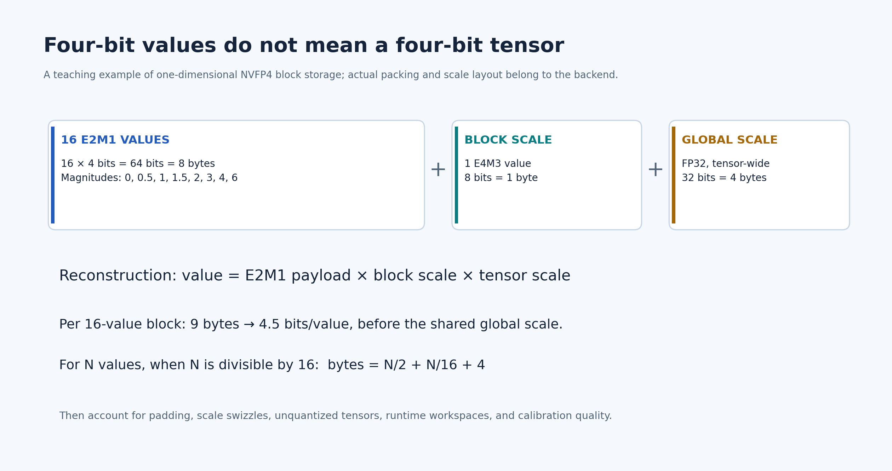

# Lecture 04 — Memory Residency and Traffic

**Question:** which tensors should stay on-chip, for how long, and how many external bytes does that actually save?

**Prerequisites:** [Lecture 03](Lecture-03.md), byte/bit conversion, tensor lifetimes, and the distinction between capacity and bandwidth.

**By the end:** calculate packed storage including metadata, derive cold and warm residency traffic, build a lifetime-constrained SRAM allocation, and distinguish a bandwidth floor from a latency prediction.

**Deliverable:** a versioned memory ledger and SRAM sweep for the policy graph. Every claimed saved byte must have a producing node, consuming node, and retention interval.

## 1. Separate four questions

| Question | Required evidence |
|---|---|
| Does the checkpoint fit in external memory? | All weights, metadata, caches, workspaces, runtime allocations, and concurrent services |
| Does a selected working set fit in SRAM? | Physical layout, live intervals, banks, alignment, and reserved capacity |
| Can the machine supply bytes on time? | Sustainable bandwidth at every contested interface |
| Is retaining a tensor worthwhile? | Reuse count, avoided transfers, retention cost, and displaced data |

“The model is 4-bit” answers none of these completely. Some tensors may remain in higher precision; runtime packing can create additional copies; model weights do not include camera buffers or activation storage.

Use **MB/GB for decimal bytes** and **MiB/GiB for binary bytes**. A 64 MiB SRAM contains 67,108,864 bytes, not 64 million bytes.

## 2. Worked example: an expert does not fit merely because it is quantized

For an illustrative 300-million-parameter expert with all weights stored at four bits:

\[
S_{\mathrm{payload}}=300\times10^6\times\frac{4}{8}
=150{,}000{,}000\ \mathrm{bytes}
\approx143.05\ \mathrm{MiB}.
\]

It cannot fit in 16, 32, or 64 MiB of SRAM, even before reserving space for activations.

For a hypothetical symmetric integer format with one FP16 scale per 128 weights and no zero point, padding, or headers:

\[
S=\frac{N}{2}+\frac{N}{128}\times2
=154{,}687{,}500\ \mathrm{bytes}
\approx147.52\ \mathrm{MiB}.
\]

For an idealized **one-dimensional NVFP4** representation with one byte of block scale per 16 values and a four-byte global scale for one tensor:

\[
S=\frac{N}{2}+\frac{N}{16}+4
=168{,}750{,}004\ \mathrm{bytes}
\approx160.93\ \mathrm{MiB}.
\]

The last equation is a storage calculation under an explicitly selected layout, not a universal checkpoint-size formula. Real tensors have separate global scales and may need padding or a different recipe. NVIDIA also documents two-dimensional scaling variants; do not silently apply a 1D formula to them. [NVFP4 format and recipes](https://docs.nvidia.com/deeplearning/transformer-engine/features/low_precision_training/nvfp4/nvfp4.html)



*Read the figure as a 1D packing example. Which additional terms would your chosen checkpoint loader allocate?*

## 3. Follow the repeated nodes

Consider this **hypothetical graph**, not a claim about a named policy:

```text
observation -> backbone -> fixed conditioning C
                                  |
initial action state -> expert(C, state, step) -> updated state
                              repeated 10 times
```

Assume a 3B-parameter backbone stored at four bits and a 300M-parameter expert stored at eight bits. Count only packed weight payload. The backbone runs once; the full expert runs ten times. Each invocation streams its weights from external memory, with no cross-iteration residency.

\[
D_{\mathrm{backbone}}=3\times10^9\times0.5=1.5\ \mathrm{GB},
\qquad
D_{\mathrm{expert}}=10\times300\times10^6\times1=3.0\ \mathrm{GB}.
\]

Therefore \(D_{\mathrm{weights}}=4.5\) GB per evaluation. Multiplying the whole model by ten would count backbone work that the graph does not repeat.

If some expert layers run only once, count them separately. If one layer streams the same weights repeatedly because of a poor mapping, account for that additional traffic too. Parameter count is a starting point, not a substitute for measured memory transactions.

## 4. Partial residency: derive the saved traffic

Let the repeated expert contain \(W\) bytes, execute \(I\ge1\) times, and retain \(R\le W\) bytes throughout the loop. Ignore metadata only when the chosen fixture explicitly excludes it.

For a **cold** evaluation, resident weights are loaded once and the rest are streamed every iteration:

\[
D_{\mathrm{cold}}=R+I(W-R)=IW-(I-1)R.
\]

For a **warm** evaluation whose resident weights are already present and valid before the timed window:

\[
D_{\mathrm{warm}}=I(W-R).
\]

The cold savings are \((I-1)R\); the warm savings are \(IR\). A benchmark that excludes initial loading must say so. Model replacement or loss of residency can restore cold behavior.

Take \(W=300\) MB and \(I=10\). Reserve 8 MiB of a 32 MiB SRAM for workspaces, leaving at most 24 MiB, or 25.165824 MB, for this resident weight set:

\[
D_{\mathrm{cold}}=3{,}000-9(25.165824)
=2{,}773.507584\ \mathrm{MB}.
\]

That is about **7.55% less expert payload traffic**, not a tenfold reduction. Including the 1.5 GB backbone gives approximately 4.274 GB total weight traffic in this idealized cold case.

The formula assumes selected weights remain usable in their retained representation. Retaining expanded BF16 weights consumes more capacity than retaining packed INT4 weights. Reserving space for scales, unpacking, or bank padding further reduces \(R\).

## 5. Capacity feasibility is necessary, but not sufficient

At time \(t\), require:

\[
\sum_{x\in\mathrm{live}(t)}\operatorname{allocatedBytes}(x)
\le S_{\mathrm{usable}}.
\]

Apply a corresponding constraint to each bank or partition. Two allocations that fit in total can still conflict if they require the same bank ports in the same cycle.

Build a lifetime diagram containing weights, conditioning, current action state, next action state, accumulators, DMA buffers, and vector scratch. Record each tensor's producer, last consumer, format, bank assignment, and aliasing restrictions.

Double buffering consumes real capacity. If input and weight tiles are prefetched independently, a simplified allocation includes two input buffers and two weight buffers, plus accumulators and output space. “Overlap transfer with compute” is not free SRAM.

Allocate by **avoided traffic per retained byte subject to timing and bank constraints**. This is a useful heuristic, not a complete optimizer: a smaller tensor on the critical path may be worth more than a larger one with more aggregate reuse.

## 6. Convert traffic into a bound

Suppose a 200 GB/s advertised interface sustains 60% for this workload, giving 120 GB/s. For the 4.5 GB fixture:

\[
T_{\mathrm{weight\ transfer}}\ge\frac{4.5}{120}\ \mathrm{s}
=37.5\ \mathrm{ms}.
\]

At 20 evaluations per second, this payload alone requires 90 GB/s. Activations, metadata, camera traffic, and other consumers need additional bandwidth.

The 37.5 ms result is a bandwidth floor under the assumed measurement window, traffic, and sustained service rate. It is not a complete latency estimate. Some computation overlaps transfers; some dependencies prevent overlap. Weights prefetched before the window must be counted as pre-existing residency, not silently charged or excluded in different comparisons.

Do not add isolated compute and transfer times automatically. Construct the resource-constrained execution timeline, then measure its critical path. The [critical-path teaching diagram](../../../Assets/illustrations/learning-path/critical-path.png) illustrates the distinction.

## 7. Exercise: construct a residency policy

Use the [course lab guide](Lab-Guide.md) and the analytical fixture above. Sweep total SRAM through 16, 32, and 64 MiB while recording an explicit workspace reserve.

1. Produce cold and warm traffic columns, including the exact byte units.
2. Start with payload-only weights; then add a separately named quantization layout.
3. Compare retaining weights, fixed conditioning, and frequently reused activations.
4. Draw simultaneous live ranges and reject infeasible allocations.
5. Repeat with the iteration count changed from ten to one.

**Negative case:** let a camera preprocessing buffer evict part of your resident expert between iterations. Recompute traffic using actual retained bytes. Your model must not keep claiming full-residency savings after eviction.

**Acceptance:** deliver `memory-ledger.csv`, the lifetime diagram, all assumptions, and a paragraph identifying the largest unmodeled source of traffic. If no hardware counters were collected, label every bandwidth and latency value as an estimate.

## 8. Answered self-checks

**1. Does retaining 24 MiB save 24 MiB on every iteration of a cold evaluation?** Not on the first load. Relative to streaming everything, cold savings across \(I\) iterations are \((I-1)R\), provided residency survives.

**2. Why is 150 MB not a sufficient SRAM specification for a 300M-parameter four-bit expert?** It is only packed payload. Scales, alignment, live activations, accumulators, and DMA buffers require additional capacity; representation changes can expand weights further.

**3. Can adding compute units remove a 90 GB/s weight requirement?** No. It changes that requirement only if the mapping or algorithm also changes the bytes transferred, their reuse, or the number of evaluations.

## Sources and next step

- [NVFP4 documentation](https://docs.nvidia.com/deeplearning/transformer-engine/features/low_precision_training/nvfp4/nvfp4.html): check the exact scaling recipe and layout before estimating size.
- [Timeloop architecture and mapping models](https://timeloop.csail.mit.edu/): model working sets and movement, then calibrate against an implementation.
- [Gemmini scratchpad and accumulator description](https://github.com/ucb-bar/gemmini): inspect a concrete banked-memory design.

Continue to [Lecture 05 — Precision and Valid Reuse](Lecture-05.md). A retained tensor saves useful work only if its numerical interpretation and dependencies remain valid.
