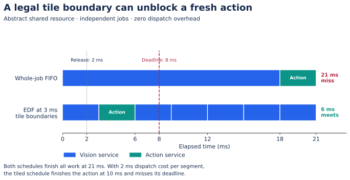

# Lecture 07 — Scheduling for fresh actions

**Previous:** [Compiler and runtime](Lecture-06.md) · **Next:** [Evaluation](Lecture-08.md) · **Practice:** [CPU labs](Lab-Guide.md)

**Prerequisites:** dependency graphs, buffer lifetimes, and the command ABI from Lecture 06. **Deliverable:** a schedule with explicit blocking bounds, resource assumptions, and observation-age checks.

## 1. Four clocks in one robot

Distinguish sensor sampling, model invocation, action-chunk sampling, and actuator control. An example system might capture at 30 Hz, invoke a policy at 10 Hz, produce actions spaced 20 ms apart, and run a local controller at 200 Hz. These rates do not imply four independent streams of fresh decisions. Some camera frames will not be used; some control ticks consume/interpolate actions from the same chunk.

Define timestamps in one clock domain, or retain a calibrated conversion with uncertainty:

```text
t_capture → t_admitted → t_policy_start → t_policy_end → t_usable → t_consumed
```

`t_usable - t_capture` measures the path to a validated action; `t_consumed - t_capture` measures observation age when that action is applied. A fast policy can still consume an old observation after queueing. Frame IDs must accompany timestamps through preprocessing and compilation.

**Worked example:** capture at 100 ms, start at 112, end at 144, validate at 146, consume at 170. Model execution is 32 ms, usable-action latency is 46 ms, and observation age at consumption is 70 ms. With a 50 ms latency limit and a 60 ms maximum age, the action passes one check and fails the other. Faster chunk playback does not fix that age.

## 2. Schedule a resource, not an adjective

Calling a runtime “deadline-aware” leaves several questions unanswered:

| Resource | Required scheduling contract |
|---|---|
| Tensor/vector tile | Legal interruption boundary; command duration; saved state |
| SRAM | Reservation, bank/port conflicts, lifetime, eviction and refill cost |
| DMA | Maximum in-flight bytes, burst length, arbitration, completion ordering |
| DRAM/interconnect | Sustained service under contention; bandwidth sharing; outstanding transaction limits |
| Host CPU | Submission/recovery budget; interrupts; competing work |
| Controller | Freshness checks, chunk replacement rule, fallback and recovery |

Separate tiles still contend for shared memory. Priority at the command queue cannot interrupt a large transaction already in service. A useful architectural feature is a **bounded unit of nonpreemptive work** plus enough state to resume correctly; its size must be evaluated with dispatch/refill overhead.

Linux `SCHED_DEADLINE` provides CPU scheduling with admission-control assumptions; it does not reserve your accelerator, DRAM, or radio. Use it only as one part of a resource-specific timing design. [Linux deadline scheduling](https://kernel.org/doc/html/latest/scheduler/sched-deadline.html).

## 3. Worked blocking example

Consider one abstract shared resource. Vision arrives at 0 ms and needs 18 ms of service, with absolute deadline 40 ms. An action job arrives at 2 ms and needs 3 ms, with absolute deadline 8 ms. No dependencies or dispatch costs are included in this first example.

- With whole-job FIFO service, vision occupies `[0,18]`, then action occupies `[18,21]`. The action misses its deadline.
- If vision has valid 3 ms tile boundaries, an earliest-deadline choice at time 3 runs action during `[3,6]`. Vision finishes at 21 ms. Both meet their declared deadlines in this trace.
- If each dispatched segment additionally costs 2 ms, the first vision segment finishes at 5 and action finishes at 10. The apparent guarantee disappears.

[](../../../Assets/illustrations/vla-accelerator/scheduling.svg)

*This is an abstract schedule, not a GPU or silicon benchmark. [PNG](../../../Assets/illustrations/vla-accelerator/scheduling.png). Predict the result when dispatch cost becomes 2 ms before running the lab.*

The CPU lab implements exactly these assumptions. It does not establish that a real kernel can pause every 3 ms. Identify a legal boundary in your compiled command stream and measure its maximum observed blocking and restoration cost.

## 4. Admission, overload, and data freshness

For a single ideal server with periodic work, `sum(service_i / period_i)` is a useful initial load check. It does not prove feasibility when deadlines differ from periods, jobs are nonpreemptive, resources are coupled, or service estimates are optimistic. Model release jitter, blocking, dependencies, and the relevant scheduling assumptions before making a hard bound claim.

For an experimental robot runtime, define overload behavior before adding more producers:

1. Bound each input queue; record drops and replacement decisions.
2. Decide whether the policy needs every observation, a history window, or the newest complete snapshot. A recurrent policy may require state advancement even when a frame is not rendered into a full observation.
3. Reject expired work before expensive execution when possible; recheck at consumption.
4. Give logging, uploads, and wireless retries explicit limits.
5. Keep local controller fallback independent of a successful model/network response.

Do not silently drop an observation while preserving state that assumes it was processed. Queue policy is part of model semantics when history matters.

## 5. Asynchronous action chunking

While the robot consumes a previous chunk, inference can prepare the next one. That overlap raises a continuity problem: some old actions may already be committed by the time the new chunk is ready. A replacement rule must account for actual elapsed time, the controller's consumed prefix, and transition behavior.

The [Real-Time Chunking paper](https://arxiv.org/abs/2506.07339) studies execution of action-chunking flow policies under inference delay. Treat its algorithm as a model/runtime method to implement and evaluate; scheduling two threads alone does not reproduce its action continuity. Use the [VLA asynchronous-control lecture](../../Track%20D%20-%20Robotics/VLA%20Foundations%20to%20Frontier%202026/Lecture-22.md) for the robotics counterpart.

For every approximate reuse or early-exit method, compare a fixed algorithm on different schedules and then a changed algorithm on the same schedule. This separates hardware scheduling benefit from behavior changes.

## Lab: explain one missed deadline

Run the `schedule` fixture with zero and 2 ms dispatch cost. Draw both timelines without consulting the result, then reproduce them. Extend the fixture with a third telemetry job and an action burst; keep the single-resource abstraction explicit.

**Negative control:** choose a quantum longer than the action deadline window. Show why an earlier deadline in the queue cannot undo work already in service.

**Hardware extension:** trace submit, start, DMA completion, output validation, and consumption under simultaneous perception and logging. Report cold, warm, sustained, and recovery cases. Save the configuration and raw timestamps rather than only a histogram image.

**Acceptance:** explain every interval in the fixture; identify at least one unmodeled source of blocking in the hardware extension; export a maximum command-size proposal and action-expiry rule to the ABI.

## Self-check with answers

1. **Does p99 below the deadline establish a hard bound?** No. It describes the sampled distribution under the tested conditions; it permits tail misses and says nothing about untested execution paths.
2. **Can two compute tiles guarantee independent action timing?** No. They may share SRAM ports, DRAM, interconnect, DMA, or host dispatch.
3. **Why can a low-latency output be stale?** It may have used an observation delayed before inference or waited in the action queue afterward.
4. **What makes a tile boundary useful?** Correct resumable state and a sufficiently small blocking interval after accounting for dispatch, refill, and synchronization.

**Pass forward:** a schedule/age contract, an overload policy, and measured or explicitly modeled blocking evidence. Lecture 08 uses them in the acceptance experiment.
