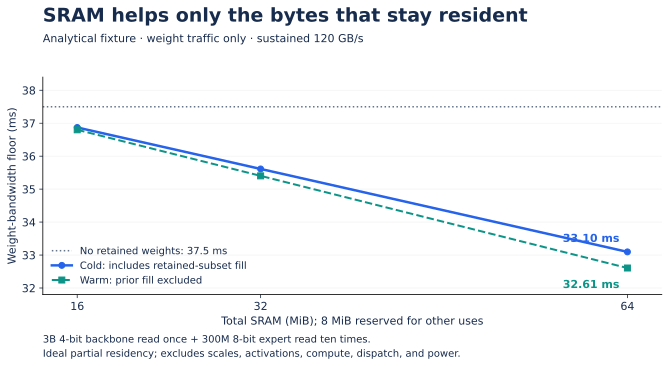

# Lecture 10 — Capstone: defend a programmable VLA accelerator

**Previous:** [Prototype and feasibility](Lecture-09.md) · **Course:** [Overview](README.md) · **Execution:** [Lab guide](Lab-Guide.md)

The capstone turns the original proposal into a falsifiable design study. The product hypothesis is: **a robot completes the required tasks, within its response-time constraints, using less compute-system energy**. Select an evidence level you can complete; a sound analysis is useful, but cannot be relabeled measured silicon performance.

## 1. Freeze a scope that can be reviewed

Select a task family, an embodiment or simulator, and a small diverse policy set. Begin with one usable checkpoint; add a second architecture only after the first reference works. Flow-based, autoregressive-action, and cascade-style policies test different assumptions. Use the [model source ledger](Sources-Models.md) to check accessible weights, dependencies, and licenses.

Write a one-page requirements sheet:

| Requirement | Example form, to replace with your task |
|---|---|
| Behavior | Named tasks/scenes, success predicate, timeouts, recovery and intervention rules |
| Freshness | Capture-to-usable deadline and maximum source-observation age at consumption |
| Power | Measurement boundary and sustained budget, including host/DRAM |
| Capacity | Peak live system memory and supported concurrent workloads |
| Compatibility | Required model/operator/shape/precision set; documented fallback |
| Programming | Import path, compiler IR, generated commands, versioned runtime/driver ABI |
| Connectivity | Telemetry/task-request role, expiry, authentication, link-loss behavior |
| Quality | Allowed loss, paired evaluation, confidence procedure, held-out conditions |

The teaching design envelope of 0.5–4B parameters, 20–40 W, 16–32 GB external memory, 16–64 MiB SRAM, and 10–30 Hz are a **search region**. Replace each with evidence. Do not combine all upper bounds into a claimed feasible product.

## 2. Build an evidence chain

| Gate | Artifact | Reason to return upstream |
|---|---|---|
| A — Reference | Pinned model/data/processor and valid action loop | Unknown action semantics or unavailable dependency |
| B — Workload | Trace, shapes, lifetimes, repeated work, cold/warm traffic | Analytical counts disagree with trace |
| C — Architecture | Tile/vector/memory candidates and contention model | Bandwidth, SRAM, or timing budget fails |
| D — Software | Numerical reference, lowering, command ABI, fallback | Unsupported operator or incorrect layout/state |
| E — Prototype | Simulator/RTL/FPGA evidence at a declared level | Tail shapes, ownership, or recovery fail |
| F — Evaluation | Quality, energy, freshness, sustained behavior | Advantage vanishes at matched task quality |
| G — Integration decision | Linux/wireless plan and physical feasibility memo | Missing IP, unrealistic power/area, or unbounded shared-resource interference |

Keep rejected candidates. They explain why the final architecture needs each feature. If a small programmable baseline meets the requirements, justify additional area by the measured limitation it removes.

## 3. A concrete design-space experiment

Run the CPU memory sweep before collecting hardware data. It uses a synthetic 3B packed-4-bit backbone once and a 300M 8-bit expert ten times. The zero-residency payload-only traffic is 4.5 GB; at 120 GB/s the weight-transfer floor is 37.5 ms.

Then compare:

1. SRAM capacities 16, 32, and 64 MiB, reserving 8 MiB for other live data in this toy model.
2. Cold versus already-valid warm weight residency.
3. Sustained bandwidth 60, 120, and 180 GB/s.
4. Optional 1D NVFP4 metadata for one synthetic backbone tensor.
5. Small versus larger padded matrix tiles for the same operator shapes.

*The curve omits compute, activation traffic, banks, power, and area. It is not a measured speedup. [PNG](../../../Assets/illustrations/vla-accelerator/residency.png). Explain why 64 MiB does not hold the 300 MB expert and why its 8 MiB reserve reduces useful residency.*

Use these results to prioritize a real trace experiment. Iteration reduction, model compression, caching, and bandwidth changes require separate correctness and feasibility evidence; the sweep does not decide them automatically.

## 4. Proposal audit

For each claim in your design proposal, record one of four outcomes:

- **Verified context:** supported by a dated primary specification, paper, or official repository; preserve its conditions.
- **Engineering hypothesis:** plausible and now paired with a falsifying experiment.
- **Analytical example:** reproducible arithmetic with units and omitted costs.
- **Unresolved:** inaccessible artifact, inconsistent source, missing metadata, or experiment not run.

Examples: Thor capacity is a specification; GR00T replanning rate is a vendor-reported result; a 2× energy target is a hypothesis; the 37.5 ms calculation is a conditional bandwidth floor. A public paper does not establish that its checkpoint, kernel implementation, or chip is available.

**DeepSeek connection:** use [DeepSeek V4.1 Flash NVFP4](../../Track%20G%20-%20ML%20Systems%20Engineering/AI%20Inference%20Engineer%202026/Part%205%20-%20DeepSeek%20V4.1%20Flash%20NVFP4/README.md) to practice exact format, state, and placement auditing. Its text-output workload is not automatically an on-robot VLA action policy. Transfer the relevant mechanisms and retain the different capacity, latency, and action contracts.

## 5. Review packet

Submit a single index linking:

1. Requirements and architecture diagram, including host, memory, controller, and wireless boundaries.
2. Immutable artifact manifest and reproduction commands.
3. Model/operator inventory, numerical reference, and invalid-input tests.
4. Capacity and traffic worksheets, candidate sweeps, and model-to-measurement discrepancies.
5. Compiler/ABI specification and one executable lowered subgraph.
6. Scheduling/freshness analysis and overload/recovery evidence.
7. Paired task outcomes, power-window definition, raw energy/timing data, and uncertainty.
8. Implementation maturity, missing experiments, PPA assumptions, and product decision.

Keep large weights and recordings outside the source repository unless redistribution is permitted. Provide retrieval instructions, checksums, and small shareable fixtures. The current course labs are deliberately small and do not download model weights.

## 6. Assessment

| Dimension | Weight | Strong evidence |
|---|---:|---|
| Workload and numerical correctness | 25 | Real graph semantics, complete formats, valid actions, negative cases |
| Memory and architectural reasoning | 20 | Distinct capacity/traffic; explicit reuse and bottleneck assumptions |
| Compiler/runtime integration | 20 | Executable mapping, ABI, ownership, fallback and recovery |
| Experimental quality | 25 | Controlled comparisons, failed attempts retained, uncertainty and energy boundary |
| Reproduction and critique | 10 | Another learner reruns a bounded result; limitations identify next experiments |

A teaching pass is 75/100 with no missing correctness or reproduction evidence. This is a course rubric, not tapeout approval or product certification. An architecture hypothesis that is convincingly falsified can pass; an unsupported efficiency claim cannot.

## Oral defense with answer guidance

1. **What survives a new action-head architecture?** Identify programmable vector/tensor operations, supported state/layouts, and explicit fallback; do not answer only “the compiler.”
2. **Where did each saved byte go?** Point to actual removed loads or retained allocations, including fills, evictions, scale data, and buffer reserves.
3. **What happens during network loss?** Trace the local controller and expiry behavior independently of retries or planner availability.
4. **What would make you abandon the chip proposal?** Examples include no advantage against a tuned baseline, insufficient model coverage, quality regression, or infeasible memory/power implementation.

**Continue:** pass the reviewed evidence into the [full SoC capstone](../Guide.md#physical-ai-soc-capstone) and [Physical AI Design Studio](../../../Physical-AI-Design-Studio.md). The next design decision should answer the most consequential unresolved question in your report.
