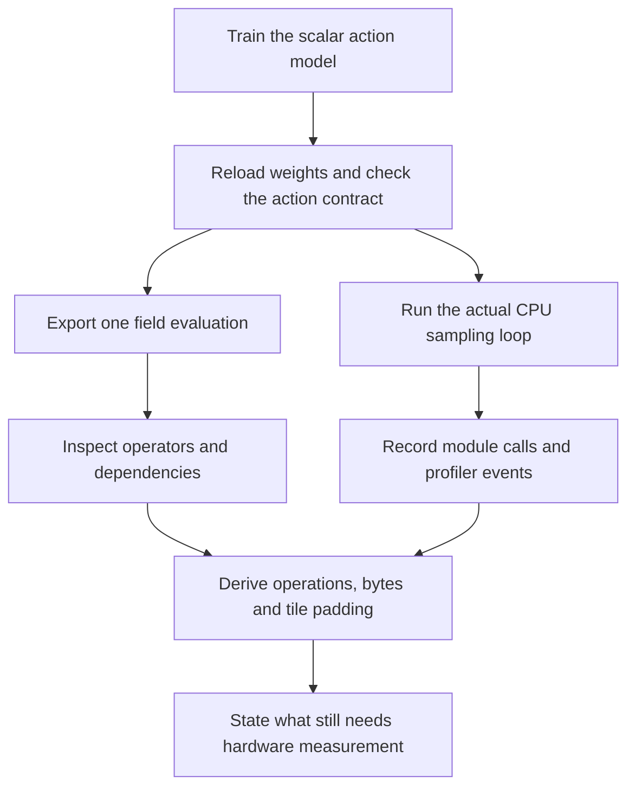

# Trace the model you trained, then size a candidate tile

[Workload lecture](Lecture-02.md) · [Tile lecture](Lecture-03.md) · [Analytical labs](Lab-Guide.md)

**Time:** 45–75 minutes after the action-generation lab. **Hardware:** CPU. **Requires:** the full course checkout and its CPU PyTorch environment. **Result:** a saved computation graph, actual CPU operator records, a checked parameter/work ledger, and a clearly labeled tile-efficiency estimate.

Start with the [diffusion and flow action lab](../../Track%20D%20-%20Robotics/VLA%20Foundations%20to%20Frontier%202026/Action-Generation-Lab.md). That lab trains a real small network on synthetic scalar actions. This lab takes its `flow-7.pt` checkpoint through the next engineering boundary. Neither exercise runs a vision-language foundation model or controls a robot.



## Predict three numbers

The network has linear layers `13 → 64 → 64 → 1`, with SiLU between layers. Its 13 input features combine the current scalar, time, eight sine/cosine time features, and three category indicators. For batch size one, the linear multiply-add estimate per field evaluation is

\[
2(13\times64+64\times64+64\times1)=9{,}984.
\]

This convention counts a multiply and an add as two operations. It excludes 129 bias additions, SiLU, time-feature construction, category encoding, and the Euler update. It is not a complete instruction count.

Count each layer's weights and biases separately:

| Layer | Weights | Biases | Parameters |
|---|---:|---:|---:|
| 13 → 64 | 832 | 64 | 896 |
| 64 → 64 | 4,096 | 64 | 4,160 |
| 64 → 1 | 64 | 1 | 65 |
| **Total** | **4,992** | **129** | **5,121** |

At FP32, each parameter occupies four bytes, giving **20,484 logical parameter bytes**. Running 32 Euler evaluations still stores one model, while invoking each linear layer 32 times. Predict the call count and operation estimate before reading the results below.

## Run the supplied trace

From the **repository root**, using the environment and output directory created by the prerequisite lab:

```bash
VLA_TRACE_LABS='Phase 5 - Advanced Topics and Specialization/Track F - AI Chip Design/Programmable VLA Inference Accelerator/labs'
/tmp/course-vla-actions-venv/bin/python -m unittest discover -s "$VLA_TRACE_LABS" -p 'test_trace_action_model.py' -v
/tmp/course-vla-actions-venv/bin/python "$VLA_TRACE_LABS/trace_action_model.py" --checkpoint /tmp/vla-action-run/flow-7.pt --output /tmp/vla-hardware-trace
```

The [script](labs/trace_action_model.py) rejects a diffusion checkpoint, reversed category order, a changed distribution schema, or nonfinite weights. It loads the state dictionary with PyTorch's restricted weights loader and requires the expected parameter structure. This verifies the course fixture's compatibility, not arbitrary checkpoint trustworthiness.

The program writes a JSON report, two serialized export artifacts for static batch sizes 1 and 7, and four CPU traces. Keep these in your own experiment directory. The course retains a [small recorded report](labs/model-trace-results.json), rather than committing generated binary models or the larger Chrome trace files.

## Read three kinds of evidence separately

| Artifact | What actually happened | Practical limit |
|---|---|---|
| Exported ATen graph | `torch.export` captured one field evaluation; changed values/time/categories were checked against eager execution | Static batch shape; the Python Euler loop was not exported or compiled into hardware |
| Module call rows | Hooks observed each of the three linear layers during a full sampling query | Hooks miss functional work such as sine, concatenation, and Euler updates |
| CPU profiler events | PyTorch recorded actual operator calls and input shapes during the query | Instrumentation affects timing; operator duration is not a DRAM-byte counter |

The script saves and reloads each exported artifact, then runs 12 probes against both the in-memory and reloaded graphs. It changes scalar values, time, and all three category IDs, including at batch size one. In the recorded run, both forms had zero maximum absolute error for both batch sizes. `torch.export` provides a graph with constraints; it is not by itself a code generator for the proposed accelerator. [PyTorch export documentation](https://docs.pytorch.org/docs/2.14/export.html)

Inspect `aten.sin`, `aten.cos`, `aten.one_hot`, `aten.cat`, `aten.silu`, and `aten.linear` in the graph. A tensor array supporting only matrix multiplication cannot execute this complete model without vector support or a visible fallback path. The profiler checks that the selected CPU runtime actually dispatches the expected `aten::linear` and `aten::addmm` calls. If a later version changes that lowering, the report fails for review rather than silently reusing the old interpretation. [PyTorch profiler documentation](https://docs.pytorch.org/docs/2.14/profiler.html)

## Compare the actual calls with the hand calculation

The October 18 run used Python 3.12.3, PyTorch 2.14.0+cpu, FP32 tensors, and one CPU thread. The five dedicated trace/export tests passed. See the [validation record](labs/model-trace-validation.json) for source identities and commands.

| Batch | Euler evaluations | Observed linear calls | Derived linear multiply-add operations | Distinct logical parameter bytes |
|---:|---:|---:|---:|---:|
| 1 | 8 | 24 | 79,872 | 20,484 |
| 1 | 32 | 96 | 319,488 | 20,484 |
| 7 | 8 | 24 | 559,104 | 20,484 |
| 7 | 32 | 96 | 2,236,416 | 20,484 |

Batch size changes the matrix row count. It does not change the number of layer invocations or stored parameters in this model. Integration evaluations multiply the number of invocations; they do not multiply parameter storage.

If every layer's parameters were fetched from a named external boundary on every call, 32 evaluations would transfer \(32\times20{,}484=655{,}488\) parameter bytes. The report calls this **hypothetical streamed traffic**. A 20 KiB model can be retained in a CPU cache; this profiler does not measure its actual DRAM traffic. Do not present the hypothetical number as a measured hardware bottleneck.

The report also keeps eleven warm wall-time measurements without hooks or profiler instrumentation. They include validation and the Python Euler loop. Read them as local observations under the recorded host load, with sample count and maximum observed time. They do not establish a hard bound, single-operator cost, robot response time, or accelerator speedup.

## Apply the tile model without changing the evidence label

For a proposed implementation that executes complete padded `16×16×16` tiles, the three observed matrix shapes yield **5.078% useful arithmetic** at batch 1 and **35.547%** at batch 7. The calculation pads all three dimensions and weights by issued scalar products; averaging per-layer percentages would give a different and misleading result.

Changing the row tile to 1 while retaining 16-wide column/reduction tiles gives **81.25%** for these shapes. That is a mapping estimate, not a measured performance gain. Such a design may have different multiplier count, data reuse, control overhead, ports, frequency, and area. The CPU run did not execute either hypothetical tile architecture.

The tiny final projection has only one output. Inspect how padding its output columns creates waste even after the row dimension is fixed. This is a concrete reason to trace short action heads before choosing a large square array.

## Finish with an honest hardware proposal

1. Identify the three matrix shapes from the graph and trace without reading the table. Reproduce the 32-evaluation operation count.
2. Separate logical parameter storage, assumed parameter traffic, temporary tensor sizes, and allocator peak. Which of these did the experiment actually measure?
3. Propose a mapping for the final `64 → 1` projection and one vector operation. List the conversion and fallback work it would need.
4. Explain why this small model is a poor DRAM-bandwidth benchmark for a multi-billion-parameter VLA. Which accounting method still transfers?
5. Link the original model's sampling-quality report. More Euler steps change both work and generated samples; the hardware report alone cannot decide the best number of steps.

**Completion:** retain the checkpoint/source identity, exported graph, CPU event report, hand calculation, and one rejected mapping assumption. Continue with the [actual MLIR lowering lab](../Labs/Tiling-and-Dataflow.md) for a small supported subgraph and the [prototype lecture](Lecture-09.md) for the remaining verification boundary.
