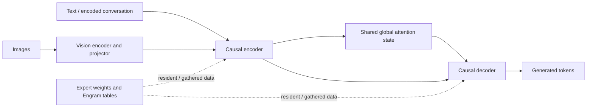

# Lecture 02 — Execution and memory budgets

**Prerequisites:** Lecture 01 and MoE routing. **Time:** 3 hours; CPU analysis, optional GPU validation. **Outcome:** construct a capacity plan that does not confuse active parameters with resident bytes.

## Read the actual computation graph

The [official model card](https://huggingface.co/deepseek-ai/DeepSeek-V4.1-Flash) describes a causal encoder-decoder, shared compressed attention state, Engram lookups, and a vision path. Draw these as separate consumers of memory and bandwidth. Do not reuse a V3 MLA cache formula without checking the V4.1 implementation.

The [technical report](https://arxiv.org/html/2609.19969v1) reports 552B backbone parameters plus 196B Engram parameters, with different active parameter counts for prefill and decode. Those active counts describe computation, not how many weights a deployment must store. This distinction is the central capacity-planning lesson.



This is a conceptual dataflow, not a runtime schedule. Local attention, indexing, residual paths, and speculative work must be added when profiling the actual implementation.

## Derive a per-rank budget

For rank r:

```text
peak_r = weights_r + persistent_cache_r + live_request_state_r
       + activations_r + kernel_workspace_r + communication_r
       + graph_pools_r + allocator_headroom_r
```

Separate host RAM and disk budgets from HBM. Checkpoint conversion can temporarily require both source and target buffers; a final steady-state fit does not guarantee startup fits.

**Worked example (invented teaching numbers):** a 480 GiB payload evenly divided over eight GPUs starts at 60 GiB/rank. Replicated tensors, 12 GiB of request state, 8 GiB of workspace, and 6 GiB of reserve would already bring the simplified total to 86 GiB before imbalance. This cannot fit a nominal 80 GiB device. The example is not a DeepSeek measurement.

For a checkpoint-specific exercise, the [default conversion card](https://huggingface.co/s-zaizen/DeepSeek-V4.1-Flash-NVFP4) reports 527.293 GB of weight files. Treating GB as decimal gives approximately 491.08 GiB, or 61.39 GiB/rank under an eight-way even split. This is publisher-reported file size and an optimistic arithmetic division, not measured residency. Reconcile it with the index and actual tensor placement before adding runtime allocations.

If only E experts are selected per token, all routed experts can still need residency somewhere in the expert-parallel group. A host-offload design trades residency for transfer, page-fault, and queueing costs.

## Account for traffic

Use an intentionally simple lower bound:

```text
stage_time >= max(bytes_from_HBM / sustainable_HBM_bandwidth,
                 operations / sustainable_compute_rate)
```

This is a bound for a stage, not a sum-free formula for the entire model. Add serial stages and account for overlap only when a trace demonstrates it.

Engram is a lookup path: track requested rows, unique rows, cache hit rate, locality, and transfer granularity. “Small useful bytes” does not imply cheap random I/O. Page-sized fetches, synchronization, and concurrent requests can dominate.

For sharding, classify every large tensor as partitioned, replicated, or offloaded. Tensor-parallel and expert-parallel dimensions are not always independent products; document the runtime's process groups.

## Lab

1. Run the audit from Lecture 01 and record payload bytes and shard count.
2. Create a table for expert weights, shared/dense weights, Engram, vision, cache, and temporary buffers. Leave unknown values explicit.
3. Calculate an even-sharding lower bound for two candidate GPU counts.
4. Add a scenario with replicated components and a deliberately imbalanced rank.
5. If hardware is available, measure every rank during load, warmup, graph capture, and the longest request. Explain differences from the estimate.

**Expected artifact:** a spreadsheet or script with units, a per-rank peak table, and a capacity decision. Reject a configuration if even its optimistic bound exceeds available memory.

**Independent transfer:** double concurrent context tokens while keeping model weights unchanged. Which budget terms change? Which might grow discontinuously because of graph capture or cache block allocation?

## Self-check

- Why is “16B active” not a 16B-parameter download? Routing reduces work per token; storage must cover all possible routed weights and other model components.
- Why can a nominally sufficient multi-GPU total still fail? Replication, imbalance, temporary allocation, and topology-specific layouts constrain individual ranks.
- What should an analytical result be labeled? An estimate with assumptions; validate it against startup and steady-state traces separately.

[Previous](Lecture-01.md) · [Overview](README.md) · [Next: NVFP4](Lecture-03.md)
