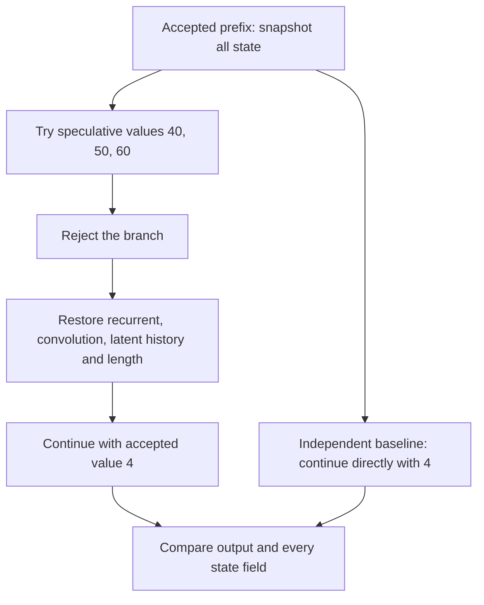

# CPU lab: understand a hybrid model's state

This lab turns Modules 03–09 into experiments you can inspect on a laptop.
You will update a tiny recurrent memory, compare two attention formulations,
reject speculative work, and account for memory at a stated concurrency.
The optional second session executes the actual upstream PyTorch KDA and KPool
reference functions without loading model weights.

**Prerequisites:** multiply a matrix by a vector, read a Python loop, and explain
why a request's cached state belongs to a particular prefix. Review
[Module 03](Lecture-03.md) if “decay, predict, correct, write, read” is unfamiliar.
Allow 60–90 minutes for the standard-library session and another 45–60 minutes
for the framework comparison, excluding installation. Python 3.12 was tested.

## Session 1: make the state visible

From the repository root, the directory containing `mkdocs.yml`:

```bash
COURSE_GLM='Phase 5 - Advanced Topics and Specialization/Track G - ML Systems Engineering/GLM-5.3-Flash Architecture Mastery/labs'
python3 "$COURSE_GLM/hybrid_reference.py"
python3 -m unittest discover -s "$COURSE_GLM" -p 'test_*.py' -v
```

The second command runs **21 tests** without network access or third-party
packages. Downloadable files: [reference](labs/hybrid_reference.py),
[tests](labs/test_hybrid.py), and [config snapshot](labs/checkpoint-config.json).
Keep these three files together if working outside a repository checkout.

The first output is:

```text
worked_state  = [[4.0, 0.5], [0.0, 4.0]]
worked_output = [4.0, 0.5]
```

The state is a table: rows correspond to key channels and columns to value
channels. It is neither a list of tokens nor a model weight being trained.
The query `[1,0]` reads the first row. Starting from `[[2,0],[0,4]]`, key `[1,0]`
predicts value `[2,0]`; the desired value is `[6,1]`. A write gate of one half
adds half of the error `[4,1]` to the selected row. The second row is untouched.

**Predict before changing code:** what happens when `beta=0`? What happens when
`beta=1`, the key has unit length, and decay is disabled?

<details markdown="1">
<summary>Worked answers</summary>

With zero write gate, only the decay changes state. With full write and a
unit-length key, querying that same key immediately after the update returns
the supplied value. The condition on the key matters: `kᵀk=1` is what makes the
correction replace the old association exactly in real arithmetic.

</details>

### Why operation order matters

The update is `S'=(I−βkkᵀ)DS + βkvᵀ`. `D` scales the **rows of S**, but it
scales the **columns of the transition matrix** when you form
`(I−βkkᵀ)D`. These are consistent views of the same multiplication.

Read `test_decay_correction_order_mutant_is_detected`. Its nonuniform decay,
nonzero initial state and key with two nonzero entries distinguish the correct
order from `D(I−βkkᵀ)`. Testing only zero state or uniform decay can hide this
error. The deliberately wrong version is expected to disagree; a passing test
means the test detected that disagreement.

`affine_update`, `compose`, and `apply_affine` provide a second mathematical
implementation. Composition is associative, so grouping updates into chunks
does not change the real-arithmetic result. It is not commutative: reversing
chunks changes the history. The portable implementation materializes tiny
dense matrices for clarity; it is not an efficient KDA kernel.

Shapes are checked before arithmetic. A ragged input such as
`[[1,2],[3]]` is not a 2×2 matrix. Python's `zip` would silently shorten a dot
product and could return a plausible result, so the reference rejects it.
Both attention formulations also reject mismatched query/projection dimensions,
and Sinkhorn rejects nonfinite epsilon and overflowing normalization sums.

### Why output checks alone can miss a bug

Consider two states, `[[1],[2]]` and `[[1],[99]]`. Query `[1,0]` returns 1 from
either, although their second rows differ substantially. A later query `[0,1]`
reveals the corruption. This is why you compare outputs **and carried state**,
then continue the sequence after a chunk boundary or checkpoint restore.

The test `test_output_agreement_can_hide_state_corruption` makes this example
executable. Change the first query to `[0.6,0.8]` and explain why it detects the
error immediately. Do not weaken a state check because one output happens to
match.

## Session 2: run the upstream recurrence and pooling code

The optional comparison needs PyTorch. Use an isolated environment; the
portable session above does not need it:

```bash
python3 -m venv /tmp/glm-course-env
/tmp/glm-course-env/bin/python -m pip install --index-url https://download.pytorch.org/whl/cpu -r "$COURSE_GLM/requirements-torch.txt"
/tmp/glm-course-env/bin/python "$COURSE_GLM/compare_transformers.py" --output /tmp/glm-reference-result.json
```

Keep the `COURSE_GLM` assignment from Session 1, or repeat it in a new terminal.
The comparison downloads one small Python source file at an immutable commit
and verifies its SHA-256 before extracting six named functions/methods. It
removes GPU dispatch decorators and executes the upstream **CPU fallback**.
It does not import an entire remote model module or download weights. Read the
[comparison script](labs/compare_transformers.py) to see the exact boundary.

For an offline rerun, pass `--source /path/to/modeling_glm5_next.py` using the
file from the pinned URL in [sources.json](labs/sources.json). A different
revision fails the hash check deliberately; review it before updating the pin.

The recorded run used PyTorch **2.14.0+cpu** and compared:

| Check | Cases | Observed maximum absolute error |
|---|---:|---:|
| Upstream recurrent vs chunked outputs | 64 | 2.98 × 10⁻⁷ |
| Upstream recurrent vs chunked final state | Same 64 | 2.98 × 10⁻⁷ |
| Independent Python recurrence vs upstream output | Every batch/head/token in those inputs | 2.07 × 10⁻⁷ |
| Chunked prefix followed by recurrent continuation | 14 prefix/suffix cases | 1.79 × 10⁻⁷ |
| Actual upstream pooling, visibility and tail methods | 72 prefix/padding cases | Exact index agreement |
| Nonuniform pooling and mixed-length batches | One hand calculation, six pool slots and nine multi-query tails | Weighted values agree; indices exact |

The inputs use two batches, two heads, key dimension 3 and value dimension 5.
Sequence lengths are 1, 3, 4, 5, 7, 8, 9 and 65; chunks are 1, 4, 8 and 64.
Both normalization modes are checked. Rectangular states expose transposition
errors that a square example can conceal. Declared tolerances are recorded in
the script; the measured errors above are results, not universal error bounds.

**Two easy mistakes:** the upstream function accepts log-decays `g`, while the
portable function accepts `exp(g)`; the upstream function also applies query
scaling by `1/sqrt(d_k)`. Double-applying either conversion changes the model.
When enabled, upstream L2 normalization uses `sqrt(sum(x²)+1e−6)`, which differs
from clipping the denominator to an epsilon after computing the norm.

For pooling, four visible tokens form a complete pool. A query at position 3
can select positions `[0,1,2,3]`; a query at position 2 cannot select that pool
representation. Its three visible tokens belong to the incomplete tail.
The tests include left and right padding, plus invalid tail slots marked `−1`.
The tested methods assume contiguous valid tokens after left padding. Packed
documents need segment isolation in a supporting backend and are not validated
by this comparison.

The original pooling examples use zero gate scores and position weights, so
the result is a simple mean. The additional check uses different weights in
each channel: token values `[1,2,3,4]` weighted by `[2,2,9,8]` produce
`65/21`, while `[10,20,30,40]` weighted by `[4,9,4,4]` produce `500/21`.
These are independently calculated targets for the actual upstream method.
The mixed batch contains different left-padding offsets and valid lengths,
including one entirely padded request. Invalid pools must remain masked; a
pool valid for one request must not become valid for another.

## Session 3: preserve attention and restore a rejected branch

### Move a projection without changing attention

For cached latent `c`, expanded key `k=U_K c`, and query `q`, both scores
`qᵀ(U_K c)` and `(U_Kᵀq)ᵀc` are equal in real arithmetic. Apply the same
softmax scale and mask in both paths. After attention weighting, move the
fixed value projection outside the weighted sum too.

Read `mla_expanded` and `mla_absorbed`. One materializes historical keys and
values; the other transforms the query and accumulates in latent space. Tests
compare their outputs at multiple history lengths and deliberately detect a
missing scale. This is a single-head algebra check with invented small inputs,
not execution of the full GLM sparse-attention layer.

### Restore every part of the same prefix

The `HybridState` fixture has a recurrent matrix, a short convolution history,
a latent history and a prefix length. Its tiny weights and output formula are
invented to make each state field observable. They do not reproduce GLM.



The test first processes `[1,−2,3]`, saves a deep copy, tries a rejected branch,
then continues with 4 from the snapshot. Three deliberate partial-restore
versions each leave one state component dirty. All three produce a different
continuation even though their prefix-length counter is correct.

**Explain:** why does a shallow copy fail for nested lists? Why can shortening
the latent list not undo the recurrent update?

<details markdown="1">
<summary>Worked answers</summary>

A shallow copy can retain references to the same nested arrays, so writing one
branch changes another branch or the saved checkpoint. A recurrent update
overwrites a summary rather than appending a separately removable token. A
correct rollback restores a snapshot or recomputes from a known prefix. A
complete server must also reconcile sampler, penalty, position and draft state.

</details>

## Session 4: check two tempting but false shortcuts

**“Doubly stochastic mixing preserves signal magnitude.”** It preserves each
feature's sum across streams in exact arithmetic. It can still average `[1,−1]`
to `[0,0]`. Run the cancellation test before reading the corrected
[mHC lesson](Lecture-07.md). The generic Sinkhorn helper shows how finite
iterations approach row/column sums of one; GLM additionally learns the
coefficients and uses epsilon stabilizers. The helper is not the full module.

**“Divide every cache by eight, then multiply only recurrent state by batch.”**
The example ledger explicitly assumes head-sharded FP32 KDA and replicated
BF16 MLA latents. For one request across all KDA layers, `34×64×128×128×4`
bytes is **136 MiB**, or **17 MiB per GPU** at TP=8. MLA uses
`11×T×512×2` bytes **per GPU** under the replication assumption: **11 GiB** at
`T=1,048,576`. Two requests double both terms. Weights, indexer, convolution,
rollback snapshots and workspace remain separate allocations.

Change `memory_ledger(context=131072, requests=2, tensor_parallel=8)` by one
argument at a time. Increasing TP reduces the KDA term in this fixture; it
does not reduce the replicated MLA term. Real runtime sharding, cache formats
and allocation policies must be inspected before applying this estimate.

## Finish with an independent variation

Choose a new sequence length and nonuniform decay pattern. Predict which
comparisons should remain equal, run the experiment, and save the worst output
and final-state errors. Then deliberately restore only a correct prefix counter
and demonstrate why it is insufficient. Your result should include the failing
input, state field that diverged, and a corrected continuation.

You are ready for the next module when you can explain a recurrence update by
hand, distinguish a real state mismatch from rounding, and write a memory
budget with the same request count in every request-dependent term.

## Sources and execution boundary

The [official config](https://huggingface.co/zai-org/GLM-5.3-Flash/blob/46a050bec13002ad29ee795c16e61cf4fa3c4a9c/config.json)
is pinned separately from the [Transformers reference implementation](https://github.com/huggingface/transformers/blob/d4804f9d76b8c071b993d813e9e87067b780cbee/src/transformers/models/glm5_next/modeling_glm5_next.py).
The [Kimi Linear paper](https://arxiv.org/abs/2510.26692) explains the underlying
KDA architecture. The [SparkInfer deployment report](https://github.com/gittensor-ai-lab/sparkinfer-frontier/blob/58ca63a416bcc866dbf8b8a2605643a51a5b221a/README.md)
is a separate, source-attributed NVFP4 deployment case, not a local measurement.

Retained evidence: [framework results](labs/framework-result.json),
[portable sample output](labs/sample-run.json), [source pins](labs/sources.json),
and [validation with file hashes](labs/validation.json). The native model,
vision tower, full sparse attention, CUDA/FLA kernels, packed-document serving,
multi-GPU topology and full-model quality were not executed for this lab.
