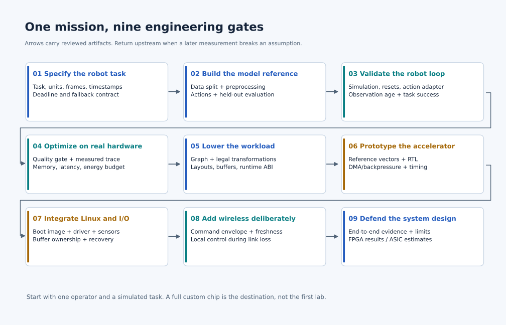
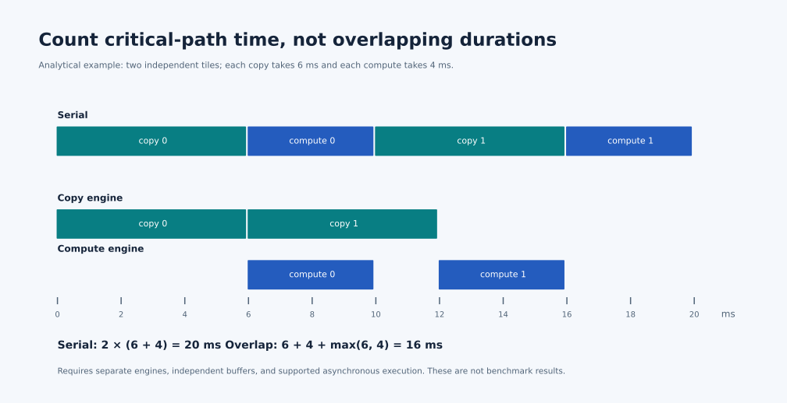
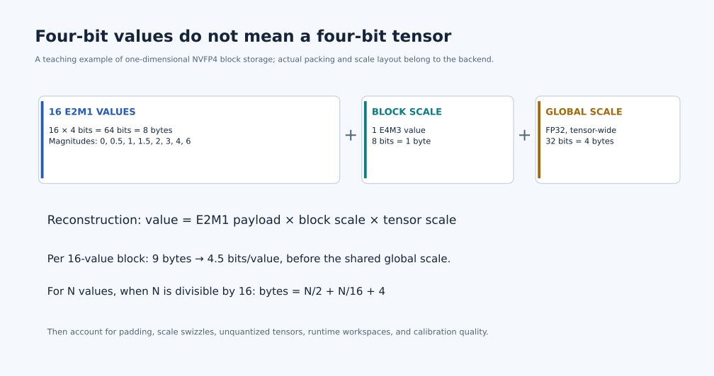

# Physical AI Design Studio — one task, from model to SoC

Build one coherent system while studying the roadmap: a vision-language-action policy that completes a defined task, a measured inference path, a compiler that lowers part of that path, and an accelerator prototype integrated with Linux and wireless. Every course contributes an artifact that the next course can use.

This is an integration project after the introductory experiments. If both AI and
robotics are new, complete the [beginner sequence](Start-Here.md#follow-a-short-learning-sequence)
first. Its cart is a small preparation exercise; completing it does not complete
the manipulation or model-to-chip gates below.

Start with **simulated tabletop manipulation**: observe an object, interpret a short instruction, and place it in a specified region. Choose a released policy with a supported embodiment and document any adaptation. A drone variant can use a simulator and a bounded waypoint/trajectory interface; its state estimator and local flight controller remain separate from language planning.

The first complete result is a reproducible software or FPGA prototype. A fabricated ASIC additionally needs physical implementation, sign-off, fabrication, packaging, board integration, and bring-up. Label evidence by the stage actually completed.

*Read each arrow as an artifact handoff. If a later measurement invalidates an assumption, return to its source gate. [Download PNG](Assets/illustrations/learning-path/mission-gates.png).*

## Choose your starting gate

| Your background | Begin with | Fill the next gap when needed |
|---|---|---|
| New to AI | Gate 1, then neural networks and frameworks in Gate 2 | Architecture and Linux alongside the first deployment |
| Model/inference engineer | Establish Gates 1–3 with an existing policy | Compiler, RTL, and device integration in Gates 5–7 |
| Embedded/RTL engineer | Gate 1 and a small model reference | VLA action semantics and closed-loop evaluation before choosing the datapath |
| Robotics engineer | Your task contract and simulator baseline | Kernel profiling, compiler lowering, and memory architecture |

Use [the entry diagnostics](Learning-Guide.md#diagnose-before-reading) to skip material you can already demonstrate. The GPU cluster, voice, agent, autonomous-driving, and multi-robot branches are useful specializations; they are not all prerequisites for one working physical-AI system.

## Gate 1 — specify the task and its contracts

**Study:** [VLA foundations](Phase%205%20-%20Advanced%20Topics%20and%20Specialization/Track%20D%20-%20Robotics/VLA%20Foundations%20to%20Frontier%202026/README.md), [sensor fusion](Phase%203%20-%20Artificial%20Intelligence/Track%20A%20-%20Hardware%20and%20Edge%20AI/4.%20Sensor%20Fusion/Guide.md), and [ROS 2 robotics](Phase%205%20-%20Advanced%20Topics%20and%20Specialization/Track%20D%20-%20Robotics/Advanced%20Robot%20Operating%20System/Lecture-01.md).

Write a one-page contract before selecting the chip:

| Boundary | Required fields |
|---|---|
| Task | Scene distribution, instruction set, success/failure criteria, episode timeout |
| Observation | Sensor IDs, shape, dtype, layout, color/normalization, source timestamp, clock domain, frame, units |
| Policy | Checkpoint/revision, preprocessing revision, history/state, sampling settings, supported shapes |
| Action | Joint/task-space representation, units/frame, normalization, chunk length, action interval, validity/expiry |
| Runtime | Memory budget, observation-to-action deadline, controller rate, fallback/recovery behavior |
| Evidence | Train/calibration/evaluation split, seeds, reference version, quality/timing acceptance criteria |

**Worked question:** a controller ticks every 5 ms, the policy produces a chunk every 100 ms, and each action in the chunk represents 20 ms. These are three different rates. Explain how the controller consumes/interpolates the chunk and what happens if the next chunk is late; do not describe the policy as running at 200 Hz.

**Exit:** another learner can construct one valid observation and reject one invalid action using your contract. Carry the contract into every following gate.

## Gate 2 — establish a model and data reference

**Study:** [Neural Networks](Phase%203%20-%20Artificial%20Intelligence/1.%20Neural%20Networks/Guide.md) → [frameworks](Phase%203%20-%20Artificial%20Intelligence/2.%20Deep%20Learning%20Frameworks/Guide.md) → the relevant VLA architecture/data/training lectures. Use [Practical ML](Phase%203%20-%20Artificial%20Intelligence/Track%20B%20-%20Agentic%20AI%20and%20ML%20Engineering/4.%20ML%20Engineering%20and%20MLOps/Practical%20Machine%20Learning%20%28CS329P%29/README.md) for evaluation design.

First make a tiny tensor program numerically correct. Then load a usable policy artifact and record the complete preprocessing-to-action path. Separate training, calibration, validation, and final test data; split robot data by episode or collection condition so adjacent frames do not leak across partitions.

**Start on a CPU:** the [small-policy lab](Phase%203%20-%20Artificial%20Intelligence/0.%20AI%20and%20Robot%20Learning%20Foundations/Lab-01-CPU-Policy.md) teaches training, held-out episodes, saving and reloading without installing an ML framework. For generative action heads, the [action-generation lab](Phase%205%20-%20Advanced%20Topics%20and%20Specialization/Track%20D%20-%20Robotics/VLA%20Foundations%20to%20Frontier%202026/Action-Generation-Lab.md) trains small diffusion and flow networks on a known distribution. Its category labels are not language understanding, and its scalar samples are not a manipulation policy. Use these small experiments to learn the mechanics before replacing them with your task's observation/action model.

**Build:** a frozen reference runner, a small golden-input set, tensor/operator inventory, and checkpoint/normalization manifest. Include action denormalization and embodiment adaptation in the reference, not as undocumented postprocessing.

**Challenge:** swap a camera channel or normalization statistic and verify that the input checks or quality evaluation detect the error. Low text perplexity does not establish correct robot actions.

**Exit:** reproduce reference outputs under stated sampling/numerical assumptions and explain the largest tensors. Export both golden vectors and dataset provenance to Gate 3.

## Gate 3 — close and validate the robot loop

**Study:** [Isaac Sim / Isaac Lab](Phase%205%20-%20Advanced%20Topics%20and%20Specialization/Track%20D%20-%20Robotics/Isaac%20Sim%20and%20Isaac%20Lab/README.md) and its [engineering labs](Phase%205%20-%20Advanced%20Topics%20and%20Specialization/Track%20D%20-%20Robotics/Isaac%20Sim%20and%20Isaac%20Lab/Lab-Guide.md). Add [Deep RL](Phase%205%20-%20Advanced%20Topics%20and%20Specialization/Track%20D%20-%20Robotics/Deep%20RL%20for%20Robot%20Learning/README.md) when the task needs policy improvement; RL training is not required just to profile a released policy.

*Follow one observation through the loop. Where does its age get checked? [Download PNG](Assets/illustrations/learning-path/robot-loop.png).*

**Practice the timing contract first:** the [timed robot-loop lab](Phase%203%20-%20Artificial%20Intelligence/0.%20AI%20and%20Robot%20Learning%20Foundations/Lab-02-Timed-Robot-Loop.md) reruns Gate 2's small cart training procedure once, then holds those learned weights fixed across explicit processing and transport queues. It does not read the saved JSON policy; the MuJoCo bridge below does. Compare FIFO and freshness policies on the same episodes. It models observation age and applied commands; it does not require or emulate Isaac physics.

For actual CPU-engine dynamics before a larger scene, the [MuJoCo bridge](Phase%203%20-%20Artificial%20Intelligence/0.%20AI%20and%20Robot%20Learning%20Foundations/Lab-03-CPU-Physics.md) reuses the same policy and checks mass-to-force conversion, physics substeps, reset state and simulator warnings. Its sliding cart has no contacts or image observations; those remain additional model and validation work.

**Build:** a versioned scene, reproducible reset, observation/action adapter, paired evaluation episodes, and a timeline with sensor capture, policy start/end, validation, and action consumption. Keep simulation time and host wall time separate. Report both task outcomes and runtime behavior.

**Challenge:** inject delay, sensor dropout, and an action in the wrong frame. The local controller must have defined behavior when no fresh policy action is available. Replay the failure case after the fix.

**Exit:** the reference completes the declared task suite, failure handling is observed, and timing has a consistent clock interpretation. Simulator success is evidence for this simulator/task, not a claim of real-world reliability.

## Gate 4 — optimize the measured inference path

**Study:** [ML systems measurement](Phase%205%20-%20Advanced%20Topics%20and%20Specialization/Track%20G%20-%20ML%20Systems%20Engineering/Guide.md), [kernel engineering](Phase%204%20-%20Track%20C%20-%20DL%20Inference%20Optimization/Guide.md), [VLA optimization and action parity](Phase%205%20-%20Advanced%20Topics%20and%20Specialization/Track%20D%20-%20Robotics/VLA%20Optimization%20and%20Action-Parity%20Harness/README.md), and [Jetson deployment](Phase%204%20-%20Track%20B%20-%20Nvidia%20Jetson/1.%20Nvidia%20Jetson%20Platform/Guide.md).

Profile preprocessing, vision encoder, backbone, action head, state, transfers, and dispatch. State workload shape, warmup, precision, clock/power mode, concurrency, and sampling. Compare candidates against the frozen reference with paired episodes, quality uncertainty, latency distributions, live memory, and energy where measurable.

*Two 6 ms copies and two 4 ms computes take 20 ms in sequence. Independent copy/compute resources permit a 16 ms schedule. Explain the dependency that prevents 12 ms. This is an analytical example, not a benchmark. [Download PNG](Assets/illustrations/learning-path/critical-path.png).*

The [DeepSeek V4.1 Flash NVFP4 course](Phase%205%20-%20Advanced%20Topics%20and%20Specialization/Track%20G%20-%20ML%20Systems%20Engineering/AI%20Inference%20Engineer%202026/Part%205%20-%20DeepSeek%20V4.1%20Flash%20NVFP4/README.md) teaches checkpoint packing, sparse compute, state, placement, and runtime compatibility at a very different scale. The [official model card](https://huggingface.co/deepseek-ai/DeepSeek-V4.1-Flash) describes a multimodal text-output model; using it as a robot policy requires additional action modeling and validation. Transfer its applicable format and systems lessons to the selected VLA, or study it as an optional remote planner.

**Exit:** one accepted optimization, or a well-supported explanation of why a candidate failed. Export the actual hot operator shapes, traffic, precision/error budgets, and timing requirements to Gate 5.

**A complete small handoff:** the [model-to-hardware lab](Phase%205%20-%20Advanced%20Topics%20and%20Specialization/Track%20F%20-%20AI%20Chip%20Design/Programmable%20VLA%20Inference%20Accelerator/Model-to-Hardware-Lab.md) reloads the flow checkpoint trained in Gate 2's action-generation lab. It exports the actual network, checks changed inputs after saving/reloading the export, profiles CPU operator calls, and derives operation counts and tile occupancy. The full solver stays in Python; measured CPU time and hypothetical accelerator tiles are reported separately. This provides a reproducible Gate 4 artifact even before a large VLA or accelerator is available.

**Accelerator handoff:** use the [memory-residency study](Phase%205%20-%20Advanced%20Topics%20and%20Specialization/Track%20F%20-%20AI%20Chip%20Design/Programmable%20VLA%20Inference%20Accelerator/Lecture-04.md) to separate capacity from repeated traffic, and the [fresh-action scheduling lab](Phase%205%20-%20Advanced%20Topics%20and%20Specialization/Track%20F%20-%20AI%20Chip%20Design/Programmable%20VLA%20Inference%20Accelerator/Lecture-07.md) to test whether a faster policy also reacts sooner.

## Gate 5 — design the compiler contract

**Study:** [compiler stack](Phase%204%20-%20Track%20C%20-%20DL%20Inference%20Optimization/03%20-%20Compiler%20Stack/Guide.md), [tinygrad](Phase%203%20-%20Artificial%20Intelligence/2.%20Deep%20Learning%20Frameworks/tinygrad/Guide.md), and [TVM](Phase%205%20-%20Advanced%20Topics%20and%20Specialization/Track%20G%20-%20ML%20Systems%20Engineering/TVM%20Deep%20Dives/README.md).

Start with one measured subgraph, such as a projection plus activation. Define supported shapes, strides, element types, quantization metadata, accumulation/rounding, alignment, and aliasing. Lower to a software target first. Preserve a slow reference and test tails, padding, saturation, and state lifetime.

*For this 1D layout and `N` divisible by 16, storage is `N/2 + N/16 + 4` bytes before padding and other tensors. For `N=4096`, derive **2308 bytes**, then explain why a complete checkpoint needs a larger inventory. [Download PNG](Assets/illustrations/learning-path/nvfp4-storage.png). See the [format reference](https://docs.nvidia.com/deeplearning/transformer-engine/features/low_precision_training/nvfp4/nvfp4.html).*

**Build:** graph/IR snapshots, lowered kernel, buffer-lifetime plan, command descriptor, and a host/device ABI. Decide which unsupported operators fall back to the CPU/GPU and measure boundary transfers. An NVFP4 checkpoint does not by itself require an FP4 arithmetic unit; compare native arithmetic with a supported dequantization path.

**Exit:** reference vectors pass before and after lowering, and the ABI is precise enough for an RTL engineer to implement. Export it unchanged to Gate 6.

**Worked contract:** [compiler, runtime ABI, and SoC integration](Phase%205%20-%20Advanced%20Topics%20and%20Specialization/Track%20F%20-%20AI%20Chip%20Design/Programmable%20VLA%20Inference%20Accelerator/Lecture-06.md) connects lowering to buffer ownership, DMA, completion, errors, and the Linux driver boundary. Use it to review the command interface with its future implementer.

## Gate 6 — prototype the accelerator and memory system

**Study:** [digital foundations](Phase%201%20-%20Foundational%20Knowledge/Guide.md), [FPGA deployment](Phase%204%20-%20Track%20A%20-%20Xilinx%20FPGA/1.%20Xilinx%20FPGA%20Development/Guide.md), and [AI chip design](Phase%205%20-%20Advanced%20Topics%20and%20Specialization/Track%20F%20-%20AI%20Chip%20Design/Guide.md).

Choose compute width and local memory from Gate 4's shape distribution, not a headline TOPS target. Implement one operator with DMA, a command queue, completion/error reporting, and backpressure. Use the compiler's golden vectors in simulation before FPGA execution.

**Challenge:** odd dimensions, maximum values, reset during work, a stalled consumer, and a failed command. Check that buffer ownership remains correct and completion cannot refer to an overwritten input.

**Exit:** simulation checks and, when hardware is available, FPGA resource/timing and host-to-host latency results. A kernel taking 1 ms plus 4 ms of transfers is a 5 ms path before other overhead; report both. Keep ASIC area/power/timing estimates separate from FPGA measurements.

**Implementation evidence:** follow [prototype to silicon feasibility](Phase%205%20-%20Advanced%20Topics%20and%20Specialization/Track%20F%20-%20AI%20Chip%20Design/Programmable%20VLA%20Inference%20Accelerator/Lecture-09.md) to turn the selected subgraph into a verified vertical slice, then identify the technology, memory-interface, and physical-design evidence still needed for an ASIC decision.

## Gate 7 — integrate embedded Linux and physical I/O

**Study:** [embedded software](Phase%202%20-%20Embedded%20Systems/2.%20Embedded%20Software/Guide.md), [embedded Linux](Phase%202%20-%20Embedded%20Systems/3.%20Embedded%20Linux/Guide.md), and [runtime/driver development](Phase%204%20-%20Track%20B%20-%20Nvidia%20Jetson/8.%20Runtime%20and%20Driver%20Development/Guide.md).

Produce a reproducible boot image and a driver/runtime implementing Gate 5's ABI. Document device-tree resources, interrupts, DMA addressability, cache/coherence rules, timeouts, and recovery. Integrate timestamped sensor buffers without assuming shared DRAM means zero-copy or automatic synchronization.

**Challenge:** restart a userspace client, reject a malformed descriptor, time out a device command, and rerun the golden vectors. Measure sustained observation-to-action timing under competing CPU and I/O load.

**Exit:** clean boot-to-inference reproduction, correct buffer ownership, recovery evidence, and a latency report. Carry this image and manifest into Gate 8.

## Gate 8 — add wireless without stalling local execution

**Study:** the [embedded Linux connectivity path](Phase%202%20-%20Embedded%20Systems/3.%20Embedded%20Linux/Jetson%20ESP-Hosted%20Host%20Code/Guide.md), plus the wireless sections of the [SoC capstone](Phase%205%20-%20Advanced%20Topics%20and%20Specialization/Track%20F%20-%20AI%20Chip%20Design/Guide.md#physical-ai-soc-capstone).

Start with telemetry and bounded task requests. Define message identity, authentication, sequence number, units, expiry, acknowledgement, and duplicate handling. Account for separate device clocks; subtracting timestamps from unsynchronized clocks is not a latency measurement.

**Challenge:** delay, duplicate, reorder, and drop messages in a local test. Disconnect the link while the simulated robot executes. Verify the local controller's defined behavior and record reconnection without replaying expired commands.

**Exit:** measured link behavior and a local-control continuity result. A radio module validates the interface and protocol; integrated RF design and certification are additional hardware work.

## Gate 9 — defend the complete system

Re-run the original held-out task suite through the integrated path. Compare it with Gate 3's reference and explain the quality, latency, memory, and energy tradeoffs. Use [interview preparation](Phase%206%20-%20Interview%20Preparation/README.md) to practice defending the evidence.

Submit one repository with these connected artifacts:

1. Task and observation/action contracts; data and checkpoint provenance.
2. Reference runner, simulator scene, golden vectors, and evaluation records.
3. Optimization report with raw measurements and negative results.
4. Compiler IR, layout/precision contract, runtime ABI, and generated artifact.
5. RTL/FPGA results, Linux image/driver recipe, and wireless failure tests.
6. System diagram, limits, reproduction commands, and an ASIC implementation proposal if pursuing silicon.

For every headline number, label it **measured**, **analytical estimate**, **reported by a cited source**, or **not run**. Ask another learner to reproduce a bounded result from the saved artifacts. Completion means the claims survive that check, not that every optional branch has been read.

## How to study between gates

Use a short repeated cycle: predict an outcome, work a numerical example, build the smallest baseline, vary one assumption, explain the evidence, and return later to reconstruct the reasoning without notes. At each handoff, answer: **what does the next layer need that my current artifact does not yet specify?**

The [current curriculum review](Curriculum-Review.md) records what was inspected and improved; the [earlier course-by-course ledger](Curriculum-Reviews/README.md) retains historical review evidence. The [learning guide](Learning-Guide.md) supplies the common rubric and hardware access routes. Original teaching figures and regeneration instructions are in [the illustration catalog](Assets/illustrations/learning-path/README.md).
