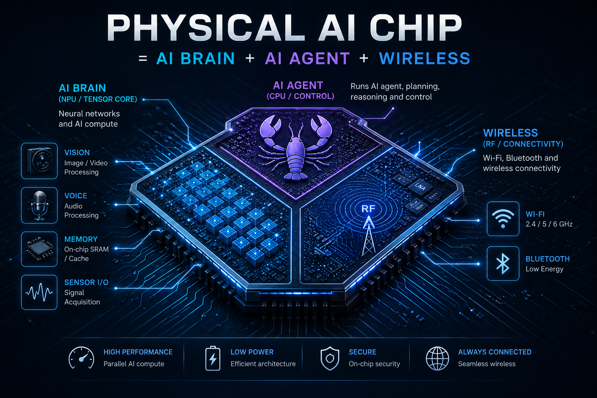
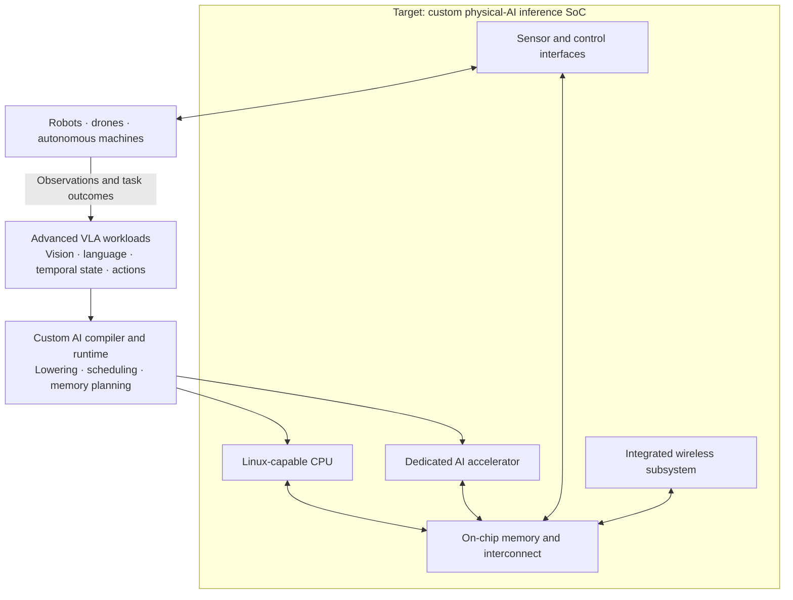
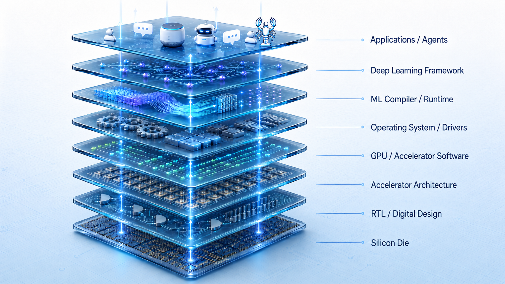

<div class="home-hero">
<div class="home-hero__copy">
<p class="home-hero__eyebrow">The AI Hardware Engineer Roadmap</p>
<h1 class="home-hero__title"><span>Master AI on hardware.</span> <span>Build the physical AI chip.</span></h1>
<p class="home-hero__lede">Design a custom system-on-chip for advanced vision-language-action models: dedicated AI acceleration, your own AI compiler, embedded Linux, and integrated wireless. Learn the full stack from models to silicon to power the next generation of robots, drones, and autonomous machines.</p>
</div>
<div class="home-hero__art">
  
</div>
</div>

<div class="home-rail" markdown="1">

**New to robotics or AI? [Start with a small robot experiment on your laptop](Start-Here.md).** Follow ten guided sessions through motion, control, AI training, evaluation, perception, and planning before choosing a specialization.

## Explore the curriculum

Six phases toward one goal: a complete physical-AI chip and its software stack.

- [<span class="home-rail__n">01</span> <span class="home-rail__copy"><strong class="home-rail__t">Digital Foundations</strong><br /><span class="home-rail__description">Logic, computer architecture, and accelerator foundations.</span></span>](Phase%201%20-%20Foundational%20Knowledge/Guide.md)
- [<span class="home-rail__n">02</span> <span class="home-rail__copy"><strong class="home-rail__t">Embedded Systems</strong><br /><span class="home-rail__description">Boards, firmware, embedded Linux, and wireless.</span></span>](Phase%202%20-%20Embedded%20Systems/Guide.md)
- [<span class="home-rail__n">03</span> <span class="home-rail__copy"><strong class="home-rail__t">Artificial Intelligence</strong><br /><span class="home-rail__description">Neural networks, vision-language models, and AI agents.</span></span>](Phase%203%20-%20Artificial%20Intelligence/Guide.md)
- [<span class="home-rail__n">04</span> <span class="home-rail__copy"><strong class="home-rail__t">Deployment &amp; Compilation</strong><br /><span class="home-rail__description">AI compilers, GPU kernels, and inference runtimes.</span></span>](Phase%204%20-%20Track%20C%20-%20DL%20Inference%20Optimization/Guide.md)
- [<span class="home-rail__n">05</span> <span class="home-rail__copy"><strong class="home-rail__t">Specialization</strong><br /><span class="home-rail__description">VLA robotics, drones, ML systems, and custom SoCs.</span></span>](Phase%205%20-%20Advanced%20Topics%20and%20Specialization/Guide.md)
- [<span class="home-rail__n">06</span> <span class="home-rail__copy"><strong class="home-rail__t">Interview Prep</strong><br /><span class="home-rail__description">Practice technical questions and explain your work.</span></span>](Phase%206%20-%20Interview%20Preparation/README.md)

</div>

---

## The Goal

> **Master AI on hardware, then design a custom physical-AI inference system-on-chip built around advanced VLA models—with a dedicated accelerator, an AI compiler, embedded Linux, and integrated wireless.**

The destination is a complete computing platform for robots, drones, and other autonomous machines. Start by understanding how a model sees, reasons, remembers, and produces actions. Use that workload to design the compute, memory, compiler, runtime, operating system, sensor interfaces, and wireless subsystem together. The chip and its software should serve the machine's behavior: useful autonomy within measured latency, energy, memory, and reliability budgets.

**Native VLA support** means the model's actual execution path shapes the architecture: visual encoding, attention, temporal state, action generation, numerical formats, data movement, and control timing. The compiler must map that workload to the accelerator, and the runtime must carry observations through to usable actions. Design for a defined set of frontier workloads and evaluate new model revisions as they emerge, with programmable components and explicit operator coverage.

| Part of the target system | What you will design and demonstrate |
|---|---|
| **AI accelerator** | Compute units, supported precision, on-chip memory, dataflow, and DMA chosen from measured VLA bottlenecks |
| **AI compiler and runtime** | Model import, intermediate representations, graph lowering, tiling, scheduling, memory planning, code generation, and device execution |
| **Linux-capable SoC** | CPU, interconnect, memory interfaces, boot flow, firmware, drivers, device tree, and a reproducible embedded Linux image |
| **Wireless subsystem** | Integrated connectivity, host/firmware interfaces, telemetry, updates, and defined behavior under communication loss |
| **Physical interfaces** | Camera and sensor inputs, time synchronization, actuator interfaces, and a clear boundary between policy inference and low-level control |
| **Robotics and drone applications** | Validated tasks, closed-loop outcomes, sensor-to-action latency, sustained power, and recovery under disturbances |

GPU and Jetson experiments establish workload evidence; FPGA and board prototypes validate architecture and interfaces. These feed the [custom SoC capstone](Phase%205%20-%20Advanced%20Topics%20and%20Specialization/Track%20F%20-%20AI%20Chip%20Design/Guide.md#physical-ai-soc-capstone), then implementation and silicon bring-up. Each stage produces evidence for the next.

---

## Who This Is For

- **AI/ML engineers** who want to stop treating inference as a black box and design the chip that runs it.
- **Inference engineers** who want to co-design VLA execution, AI compilers, and custom accelerators.
- **Embedded/firmware engineers** who want to connect Linux, wireless, sensors, and AI acceleration on a custom SoC.
- **Hardware/RTL/FPGA engineers** who want real model and compiler requirements to guide accelerator design.
- **Robotics engineers and students** who want to build the computing platform behind intelligent robots, drones, and autonomous devices.

**Baseline:** comfortable with Python or C++, and basic Linux command-line use. No prior hardware background required.

**Already past the basics?** [Phase 1](Phase%201%20-%20Foundational%20Knowledge/Guide.md) and [Phase 2](Phase%202%20-%20Embedded%20Systems/Guide.md) exist to fill specific gaps — digital logic, embedded Linux — not to gate you. If you already know CUDA/C++, go straight to [Phase 3](Phase%203%20-%20Artificial%20Intelligence/Guide.md) and pick up Phase 1–2 material only where a later module says you need it.

You can enter through software, robotics, or hardware. Choose one working artifact first and add lower-level material as your project needs it.

---

## Learn by building and testing

Follow the [**Physical AI Design Studio**](Physical-AI-Design-Studio.md) to connect the courses through one project: task contract → VLA reference → robot simulation → measured inference → compiler → accelerator → Linux → wireless → system evidence. Each gate names the courses to study, the artifact to build, and the check needed before proceeding. Includes original diagrams with downloadable PNGs.

The [October 18–19 curriculum review](Curriculum-Review.md) links the revised lessons and their execution evidence. For a connected AI/robotics experiment, [train a small CPU policy](Phase%203%20-%20Artificial%20Intelligence/0.%20AI%20and%20Robot%20Learning%20Foundations/Lab-01-CPU-Policy.md), then run it in a [timed robot loop](Phase%203%20-%20Artificial%20Intelligence/0.%20AI%20and%20Robot%20Learning%20Foundations/Lab-02-Timed-Robot-Loop.md).

Start with [How to learn this roadmap](Learning-Guide.md): entry diagnostics, a repeatable lesson cycle, hardware access options, and a shared completion rubric. Each course's practice section asks you to predict a result, build a baseline, test a variation, and explain the evidence.

New applied sequences: [DeepSeek V4.1 Flash NVFP4 inference engineering](Phase%205%20-%20Advanced%20Topics%20and%20Specialization/Track%20G%20-%20ML%20Systems%20Engineering/AI%20Inference%20Engineer%202026/Part%205%20-%20DeepSeek%20V4.1%20Flash%20NVFP4/README.md) and [Isaac Sim / Isaac Lab engineering labs](Phase%205%20-%20Advanced%20Topics%20and%20Specialization/Track%20D%20-%20Robotics/Isaac%20Sim%20and%20Isaac%20Lab/Lab-Guide.md). Both have CPU exercises and separate milestones for work requiring compatible GPU hardware.

New professional course: [**VLA Foundations to Frontier 2026 — 32 lectures**](Phase%205%20-%20Advanced%20Topics%20and%20Specialization/Track%20D%20-%20Robotics/VLA%20Foundations%20to%20Frontier%202026/README.md), covering history, architectures, training, evaluation, Isaac integration, and verified research through October 13, 2026. Includes runnable CPU labs, source dossiers, and two capstones.

Continue into [**Programmable VLA Inference Accelerator — 10 lectures**](Phase%205%20-%20Advanced%20Topics%20and%20Specialization/Track%20F%20-%20AI%20Chip%20Design/Programmable%20VLA%20Inference%20Accelerator/README.md): turn policy traces into tensor/vector tiles, memory plans, a compiler/runtime ABI, scheduling, and a prototype design defense. Includes CPU labs, worked architecture studies, and primary-source research checked October 14, 2026.

## Four Ways In

Choose your first subsystem. The full path connects these entry points into the same custom physical-AI SoC.

| Entry point | You'll build | First milestone | Start here |
|---|---|---|---|
| **AI and VLA Inference** | Visual encoders, transformers, action heads, kernels, and quantization | A workload report linking model quality, memory, latency, and energy to hardware requirements | [Phase 3 — AI Workloads](Phase%203%20-%20Artificial%20Intelligence/Guide.md) |
| **AI Compiler and Runtime Systems** | Graph lowering, kernel scheduling, memory planning, and device execution | A compiler/runtime path that runs a verified model subgraph on a target backend | [Compiler and inference stack](Phase%204%20-%20Track%20C%20-%20DL%20Inference%20Optimization/Guide.md) |
| **Physical Hardware Engineering** | Boards, embedded Linux, RTL, FPGA, ASIC flow | A board you brought up yourself, or an accelerator spec with real numbers | [Phase 1 — Digital Foundations](Phase%201%20-%20Foundational%20Knowledge/Guide.md) |
| **Robotics and Robot Learning** | Isaac Sim scenes, Isaac Lab tasks, policies, ROS 2 integration | A validated task, held-out policy evaluation, and measured sensor-to-action timing | [Robotics](Phase%205%20-%20Advanced%20Topics%20and%20Specialization/Track%20D%20-%20Robotics/Guide.md) |

Each entry point produces a useful subsystem. [The Path](#the-path) brings them together: VLA workload → compiler and runtime → accelerator and SoC → embedded Linux and wireless → validated physical behavior. The roadmap's unifying goal is the complete chip and software platform.

---

## The Three Pillars

The model defines the work. The compiler and runtime map that work onto the machine. The SoC supplies the compute, memory, operating system, connectivity, and physical interfaces. Learn all three together so a decision in one layer can be tested against its consequences in the others.



### 1. AI Models and VLA Inference

Understand the workload before choosing the accelerator. Learn visual and language representations, attention, action tokens, diffusion and flow action heads, memory, adaptation, and evaluation. Trace tensor shapes, precision, operator cost, and memory traffic. Use GPU kernels and existing runtimes to measure a reference implementation, then connect those measurements to sensor-to-action timing and task success.

**Output:** a pinned VLA workload, operator and memory profiles, a numerical reference, closed-loop evaluation, and compute/energy budgets for the proposed chip. The [professional VLA course](Phase%205%20-%20Advanced%20Topics%20and%20Specialization/Track%20D%20-%20Robotics/VLA%20Foundations%20to%20Frontier%202026/README.md) supplies the model-to-action foundation.

### 2. AI Compilers and Physical-AI Runtimes

Build the software that makes custom silicon usable. Learn graph capture and import, operator semantics, intermediate representations, quantization, fusion, tiling, buffer allocation, instruction selection, and code generation. Implement a compiler backend and the runtime/driver interface that submits work, moves data, synchronizes execution, and exposes timing and errors.

Connect model execution to robot state, sensor timestamps, action chunks, controllers, and updates. Agent harnesses contribute planning, tool use, memory, and observability to this stack; their requests must respect the device and control interfaces. Validate the compiled model against its reference and measure the complete application path.

**Output:** a working compiler/backend, runtime and driver contracts, correctness checks, and execution traces from model input to controller-ready output. Start with the [compiler and inference track](Phase%204%20-%20Track%20C%20-%20DL%20Inference%20Optimization/Guide.md) and connect it to the [agent systems course](Phase%203%20-%20Artificial%20Intelligence/Track%20B%20-%20Agentic%20AI%20and%20ML%20Engineering/3.%20Agentic%20AI%20and%20GenAI/Lectures/README.md).

### 3. Custom Accelerators, SoCs, and Embedded Platforms

Design the hardware around those measured requirements: compute arrays, vector operations, SRAM, DMA, interconnect, CPU integration, sensor interfaces, and wireless. Learn RTL and verification, FPGA prototyping, timing and power analysis, physical implementation, board bring-up, firmware, bootloaders, device trees, Linux drivers, and reproducible system images.

Prototype Linux and wireless behavior on available boards, then carry the verified interfaces into the custom SoC architecture. Define what runs on the application CPU, accelerator, and controller domains, and where external memory, RF components, antennas, and sensors connect. The integration objective is a chip that supports an entire physical-AI application.

**Output:** tested RTL, a prototype platform, compiler-visible hardware interfaces, a bootable Linux BSP, wireless integration evidence, and an implementation-ready SoC specification. Continue into the [AI chip design track](Phase%205%20-%20Advanced%20Topics%20and%20Specialization/Track%20F%20-%20AI%20Chip%20Design/Guide.md).

| Design question | Model and inference evidence | Compiler and runtime decision | SoC and platform decision |
|---|---|---|---|
| How quickly must the machine react? | Observation age, action cadence, task outcomes | Scheduling, chunk execution, synchronization | Compute budget, sensor I/O, controller interfaces |
| What must fit in memory? | Weights, activations, history, caches, action state | Buffer reuse, layouts, transfer overlap | SRAM, external-memory bandwidth, DMA, interconnect |
| Which operations deserve dedicated hardware? | Operator profiles and numerical sensitivity | Lowering, fusion, precision, fallback coverage | Compute units, supported formats, programmability |
| How does it operate as a connected product? | Sensor modalities and task behavior | Linux services, telemetry, updates, recovery | Boot flow, wireless, power management, physical interfaces |
| How will it support newer models? | A versioned workload suite and regression criteria | Extensible IR/backend and compatibility checks | Programmable execution and measured capacity margins |

---

## What You'll Have at the End

These milestones connect the courses to the chip you are designing:

- [ ] **A VLA workload contract:** selected model revisions, input/action schemas, operator coverage, memory traffic, control cadence, and task-quality targets.
- [ ] **A measured inference baseline:** reference kernels/runtime, numerical checks, full sensor-to-action latency, sustained power, and closed-loop results.
- [ ] **Your own AI compiler path:** model import, IR transformations, memory planning, scheduling, and code generation for a simulated or FPGA accelerator backend.
- [ ] **A dedicated accelerator prototype:** verified RTL or HLS, a software-visible interface, timing constraints, resource usage, and model-subgraph parity.
- [ ] **An embedded Linux platform:** boot flow, BSP, drivers, device tree, reproducible image, model runtime, and updates on the chosen prototype.
- [ ] **Wireless and physical I/O:** connectivity, sensor acquisition, synchronized timestamps, controller interfaces, and tested communication-loss behavior.
- [ ] **A robotics or drone integration:** a bounded application with logged outcomes, deadline misses, energy use, and recovery; simulation, hardware-in-the-loop, and physical results labeled separately.
- [ ] **A complete physical-AI SoC design:** CPU, custom accelerator, memory/interconnect, wireless subsystem, I/O, firmware, compiler, and Linux architecture, with traceable verification and power/performance/area assumptions.

The full hardware path continues through physical implementation, tape-out preparation, fabrication, and silicon bring-up. Keep milestones explicit: a simulator result, an FPGA prototype, a signed-off design, and a measured fabricated chip are different deliverables. The [SoC capstone](Phase%205%20-%20Advanced%20Topics%20and%20Specialization/Track%20F%20-%20AI%20Chip%20Design/Guide.md#physical-ai-soc-capstone) ties the evidence together.

---

## The AI Chip Stack

Everything in this roadmap maps onto an 8-layer stack. The point isn't to memorize layers — it's to understand how decisions in one layer ripple through the others.



When you're designing a chip, **every** layer is a constraint and a degree of freedom. The roadmap teaches you to read the whole column.

---

## The Path

Six phases. The first four build the model, software, and hardware foundations; Phase 5 combines them into the physical-AI SoC; Phase 6 prepares you to explain and defend your engineering work.

### [Phase 1 — Digital Foundations](Phase%201%20-%20Foundational%20Knowledge/Guide.md) *(Hardware pillar)*
*The language of hardware. Logic gates → GPU code.*

| Module | What you'll learn |
|--------|------------------|
| [Digital Design & HDL](Phase%201%20-%20Foundational%20Knowledge/1.%20Digital%20Design%20and%20Hardware%20Description%20Languages/Guide.md) | Verilog/SystemVerilog, simulation, the language you'll later write your accelerator in |
| [Computer Architecture](Phase%201%20-%20Foundational%20Knowledge/2.%20Computer%20Architecture%20and%20Hardware/Guide.md) | CPUs, GPUs, caches, memory hierarchies — the mental model behind your chip |
| [Operating Systems](Phase%201%20-%20Foundational%20Knowledge/3.%20Operating%20Systems/Guide.md) | Processes, drivers, scheduling — what your chip's host actually does |
| [C++ & Parallel Computing](Phase%201%20-%20Foundational%20Knowledge/4.%20C%2B%2B%20and%20Parallel%20Computing/Guide.md) | SIMD, OpenMP, **CUDA**, ROCm, OpenCL/SYCL |

### [Phase 2 — Embedded Systems](Phase%202%20-%20Embedded%20Systems/Guide.md) *(Hardware pillar)*
*Get hands-on with real hardware. MCUs, sensors, embedded Linux.*

| Module | What you'll learn |
|--------|------------------|
| [Schematic & PCB Design](Phase%202%20-%20Embedded%20Systems/1.%20Schematic%20Capture%20and%20PCB%20Design/Guide.md) | Read schematics, design carrier boards |
| [Embedded Software](Phase%202%20-%20Embedded%20Systems/2.%20Embedded%20Software/Guide.md) | Cortex-M, FreeRTOS, SPI/I²C/CAN, IoT (OpenThread, Zigbee) |
| [Embedded Linux](Phase%202%20-%20Embedded%20Systems/3.%20Embedded%20Linux/Guide.md) | Yocto, PetaLinux, driver bring-up |
| [Product Design](Phase%202%20-%20Embedded%20Systems/4.%20Product%20Design/Guide.md) | Going from prototype to shippable product |

### [Phase 3 — AI Workloads](Phase%203%20-%20Artificial%20Intelligence/Guide.md) *(AI models and runtime foundations)*
*Understand the workloads your chip must serve. Core + two tracks.*

**Core (everyone):**
- [Neural Networks](Phase%203%20-%20Artificial%20Intelligence/1.%20Neural%20Networks/Guide.md) — backprop, CNNs, transformers from first principles
- [**Transformer Fundamentals**](Phase%203%20-%20Artificial%20Intelligence/1.%20Neural%20Networks/Transformer%20Fundamentals/Lecture-01.md) — the prerequisite for every inference lecture downstream
- [Deep Learning Frameworks](Phase%203%20-%20Artificial%20Intelligence/2.%20Deep%20Learning%20Frameworks/Guide.md) — micrograd → PyTorch → tinygrad

**Track A — Hardware & Edge AI:** Computer vision, sensor fusion, Voice AI, Edge AI & optimization. Feeds Phase 4B and Phase 5C.

**Track B — Agentic AI & ML Engineering:** [42 lectures](Phase%203%20-%20Artificial%20Intelligence/Track%20B%20-%20Agentic%20AI%20and%20ML%20Engineering/3.%20Agentic%20AI%20and%20GenAI/Lectures/README.md) on agent harnesses, LangGraph, multi-agent systems, RAG, evaluation, production runtime discipline, OpenClaw, OpenAI Agents SDK, security, plus a [Qwen3.5-4B-Base Unsloth fine-tuning course](Phase%203%20-%20Artificial%20Intelligence/Track%20B%20-%20Agentic%20AI%20and%20ML%20Engineering/5.%20LLM%20Application%20Development/Qwen3.5-4B%20Unsloth%20Fine-Tuning/Guide.md). This supplies the **planning and agent-runtime layer** of the physical-AI platform; connect its interfaces to model execution, Linux services, and robot control.

### Phase 4 — Deployment & Compilation *(All three pillars co-exist here)*
*Take AI to real silicon. Three specialized tracks.*

| Track | Focus | Pillar |
|-------|-------|--------|
| [**A — Xilinx FPGA**](Phase%204%20-%20Track%20A%20-%20Xilinx%20FPGA/1.%20Xilinx%20FPGA%20Development/Guide.md) | Vivado, Zynq MPSoC, HLS, driver dev, video pipeline | Hardware |
| [**B — NVIDIA Jetson**](Phase%204%20-%20Track%20B%20-%20Nvidia%20Jetson/1.%20Nvidia%20Jetson%20Platform/Guide.md) | Orin platform, custom carrier, L4T, OTA, TensorRT/DLA | Hardware + Inference |
| [**C — DL Inference Optimization**](Phase%204%20-%20Track%20C%20-%20DL%20Inference%20Optimization/Guide.md) | MLIR, TVM, Triton, kernel engineering, quantization, runtimes | Inference |

For the complete chip path, combine **A** for RTL and FPGA validation, **B** for embedded Linux and device integration, and **C** for the compiler and runtime that target your accelerator.

### [Phase 5 — Specialization & Convergence](Phase%205%20-%20Advanced%20Topics%20and%20Specialization/Guide.md)
*The three pillars converge here. Specialization tracks plus the chip-design endpoint.*

| Track | What you'll specialize in | Pillar(s) |
|-------|---------------------------|-----------|
| [**A — GPU Infrastructure**](Phase%205%20-%20Advanced%20Topics%20and%20Specialization/Track%20A%20-%20GPU%20Infrastructure/Guide.md) | Multi-GPU, NVLink, NCCL, AMD ROCm/HIP, MI300X | Inference |
| [**B — HPC (CUDA-X)**](Phase%205%20-%20Advanced%20Topics%20and%20Specialization/Track%20B%20-%20High%20Performance%20Computing/Guide.md) | cuBLAS, cuDNN, NVSHMEM, 40+ libraries | Inference |
| [**C — Edge AI**](Phase%205%20-%20Advanced%20Topics%20and%20Specialization/Track%20C%20-%20Edge%20AI/Guide.md) | Holoscan, [Edge LLM Inference Internals](Phase%205%20-%20Advanced%20Topics%20and%20Specialization/Track%20C%20-%20Edge%20AI/Edge%20LLM%20Inference%20Internals/Lecture-01.md), [**Qwen Inference Optimization (6-lecture series)**](Phase%205%20-%20Advanced%20Topics%20and%20Specialization/Track%20C%20-%20Edge%20AI/Qwen%20Inference%20Optimization/README.md), AI-driven wireless | Inference |
| [**D — Robotics**](Phase%205%20-%20Advanced%20Topics%20and%20Specialization/Track%20D%20-%20Robotics/Guide.md) | ROS 2, Nav2, motion planning, swarm, [**Isaac Sim and Isaac Lab (22 lectures + engineering labs)**](Phase%205%20-%20Advanced%20Topics%20and%20Specialization/Track%20D%20-%20Robotics/Isaac%20Sim%20and%20Isaac%20Lab/README.md), [**Deep RL for Robot Learning (15-lecture course)**](Phase%205%20-%20Advanced%20Topics%20and%20Specialization/Track%20D%20-%20Robotics/Deep%20RL%20for%20Robot%20Learning/README.md), [**VLA Foundations to Frontier 2026 (32 lectures)**](Phase%205%20-%20Advanced%20Topics%20and%20Specialization/Track%20D%20-%20Robotics/VLA%20Foundations%20to%20Frontier%202026/README.md), [**Egocentric Data and VLA Fine-Tuning (13 lectures)**](Phase%205%20-%20Advanced%20Topics%20and%20Specialization/Track%20D%20-%20Robotics/Egocentric%20Data%20and%20VLA%20Fine-Tuning/README.md), VLA optimization | Hardware + Inference |
| [**E — Autonomous Vehicles**](Phase%205%20-%20Advanced%20Topics%20and%20Specialization/Track%20E%20-%20Autonomous%20Vehicles/Guide.md) | openpilot, BEV perception, ISO 26262, TRACE32 debug | Hardware + Inference |
| [**F — AI Chip Design**](Phase%205%20-%20Advanced%20Topics%20and%20Specialization/Track%20F%20-%20AI%20Chip%20Design/Guide.md) | **The endpoint.** [**Programmable VLA Inference Accelerator (10 lectures + CPU labs)**](Phase%205%20-%20Advanced%20Topics%20and%20Specialization/Track%20F%20-%20AI%20Chip%20Design/Programmable%20VLA%20Inference%20Accelerator/README.md), compiler/backend co-design, a Linux-capable CPU, integrated wireless, sensor I/O, SoC verification, and ASIC implementation. | **All three** |
| [**G — ML Systems Engineering**](Phase%205%20-%20Advanced%20Topics%20and%20Specialization/Track%20G%20-%20ML%20Systems%20Engineering/Guide.md) | Training systems, inference runtimes, GPU scheduling, distributed serving, compiler/runtime work, observability | Inference + Infrastructure |

**The signature physical-AI chip path:** Phase 1 → Phase 2 (Linux + wireless) → Phase 3 (models + perception + agents) → Phase 4A/B/C (FPGA + Jetson + compilers) → Phase 5D (VLA + Isaac robotics) and Phase 5C/G (edge inference + systems) → Phase 5F (custom accelerator + SoC).

**The MLSys path:** Phase 1 §3/§4 → Phase 3 Core → Phase 4B/4C → Phase 5A/B/C → Phase 5G.

---

## Featured Inference Lectures

The deepest, most current technical content lives in these Phase 5 lectures — read them as a single arc:

<div class="lecture-map" markdown>

| # | Lecture | What it teaches |
|---|---------|-----------------|
| 1 | [Edge LLM Inference Internals](Phase%205%20-%20Advanced%20Topics%20and%20Specialization/Track%20C%20-%20Edge%20AI/Edge%20LLM%20Inference%20Internals/Lecture-01.md) | GEMV vs GEMM rooflines, K-quants, KV-cache math, Jetson `nvpmodel`/`jetson_clocks` diagnostics |
| 2 | [Qwen Architecture Deep Dive](Phase%205%20-%20Advanced%20Topics%20and%20Specialization/Track%20C%20-%20Edge%20AI/Qwen%20Inference%20Optimization/Lecture-01.md) | Qwen3-4B and Qwen2.5-72B side by side, GQA, RoPE-NeoX, SwiGLU, full `config.json` → tensor-shape derivation |
| 3 | [Quantizing Qwen3-4B to Q4](Phase%205%20-%20Advanced%20Topics%20and%20Specialization/Track%20C%20-%20Edge%20AI/Qwen%20Inference%20Optimization/Lecture-02.md) | Q4_K_M vs AWQ vs GPTQ, why V and FFN-down get upgraded, calibration, GGUF layout |
| 4 | [Decode Optimization on Jetson](Phase%205%20-%20Advanced%20Topics%20and%20Specialization/Track%20C%20-%20Edge%20AI/Qwen%20Inference%20Optimization/Lecture-03.md) | 0.2 → 30 tok/s ladder, fused QKV/gate-up, CUDA Graphs, INT8 KV, speculative decoding |
| 5 | [Qwen2.5-72B Multi-GPU FP16](Phase%205%20-%20Advanced%20Topics%20and%20Specialization/Track%20C%20-%20Edge%20AI/Qwen%20Inference%20Optimization/Lecture-04.md) | TP=8 partitioning, NCCL hot path, paged attention, YaRN, runtime recipes |
| 6 | [Cross-Model & Production Serving](Phase%205%20-%20Advanced%20Topics%20and%20Specialization/Track%20C%20-%20Edge%20AI/Qwen%20Inference%20Optimization/Lecture-05.md) | Speculative decoding pairings, edge/cloud routing, observability, capacity planning |
| 7 | [Batched GEMM vs Normal GEMM](Phase%205%20-%20Advanced%20Topics%20and%20Specialization/Track%20C%20-%20Edge%20AI/Qwen%20Inference%20Optimization/Lecture-06.md) | cuBLAS API forms, column-major dance, tensor cores, bit-exact reproducibility |
| 8 | [AI Inference Engineer 2026 — special course](Phase%205%20-%20Advanced%20Topics%20and%20Specialization/Track%20G%20-%20ML%20Systems%20Engineering/AI%20Inference%20Engineer%202026/README.md) | The full 2026 production inference stack as a 27-lecture arc: dense → MoE, Hopper → Blackwell, FP16 → FP8 → FP4, vLLM / SGLang / TensorRT-LLM, tensor parallelism, collective/communication internals, disaggregated prefill/decode, rooflines |
| 9 | [Optimizing a Real Engine — Part 4 case study](Phase%205%20-%20Advanced%20Topics%20and%20Specialization/Track%20G%20-%20ML%20Systems%20Engineering/AI%20Inference%20Engineer%202026/Part%204%20-%20Optimizing%20a%20Real%20Engine/README.md) | 10 lectures on a measured optimization history: Kimi K3 (2.8T, 896 experts) on 8× H200, **1.01 → 60.17 tok/s** at 128k across ~96 PRs. Building a benchmark that cannot be gamed, diagnosing the binding ceiling, launch geometry, fusion, split-context attention, expert sharding + Amdahl, CUDA graphs, batched prefill, and bugs that make the benchmark *better* |

</div>

Read them in order if you're new. Skip to whichever solves your current problem if you're not.

---

## How to Use This Roadmap

Don't read this like a book. Treat it like a **build-and-measure curriculum**.

For every block:

1. Read the theory.
2. Build the subsystem or implement the technique.
3. Measure something — latency, throughput, occupancy, bandwidth, power, accuracy, area, perplexity.
4. Ship one reusable artifact (benchmark, kernel, board, dashboard, RTL block, eval report).

Each artifact is a brick in the chip you're going to design.

Before you start, decide three things:

1. **Where you're entering the stack.** (See "Who This Is For" above.)
2. **What hardware you can actually use.** Start with the CPU exercises. For device work, choose hardware supported by the specific lab: a Jetson board for edge deployment, a compatible GPU for profiling or simulation, a Zynq development board for FPGA integration, or an ESP32 plus sensor for embedded interfaces. Check the lab's memory, software and equipment requirements before buying or renting anything.
3. **How you'll track outputs.** A notebook, a benchmarks repo, a project log — any system you actually use.

---

## Course Quality Bar

Every serious module in this roadmap should end with evidence, not vibes.

Use this standard for each course block:

| Step | What to do | Evidence |
|------|------------|----------|
| Understand | Learn the concept and why it matters in the stack | short design note or diagram |
| Build | Implement the subsystem, kernel, model path, driver, board flow, or runtime feature | code, RTL, config, schematic, or build script |
| Measure | Collect real numbers | latency, throughput, memory, power, timing, utilization, accuracy, area, or boot time |
| Debug | Explain at least one failure mode | log, waveform, profiler trace, ILA capture, or root-cause note |
| Ship | Package the work for review | README, commands, raw results, and final report |

Weak completion:

```text
I read about CUDA, TensorRT, and FPGAs.
```

Strong completion:

```text
I built a TensorRT INT8 benchmark on Orin Nano, captured latency/RAM/power,
compared it to FP16, and explained why one layer stayed memory-bound.
```

The roadmap is intentionally broad, but the completion standard is narrow: build something real, measure it, and explain the tradeoff.

---

## Reference Projects

These projects exist for you to study, not just read about:

| Project | Why it's here |
|---------|---------------|
| [**jetson-llm-runtime**](Projects/jetson-llm-runtime/README.md) | Experimental teaching runtime with executed CPU exercises for sampling, bounded GGUF parsing, model configuration and a deliberately small tokenizer. CUDA kernels and the engine remain source-audit exercises; this checkout has no validated pretrained-model generation or Jetson performance result. The linked upstream implementation is separate and does not validate this code. |
| [**llm-inference-viz**](https://github.com/ai-hpc/llm-inference-viz) | Interactive 3D visualization of dense decoder-only LLM inference — walk the forward pass, watch each stage land memory- vs compute-bound on an H200 roofline, and shard the model across GPUs with tensor parallelism. The inference mental model, made visible; companion to the AI Inference Engineer 2026 course. |
| [**jetson-esp-hosted**](https://github.com/ai-hpc/jetson-esp-hosted) | Jetson-validated ESP-Hosted fork for SPI/Wi-Fi/BLE bring-up. The embedded pillar in code. |
| [**tinygrad**](https://github.com/tinygrad/tinygrad) | ~10 K-line ML framework. The cleanest place to read framework → compiler → kernel → backend in one repo. |
| [**openpilot**](https://github.com/commaai/openpilot) | Production ADAS stack. End-to-end perception, ML, and embedded software on one board. |

---

## Target Roles This Enables

The roadmap develops skills used in several specialist roles. Use the projects to demonstrate the responsibilities relevant to your target role:

| Role | Key Phases |
|------|-----------|
| **AI Inference Engineer** | 3 + 4C + 5A/B/C |
| **ML Systems Engineer** | 1 + 3 + 4B/4C + 5A/B/C/G |
| **AI Compiler Engineer** | 1 + 4C + 5F/G |
| **Edge AI Engineer** | 3A + 4B + 5C |
| **GPU Runtime / Kernel Engineer** | 1 + 4B + 5A |
| **Agentic AI / Agent Harness Engineer** | 3B (full lecture series) + 5C |
| **Embedded / Firmware Engineer** | 1 + 2 + 4B |
| **Autonomous Vehicles Engineer** | 3A + 4B + 5E |
| **RTL / FPGA Design Engineer** | 1 + 4A |
| **AI Accelerator Architect** | 1 + 4A + 5F |
| **Physical AI SoC Architect** | Full path — VLA workload, custom accelerator/compiler, embedded Linux, integrated wireless, and robot/drone interfaces |

→ See [**Roles & Market Analysis**](Roles%20and%20Market%20Analysis.md) for role responsibilities, prerequisite paths, portfolio evidence, and ways to check current openings.

---

## Why This Roadmap Exists

The aim is to give engineers the skills to build the computing foundation for future robotics, drones, and autonomous machines. That requires understanding AI deeply enough to decide what hardware it needs, and understanding hardware deeply enough to build the compiler, runtime, Linux platform, and connectivity that make the models useful.

Each experiment should answer a design question for the eventual SoC: which computation to accelerate, which data to keep on chip, how to schedule inference around fresh observations, how to preserve action quality at lower precision, or how to keep the machine operating when workloads or network conditions change.

The result is a coherent design effort from model behavior to physical implementation: **advanced VLA models → custom AI compiler and runtime → dedicated accelerator → Linux and wireless SoC → robots, drones, and autonomous machines.**

---

## Star History

<a href="https://github.com/ai-hpc/ai-hardware-engineer-roadmap/stargazers">
  <picture>
    <source media="(prefers-color-scheme: dark)" srcset="https://raw.githubusercontent.com/ai-hpc/ai-hardware-engineer-roadmap/main/Assets/star-history/star-history-dark.svg" />
    <source media="(prefers-color-scheme: light)" srcset="https://raw.githubusercontent.com/ai-hpc/ai-hardware-engineer-roadmap/main/Assets/star-history/star-history-light.svg" />
    
  </picture>
</a>

---

<div align="center" markdown="1">

**Master the models. Build the compiler. Design the accelerator. Bring up Linux and wireless. Build the physical-AI SoC.**

[⭐ Star this repo](https://github.com/ai-hpc/ai-hardware-engineer-roadmap) if you're on this path — it helps the next engineer find it.

[ Join the Community](https://discord.gg/r8DKtDzrsm) — the Inference Engineering Discord, for engineers building this stack end to end.

</div>
