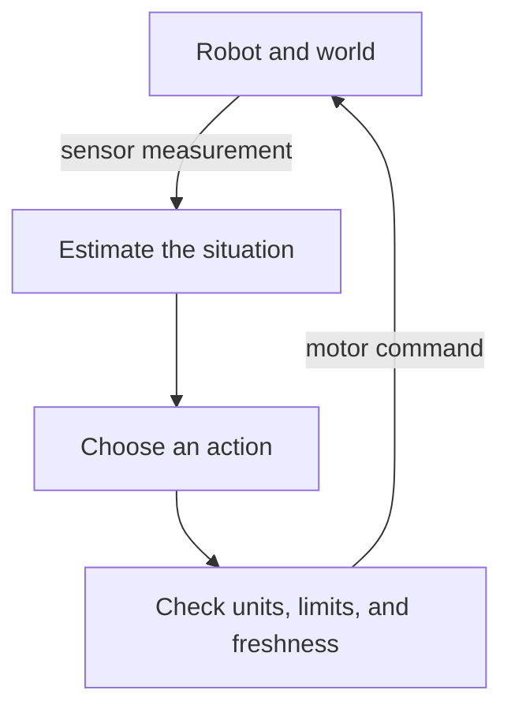

# Start here: your first robot and AI experiments

You can begin on a laptop with Python. Your first goal is to understand a small
robot loop, run it, change one thing, and explain the result. The later courses
add cameras, learned policies, real hardware, compilers, and chip design to that
same loop.

**Start with this page if the roadmap feels too large.** Allow 45–90 minutes for
the first session, plus any time needed to install Python. You do not need to
buy a robot or GPU for this session.

## What you are learning to build

A robot repeatedly measures the world and acts on those measurements:



A **controller** computes an action from an error, such as distance from a goal.
A **learned policy** computes an action using parameters fitted from examples or
experience. A **planner** selects a route or sequence of actions. These components
can work together. A language model can help interpret a task, but its text must
still be converted into a well-defined, checked action.

The hardware must move data through this loop in time. That is why this course
connects robotics and AI to memory, firmware, GPUs, and accelerators.

## Try it in a browser first

Open the [interactive observation dashboard](Phase%204%20-%20Track%20B%20-%20Nvidia%20Jetson/5.%20Application%20Development/3.%20GUI/labs/dashboard.html). It uses simulated data and needs no account, robot or model download. If you download the HTML separately, keep its adjacent `telemetry.js` file with it; the [dashboard lab](Phase%204%20-%20Track%20B%20-%20Nvidia%20Jetson/5.%20Application%20Development/3.%20GUI/CPU-Dashboard-Lab.md) links both.

Spend five minutes on three actions: pause samples, watch the age become stale, then disconnect/reconnect. The number can stay plausible even when the observation is old. That is the timing problem you will explore in the cart experiment below.

## Before your first session

You need to be able to open a terminal, run a Python file, and recognize a
variable, a loop, and a function. If those are new, first use the
[Python tutorial's introduction](https://docs.python.org/3.12/tutorial/introduction.html)
and [control-flow lesson](https://docs.python.org/3.12/tutorial/controlflow.html).
You can return here before mastering the rest of Python.

Keep the [beginner reading aid](Beginner-Reading-Aid.md) nearby for terminal
paths, radians, array shapes, and the difference between a state, observation,
and action. It works through one complete cart update with units.

If you already have this repository, open a terminal in its root directory: the
folder containing `README.md` and `mkdocs.yml`. Otherwise, obtain a copy from the
[course repository](https://github.com/ai-hpc/ai-hardware-engineer-roadmap).

**Tested here:** the portable examples run with Python 3.12 on Linux. The shell
blocks below use Bash. A Windows learner can use a Linux environment such as
WSL; the simulator and hardware courses have their own platform requirements.

```bash
python3 --version
python3 -c 'from pathlib import Path; print("Course root:", Path("mkdocs.yml").is_file())'
```

The second command should print `Course root: True`. The first session uses only
Python's standard library, so there are no packages or model weights to download.
Later courses give their dependencies separately. Use a separate
[virtual environment](https://docs.python.org/3.12/tutorial/venv.html) for each
software stack; a simulator's Python environment is not interchangeable with
every training environment.

## First experiment: move toward a target

Imagine a cart that can move left or right on a line. Its position is `x`, and
the target is 1 metre. Every 0.1 seconds we measure the position and request a
velocity equal to the remaining distance times a gain of 1 per second.

For the first step, the error is `1 − 0 = 1 m`. The requested velocity is `1 m/s`.
Over `0.1 s`, the cart moves `0.1 m`. The next error is only `0.9 m`, so the next
movement is smaller.

**Predict:** after ten steps, will the cart be at exactly 1 metre?

Run this complete experiment from a Bash terminal:

```bash
python3 - <<'PY'
position_m = 0.0
target_m = 1.0
dt_s = 0.1
gain_per_s = 1.0
for step in range(10):
    error_m = target_m - position_m
    velocity_m_s = gain_per_s * error_m
    position_m += dt_s * velocity_m_s
    print(f"step={step + 1:2d} position={position_m:.4f} m")
PY
```

Paste the whole block, including the opening command and final `PY`. Unlike the
file-based commands below, this self-contained experiment works from any folder.

**Expected result:** the first position is `0.1000 m`; the tenth is `0.6513 m`.
This is a numerical model with exact observations and immediate velocity changes.
A motor's inertia, slip, noise, and communication delay are absent.

<details markdown="1">
<summary>Why does it stop short?</summary>

At every step the remaining error is multiplied by `1 − gain × dt = 0.9`.
After ten steps the error is `0.9^10 ≈ 0.3487 m`, so position is about `0.6513 m`.
The cart approaches the target gradually. In this ideal model it does not reach
exactly 1 metre in a finite number of steps with this gain.

</details>

**Change one thing:** set `gain_per_s` to `5.0` and rerun. Then try `25.0`.
Write down your prediction first. With gain 5 the error halves on each step.
With gain 25 the error changes sign and grows: the controller overshoots farther
each time. A larger gain does not always improve the behavior.

## Second experiment: a late observation

From the **repository root** (the folder containing `mkdocs.yml`), run this
control experiment. The [Robotics Foundations lab guide](Phase%205%20-%20Advanced%20Topics%20and%20Specialization/Track%20D%20-%20Robotics/Robotics%20Foundations/Lab-Guide.md)
explains its output and provides further variations.

```bash
python3 'Phase 5 - Advanced Topics and Specialization/Track D - Robotics/Robotics Foundations/labs/foundations.py' control
```

Read the `instantaneous` and `one_step_delay` results. The same controller gain
can behave very differently when it acts on an old position. A velocity limit
bounds the requested motion, but does not by itself prove the cart settles.

This comparison uses gain `12 /s`, timestep `0.1 s`, and 80 steps. It compares
**the same gain in both cases**; it does not reuse the first experiment's gain
of `1 /s`. The delayed fixture can report errors over 1,000 metres because its
mathematical cart has no physical boundary. Read that as an instability example,
not a prediction for a real robot. The [control lesson](Phase%205%20-%20Advanced%20Topics%20and%20Specialization/Track%20D%20-%20Robotics/Robotics%20Foundations/Lecture-03.md)
explains the trace.

This is your first hardware connection: a slower sensor, a queue, or a slow AI
model changes the age of the information used by the controller. A fast isolated
model benchmark does not tell you the age of the observation at actuation.

Save three sentences in your own notes:

1. What did you predict?
2. What changed when the observation arrived late?
3. What would you need to measure on a real robot to test your explanation?

## Follow a short learning sequence

Work through these sessions in order if robotics and AI are new to you. Each
session may take 1–3 hours; repeat a session when the explanation or exercise is
still unclear. This sequence is an introduction, not the entire roadmap.

The first cart directly commands **velocity** toward `1 m`. The AI policy in
sessions 5–7 commands **acceleration** toward `0 m` and keeps velocity as part of
its state. Before switching, work through the [one-step comparison](Beginner-Reading-Aid.md#2-the-same-cart-has-two-different-action-interfaces).
The changed task contract explains the different equations and signs.

| Session | Study and practice | Evidence that you can move on |
|---|---|---|
| 1 | The two experiments above | Explain gain, timestep, and observation age in your own words |
| 2 | [Frames and timestamps](Phase%205%20-%20Advanced%20Topics%20and%20Specialization/Track%20D%20-%20Robotics/Robotics%20Foundations/Lecture-01.md) | Transform a camera point into a world frame and recover the original point |
| 3 | [Kinematics](Phase%205%20-%20Advanced%20Topics%20and%20Specialization/Track%20D%20-%20Robotics/Robotics%20Foundations/Lecture-02.md) | Compute a two-link arm's endpoint and recognize an unreachable target |
| 4 | [Control](Phase%205%20-%20Advanced%20Topics%20and%20Specialization/Track%20D%20-%20Robotics/Robotics%20Foundations/Lecture-03.md) | Predict a stable and an unstable configuration, then test both |
| 5 | [AI math and training](Phase%203%20-%20Artificial%20Intelligence/0.%20AI%20and%20Robot%20Learning%20Foundations/01-Math-and-Training.md) | Trace shapes, calculate a loss, and explain one parameter update |
| 6 | [AI evaluation and robot learning](Phase%203%20-%20Artificial%20Intelligence/0.%20AI%20and%20Robot%20Learning%20Foundations/02-Evaluation-and-Robot-Learning.md) | Split demonstrations by episode and explain why testing on training data misleads |
| 7 | [Train a small CPU policy](Phase%203%20-%20Artificial%20Intelligence/0.%20AI%20and%20Robot%20Learning%20Foundations/Lab-01-CPU-Policy.md) | Compare held-out prediction error and closed-loop outcomes against a simple baseline |
| 8 | [Perception](Phase%205%20-%20Advanced%20Topics%20and%20Specialization/Track%20D%20-%20Robotics/Robotics%20Foundations/Lecture-04.md) | Explain what a pixel and a depth measurement can and cannot tell you |
| 9 | [Planning](Phase%205%20-%20Advanced%20Topics%20and%20Specialization/Track%20D%20-%20Robotics/Robotics%20Foundations/Lecture-05.md) | Find a route and show why a point-sized robot can fit where a real footprint cannot |
| 10 | [ROS 2 integration](Phase%205%20-%20Advanced%20Topics%20and%20Specialization/Track%20D%20-%20Robotics/Robotics%20Foundations/Lecture-06.md) | Map the loop to messages, frames, clocks, and a command-expiry rule |

**Connect the pieces:** after session 10, run the [timed robot loop lab](Phase%203%20-%20Artificial%20Intelligence/0.%20AI%20and%20Robot%20Learning%20Foundations/Lab-02-Timed-Robot-Loop.md). It reuses the trained CPU policy and shows how queueing and expired observations can change its closed-loop behavior while its prediction error stays the same.

**Try an actual physics engine when ready:** the optional [CPU physics lab](Phase%203%20-%20Artificial%20Intelligence/0.%20AI%20and%20Robot%20Learning%20Foundations/Lab-03-CPU-Physics.md) reuses the saved policy in MuJoCo. It begins by matching the cart equations, then tests a heavier cart and a limited actuator. It needs a separate package environment, but no GPU or display.

If you already know one topic, attempt its exercise first. Skip its introductory
reading only when you can explain the result and one failure case.

## Then choose one next project

| What interests you? | Next course | A reasonable first project |
|---|---|---|
| Making a simulated robot perform a task | [Isaac Sim / Isaac Lab](Phase%205%20-%20Advanced%20Topics%20and%20Specialization/Track%20D%20-%20Robotics/Isaac%20Sim%20and%20Isaac%20Lab/README.md) | A resettable task with verified frames and success conditions |
| Learning actions from images and instructions | [VLA Foundations](Phase%205%20-%20Advanced%20Topics%20and%20Specialization/Track%20D%20-%20Robotics/VLA%20Foundations%20to%20Frontier%202026/README.md) | A grounded policy evaluation with held-out tasks |
| Wiring sensors and running code on a device | [Embedded Systems](Phase%202%20-%20Embedded%20Systems/Guide.md) | A timestamped sensor pipeline that detects stale input |
| Understanding why AI is slow or uses too much memory | [Inference Optimization](Phase%204%20-%20Track%20C%20-%20DL%20Inference%20Optimization/Guide.md) | A reference-checked operator with a memory and latency report |
| Designing the hardware itself | [Digital Foundations](Phase%201%20-%20Foundational%20Knowledge/Guide.md) | A small verified circuit and an explanation of its timing |

The [learning guide](Learning-Guide.md) explains the larger routes. The
[Physical AI Design Studio](Physical-AI-Design-Studio.md) connects them into the
advanced model-to-chip capstone once you have a working subsystem.

## When something goes wrong

| Symptom | What to check first |
|---|---|
| `python3: command not found` | Install Python for your operating system, reopen the terminal, and check its version |
| `can't open file` | Check the course-root command above; preserve quotes around paths containing spaces |
| A type-annotation error mentioning `|` or `unsupported operand type` | Use the documented Python version; do not remove annotations at random |
| A missing third-party package in an advanced lab | Use that lab's environment instructions; the first-session examples need no packages |
| Your result differs in the last decimal place | Compare with the stated tolerance and check rounding before changing the algorithm |
| Your result is radically different | Check units, gain, timestep, initial conditions, and whether you changed more than one variable |
| A test fails after your edit | Read the first failing case; preserve the failing input and explain the violated assumption |

To check all portable exercises from the repository root:

```bash
python3 scripts/run_portable_checks.py
```

Passing these tests verifies the small teaching programs. Simulator installation,
full-model quality, GPU performance, and physical behavior have separate checks
in their courses.
